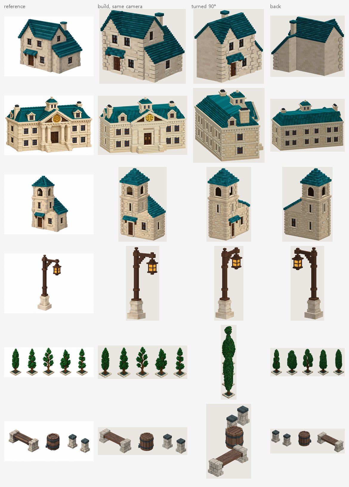
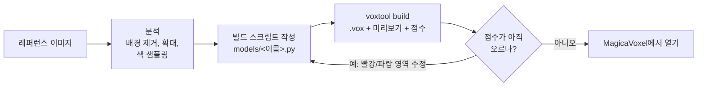
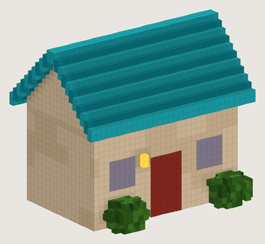
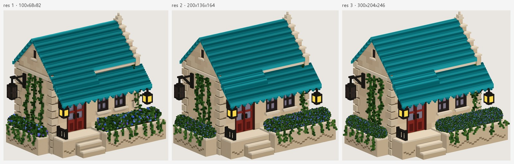
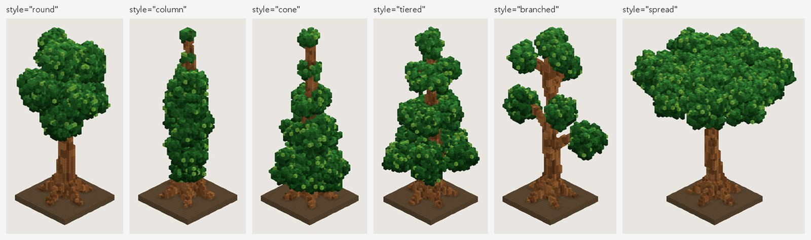

# 2DtoVoxel

[English](README.md) · **한국어**

**2DtoVoxel은 물체 하나가 담긴 그림(콘셉트 아트, 3D 렌더, 게임 스크린샷, 픽셀아트)을 [MagicaVoxel][magicavoxel]용 복셀 모델(`.vox` 파일)로 만듭니다.** [Claude Code][claude-code]가 그림을 보고 모델을 짧은 Python 빌드 스크립트로 작성합니다. 함께 들어 있는 `voxtool` 라이브러리가 그 스크립트로 `.vox` 파일과 미리보기를 만들고, 결과가 그림과 얼마나 닮았는지 숫자로 잽니다. Claude는 그 측정값을 읽고 스크립트를 고쳐 다시 빌드하고, 더 나아지지 않을 때까지 이 과정을 반복합니다. 결과로 `.vox` 파일과 스크립트가 남습니다. `.vox`는 MagicaVoxel에서 열어 계속 편집할 수 있고, 스크립트는 나중에 직접 고치거나 Claude에게 수정을 맡길 수 있습니다.

Claude 없이 되는 기능도 있습니다. 픽셀아트를 몇 초 만에 복셀로 바꾸고, 정면·측면·윗면 그림을 교차시켜 모델을 깎아 내며, 게임 에셋(스프라이트 시트, GLB / OBJ / PLY 메시, 팔레트 변형)을 내보냅니다.

[![License: MIT][license-badge]][license] [![Tests][ci-badge]][ci] [![Python 3.10+][python-badge]][python] [![Output: MagicaVoxel .vox][vox-badge]][magicavoxel]


## 한눈에 보기

| | |
|---|---|
| **무엇인가** | 그림을 복셀로 바꾸는 도구. Claude Code가 모델을 코드로 쓰고, 그 코드를 그림과 비교해 점수를 매깁니다. |
| **입력** | 물체 하나가 담긴 그림 한 장(PNG / JPG / WEBP). 다른 방향의 그림은 선택이고, 있으면 함께 채점합니다. |
| **출력** | MagicaVoxel `.vox` 파일, 그것을 만드는 Python 빌드 스크립트, 미리보기 이미지와 점수. 선택: 스프라이트 시트, GLB / OBJ / PLY 메시, 색만 바꾼 변형. |
| **AI 부분의 동작** | Claude가 좁은 허용 목록 안에서 Claude Code로 실행됩니다. 그림을 분석해 `models/<이름>.py`를 쓰고, `voxtool`로 빌드하고, 점수와 차이 이미지를 읽고, 이를 반복합니다(보통 4~6회). |
| **AI 없이** | `voxtool extrude`(픽셀아트 → 복셀), `voxtool carve`(정면 / 측면 / 윗면 실루엣 → 복셀), 내보내기, 미리보기와 점수 도구는 모두 Claude 없이 동작합니다. |
| **쓰는 방법** | 로컬 웹 UI(English / 한국어), Claude Code 안의 `/voxelize` 스킬, `voxtool` 명령줄. |
| **필요한 것** | Python 3.10+와 numpy, Pillow, scipy. 모델 생성에는 로그인된 Claude Code. MagicaVoxel은 결과를 열 때만 필요(선택). |
| **비용과 시간** | 생성에 10~30분 정도 걸립니다. Claude Code 로그인을 쓰므로 사용량이 본인의 Claude 요금제에서 차감되고, 별도 API 키는 필요 없습니다. 실제 한 번 실행에 $4.65가 들었습니다([자세히](#실제-생성-사례)). |
| **플랫폼** | Windows 10/11에서 전체 흐름 테스트 완료. CLI와 테스트는 macOS, Linux에서도 동작(CI: Windows, Ubuntu). |
| **라이선스** | MIT |

## 목차

- [갤러리](#갤러리)
- [동작 방식](#동작-방식)
- [설치](#설치)
- [빠른 시작](#빠른-시작)
- [웹 UI](#웹-ui)
- [Claude Code 대화에서 쓰기](#claude-code-대화에서-쓰기)
- [점수와 다른 검사](#점수와-다른-검사)
- [실제 생성 사례](#실제-생성-사례)
- [모델 스크립트](#모델-스크립트)
- [Claude 없이 변환](#claude-없이-변환)
- [게임 에셋](#게임-에셋)
- [명령줄 레퍼런스](#명령줄-레퍼런스)
- [출력 파일](#출력-파일)
- [좋은 결과를 얻는 요령](#좋은-결과를-얻는-요령)
- [제한 사항](#제한-사항)
- [문제 해결](#문제-해결)
- [보안](#보안)
- [프로젝트 구조](#프로젝트-구조)
- [개발](#개발)
- [더 자세한 문서](#더-자세한-문서)
- [라이선스와 감사의 말](#라이선스와-감사의-말)

## 갤러리

[`reference/`](reference/)의 그림으로 2DtoVoxel이 만든 모델입니다. 줄마다 레퍼런스, 레퍼런스와 같은 카메라로 본 빌드, 같은 빌드를 90°와 180° 돌린 모습을 보여 줍니다. 돌린 모습은 그림 한 장에 없는 면이라 Claude가 추론하고, 그 면이 납작하게 나오면 [네 방향 검사](#점수가-못-보는-것)가 잡아냅니다.



| 줄 | 모델 | IoU | ΔE |
|---|---|---|---|
| 1 | 돌집 | 0.973 | 10.3 |
| 2 | 법원 | 0.965 | 14.2 |
| 3 | 부속 건물이 붙은 종탑 | 0.966 | 10.6 |
| 4 | 가로등 | 0.910 | 6.6 |
| 5 | 키 큰 나무 5그루(각각 별도 오브젝트) | 0.911 | 10.3 |
| 6 | 벤치, 통, 기둥 둘(각각 별도 오브젝트) | 0.947 | 9.6 |

IoU는 실루엣이 겹치는 정도(1 = 완벽), ΔE는 평균 색 차이(낮을수록 좋음)입니다. 둘 다 레퍼런스 방향에서 잰 값입니다. [점수](#점수와-다른-검사)를 참고하세요.

## 동작 방식

Claude는 MagicaVoxel 화면을 클릭하지 않습니다. 모든 작업이 스크립트와 `voxtool` 명령줄을 거칩니다.



1. **그림 분석.** `voxtool ref cutout`으로 배경을 지웁니다. Claude는 픽셀 격자를 겹쳐 보고, 영역마다 확대하고, 실제 색을 샘플링하고, 구성 요소(벽, 지붕, 개구부, 장식, 조명, 식물…)를 정리합니다.
2. **스케일 정하기.** 크기를 아는 요소 하나로 나머지 비율을 정합니다. 집이라면 보통 문(높이 약 20 voxel)입니다. 레퍼런스는 대부분 원근 렌더라서 화면 픽셀을 그대로 잴 수 없기 때문입니다.
3. **빌드 스크립트 작성.** `models/<이름>.py`는 작은 Python DSL로 모델을 기술합니다. 상자, 속이 빈 상자, 박공지붕, 계단, 벽돌 질감, 덩굴, 나무 등을 씁니다. 주요 치수는 맨 위 상수로 두므로 비율을 바꾸는 데 한 줄이면 됩니다.
4. **카메라 맞추기.** `voxtool fit-camera`가 실루엣이 그림과 가장 잘 맞는 방위각·고도각·화각을 찾습니다. 그래야 이후 비교가 같은 조건에서 이뤄집니다.
5. **빌드, 측정, 수정.** `voxtool build`는 `.vox`와 미리보기를 만들고, 그림과 비교한 점수를 내고, 차이 이미지(빨강 = 빠짐, 파랑 = 넘침)를 그립니다. Claude는 가장 큰 차이부터 고치고, 두 번 연속 점수가 오르지 않으면 멈춥니다.
6. **점수가 못 보는 것 확인.** 점수는 레퍼런스 방향에서만 잽니다. 그래서 빌드마다 모델을 네 방향에서 렌더하고, 옆에서 보면 납작한 물체나 떠 있는 조각도 알려 줍니다([자세히](#점수가-못-보는-것)).
7. **(선택) 고해상도 마무리.** 형태가 맞으면 같은 스크립트를 2~3배 곱게 빌드하고, 그림에 보이는 복셀을 그림의 픽셀 색으로 칠할 수 있습니다.

복셀을 직접 찍지 않고 스크립트를 쓰는 이유는 결과가 정확하고, 다시 만들 수 있고, 고치기 쉽기 때문입니다. "차양을 더 크게"는 처음부터 다시 생성하는 일이 아니라 숫자 한두 개를 바꾸는 일이 됩니다.

## 설치

| 필요한 것 | 용도 | 비고 |
|---|---|---|
| Python 3.10 이상 | 전부 | `numpy`, `Pillow`, `scipy`는 패키지와 함께 설치됨 |
| [Claude Code][claude-code] (설치 + 로그인) | 모델 생성과 수정 | 사용량은 본인의 Claude 요금제에서 차감. UI는 `PATH`의 `claude`나 VS Code / VS Code Insiders / Cursor의 Claude Code 확장에 들어 있는 것을 찾고, 못 찾으면 `CLAUDE_CLI`를 지정 |
| [MagicaVoxel][magicavoxel] 0.99.x | 결과 열기·편집 (선택) | 바탕화면, 다운로드, 홈 폴더, `C:\Program Files`, `C:\` 아래, macOS의 `/Applications`에서 자동으로 찾고, 못 찾으면 `MAGICAVOXEL_EXE`를 지정 |
| 인터넷 연결 | 웹 UI의 3D 탭만 | CDN에서 three.js를 불러옴. 나머지는 오프라인에서도 동작(Claude 자체는 평소처럼 연결 필요) |

```bash
git clone https://github.com/NangManCatDev/2DtoVoxel.git
cd 2DtoVoxel
python -m pip install -e .
```

의존성과 `voxtool` 명령이 설치됩니다. 설치하지 않아도 프로젝트 폴더에서 Windows는 `py -m voxtool …`, macOS / Linux는 `python3 -m voxtool …`로 모든 명령을 쓸 수 있습니다. 모델, 레퍼런스, 출력물을 이 폴더 기준으로 찾으므로 명령은 프로젝트 폴더에서 실행하세요.

## 빠른 시작

### 1. 웹 UI로 모델 생성 (Claude Code 필요)

```bash
voxtool ui
```

Windows에서는 `2DtoVoxel.bat`을 더블클릭해도 되고, macOS / Linux에서는 `./2dtovoxel.sh`를 실행합니다. 브라우저에 `http://127.0.0.1:8765`가 열립니다. **+ 새 모델**을 누르고, 그림을 끌어다 놓고, 이름을 정하고, **생성 시작**을 누르세요. 10~30분 뒤 사이드바에 모델이 나타나고, 3D로 보거나 내려받거나 MagicaVoxel에서 열 수 있습니다.

### 2. Claude Code에 직접 요청

이 폴더에서 연 Claude Code에서:

```text
/voxelize reference/my_picture.png
```

또는 "reference/my_picture.png를 복셀 모델로 만들어줘"라고만 써도 됩니다. Claude는 UI 작업과 같은 단계를 거쳐 파일, 최종 점수, 단순화한 부분을 보고합니다. `voxtool install-skill`은 스킬을 `~/.claude/skills`로 복사해 다른 프로젝트에서도 `/voxelize`를 쓸 수 있게 합니다.

### 3. Claude 없이 픽셀아트 변환

```bash
voxtool extrude path/to/sprite.png --name my_sprite --inflate
```

몇 초 만에 `models/my_sprite.py`(와 `models/my_sprite.base.vox`)를 만들고 `output/my_sprite/my_sprite.vox`로 빌드합니다.

## 웹 UI

`voxtool ui`(옵션: `--port 9000`, `--no-browser`), `2DtoVoxel.bat`, `./2dtovoxel.sh` 중 하나로 시작합니다. 함께 열리는 콘솔 창이 서버이고, 창을 닫으면 UI가 멈춥니다. 8765 포트가 사용 중이면 다음 빈 포트를 쓰고 콘솔에 주소를 출력합니다. 언어는 오른쪽 위에서 고릅니다(English / 한국어, 기본값은 브라우저 언어).

사이드바에는 모델과 최근 작업이 있습니다. 오른쪽 위의 상태 칩 두 개는 Claude Code와 MagicaVoxel을 찾았는지 보여 줍니다. 칩이 빨간색이면 못 찾은 것이니 `CLAUDE_CLI`나 `MAGICAVOXEL_EXE`를 지정하고 다시 시작하세요.

| 새 모델 | 모델 화면(점수 탭) | 3D 미리보기 |
|---|---|---|
|  |  |  |

### 모델 만들기

**+ 새 모델**을 누르면 양식이 열립니다.

1. **레퍼런스 이미지.** PNG, JPG, WEBP를 상자에 끌어다 놓거나 클릭해서 고릅니다. `reference/`에 저장됩니다.
2. **모델 이름.** 영문 소문자, 숫자, `_`. 파일 이름이 됩니다(`models/<이름>.py`, `output/<이름>/`).
3. **방식.**
   - **Claude로 생성**: 그림을 분석해 정교한 모델 스크립트를 씁니다(10~30분).
   - **빠른 변환 (Claude 없이)**: 픽셀아트나 평평한 그림을 몇 초 만에 복셀 판으로 바꿉니다. 옵션은 **두께 (voxel)**와, 판을 가운데가 더 두껍게 만드는 **둥글게** 두 가지입니다. 나중에 Claude로 다듬을 수 있습니다.
4. **추가 요청**(선택, Claude 방식). 예: "전체 폭 80 voxel 이내로, 뒷면에도 창문 추가, 조명은 따뜻한 주황색".
5. **Claude 모델.** **Opus**(가장 정교함, 기본 선택), **Sonnet**(빠르고 저렴), 또는 Claude Code 설정을 따르는 **기본값**. 기본값으로 실행했는데 그 설정이 Haiku로 드러나면 작업이 바로 멈춥니다. Haiku가 쓴 스크립트는 쓸 수 없었기 때문입니다.
6. **최대 비용 (USD)**과 **최대 빌드 횟수**(선택). 작업마다 걸리는 상한입니다. 비용 상한은 Claude Code에 그대로 전달되고, 빌드 상한을 두 번 넘긴 작업은 강제로 멈춥니다.

### 작업 지켜보기

작업 화면에 실시간 로그가 나옵니다. Claude의 메시지, 실행한 명령, Claude가 본 이미지가 모두 표시됩니다. 빌드마다 점수와 비교 이미지가 담긴 카드가 생기고, 빌드별 점수 그래프가 그려지며, 가장 좋은 빌드가 강조됩니다. 작업이 끝나면 아무 카드에서나 **되돌리기**를 눌러 그 버전의 스크립트로 바꾸고 다시 빌드할 수 있습니다. 바꾸기 전 스크립트는 작업 폴더에 남습니다. **작업 중단**은 진행 중인 작업을 멈춥니다.


### 모델 화면

모델 화면에는 크기, 복셀 수, 색 수, 파일, 레퍼런스와 점수 기록이 나옵니다. 아래 탭은 해당 파일이 있을 때 보입니다.

| 탭 | 보여 주는 것 |
|---|---|
| **레퍼런스 비교** | 레퍼런스와 빌드를 나란히 |
| **점수** | 차이 이미지. 빨강 = 레퍼런스에는 있는데 빌드에 없음, 파랑 = 빌드에만 있음, 안쪽의 초록 → 주황 = 색 차이. 레퍼런스 그림마다 한 줄 |
| **확대 비교** | 차이가 가장 큰 영역을 레퍼런스 원래 해상도로: 레퍼런스, 빌드, 차이 |
| **전체 뷰** | 3/4 뷰, 정면, 뒷면, 왼쪽, 오른쪽, 위, 반대쪽 3/4 뷰 |
| **돌려 보기** | 레퍼런스 방향부터 90°씩 돌린 모델 |
| **3D** | 직접 돌려 보는 뷰어(드래그 회전, 휠 확대, 오른쪽 드래그 이동, 정면 / 왼쪽 / 뒤 / 위 시점 버튼) |
| **카메라 각도** | Claude가 시험해 본 카메라 각도의 렌더 |
| **카메라 맞춤** | `fit-camera` 결과 |
| **스크립트** | 빌드 스크립트와 VS Code로 열기 링크 |

버튼은 **다시 빌드**, **MagicaVoxel에서 열기**, **MagicaVoxel 화면 캡처**(Windows. 파일이 제대로 열렸는지 MagicaVoxel 화면을 저장해 확인), **.vox 다운로드**입니다. MagicaVoxel에서 **Render** 탭으로 바꾸면 등불처럼 빛나는 색이 켜집니다.

- **수정 요청**: 바꾸고 싶은 것을 말로 씁니다("차양을 더 크게", "오른쪽에 굴뚝 추가"). Claude가 스크립트를 고치고 다시 빌드합니다. **이전 대화 이어서**에 체크하면 앞선 세션을 이어 쓰므로 재분석을 건너뛰고 보통 더 저렴합니다. 모델 선택과 비용·빌드 상한도 똑같이 쓸 수 있습니다.
- **게임 에셋**: 스프라이트 시트(8방향, 투명 배경, `manifest.json` 포함)나 GLB / OBJ / PLY 메시를 내보냅니다. 내보낸 파일은 화면에 목록으로 나옵니다.
- **백업**: `.vox`가 MagicaVoxel에서 저장된 파일이면(손으로 고친 내용이 있을 수 있으므로) 다시 빌드하기 전에 `<이름>_edited_<시각>.vox`로 복사하고, 모델 화면에 그 목록이 나옵니다.

### 삭제와 휴지통

사이드바의 모델 위에 마우스를 올리고 휴지통 아이콘을 누릅니다. 확인 창에 옮겨질 파일 목록이 나오고, 이 모델을 쓰는 다른 모델, MagicaVoxel 편집 내용, 진행 중인 작업이 있으면 경고합니다. 스크립트, (있으면) 베이스 `.vox`, 출력 폴더가 `output/_trash/<이름>_<시각>/`으로 옮겨지고, 레퍼런스 이미지는 그대로 남습니다. 모델 목록 아래의 **휴지통**에서 지운 모델을 **되살리기**할 수 있습니다. 같은 이름의 모델이 다시 있으면 되살리지 않습니다. UI에서 파일을 실제로 지우는 것은 **영구 삭제**와 **휴지통 비우기**뿐입니다.

## Claude Code 대화에서 쓰기

저장소에는 Claude Code 스킬 [`.claude/skills/voxelize/SKILL.md`](.claude/skills/voxelize/SKILL.md)와 프로젝트 지침 [`CLAUDE.md`](CLAUDE.md)가 들어 있습니다. 이 폴더에서 연 Claude Code에서 `/voxelize <이미지>`(또는 그냥 말로 요청)를 실행하면 전체 절차를 밟습니다.

1. 그림 관찰(`ref cutout`, `ref grid`, `ref crop`, `ref palette`, `ref sample`)
2. `models/<slug>.py` 작성과 카메라 맞춤
3. 빌드 → 점수와 이미지 확인 → 수정, 보통 4~6회
4. (선택) 고해상도 마무리와 그림에서 색 칠하기
5. MagicaVoxel에서 열고, 제대로 열렸는지 창을 캡처해 확인(Windows)

스킬은 Claude 없이 하는 변환(extrude, carve)과 게임 에셋 내보내기도 다루므로, "이 모델 스프라이트 시트 뽑아줘" 같은 요청도 됩니다.

## 점수와 다른 검사

`REFERENCE`가 있는 스크립트를 빌드할 때마다 이런 줄이 나옵니다.

```text
score: iou=0.940 dE=17.7 worst: top-right missing 19%, bottom extra 7%
```

- **IoU**(0~1): 크기와 위치를 맞춘 뒤 모델 실루엣이 레퍼런스와 겹치는 정도. 1이 완벽.
- **ΔE**: 겹친 부분의 평균 색 차이(살짝 흐린 이미지에서 잰 CIE76). 낮을수록 좋고, 형태가 완벽해도 조명 차이 때문에 0이 되지는 않습니다.
- **worst**: 레퍼런스를 3 × 3으로 나눈 영역 중 빠진 곳(빨강)이나 넘친 곳(파랑)이 가장 큰 영역 최대 3개.


재는 방법: 레퍼런스의 배경을 지우고 물체 높이를 320 px로 맞춥니다. 빌드는 `VIEW`(또는 `SCORE_VIEW`)에서 투명 배경으로 렌더합니다. 그다음 두 실루엣의 넓이가 같도록 렌더 크기를 조정하고 무게중심을 맞추므로, 모델의 절대 크기와 상관없이 형태와 색만 남습니다. 빌드마다 기록이 `output/<이름>/<이름>_scores.jsonl`에 쌓입니다.

점수는 목표가 아니라 관찰입니다. 원근 레퍼런스와 정사영 미리보기는 절대 완벽히 같아지지 않습니다. 점수를 올리려고 뭔가를 앞으로 내밀면 문이나 창이 가려진다면, 중요한 요소가 보이게 두는 편이 낫습니다.

### 점수가 못 보는 것

한 방향에서 잰 점수로는 둥근 수관과 카메라를 향한 판을 구별할 수 없고, 벽 위에 한 칸 떠 있는 지붕도 보이지 않습니다. 실제로 UI 작업이 나무 외곽선을 복셀 한 겹으로 채운 적이 있습니다. IoU는 0.914였지만 다른 방향에서 보면 모두 납작했습니다. 그래서 빌드마다 다음도 알려 줍니다.

| 출력 | 뜻 |
|---|---|
| `_turn.png` | 레퍼런스 방향부터 90°씩 돌려 본 네 방향 |
| `depth: 0.85` | 물체마다, 수평 구간별 (앞뒤 깊이 ÷ 너비)의 중앙값. 레퍼런스 방향 기준이고, 0.5 미만이면 `(thin)`이 붙습니다. 집이나 둥근 수관은 0.7~1쯤, 카메라를 향한 판은 0.1 근처. 간판·울타리·벽 패널은 원래 얇습니다 |
| `loose: 2 pieces, 41 voxels (size at centre: …)` | 자기 물체의 나머지와 닿지 않은 조각(면·모서리·꼭짓점 중 하나라도 닿으면 이어진 것. `part()`마다 별도 물체)과 그 크기, 중심 위치(설계 단위). 깎다 남은 부스러기, 줄기에서 떨어진 잎, 떠 있는 지붕이 여기 걸립니다. 작은 것은 `m.remove_loose()`로 지웁니다 |
| `_zoom_<영역>.png` | 차이가 가장 큰 영역의 원래 해상도 확대. 그 영역이 8 % 넘게 어긋났을 때 만듭니다 |

UI 작업 프롬프트와 `/voxelize` 스킬은 Claude에게 이것들을 보고, 물체가 정말 납작하거나 떠 있어야 하는 경우가 아니면 고치라고 지시합니다.

### 그림이 여러 장일 때

다른 방향의 그림이 있으면, 그 그림이 물체를 본 카메라와 함께 스크립트에 적습니다.

```python
REFERENCE = "reference/knight_front.png"
VIEW = {"azimuth": 0, "elevation": 0}
EXTRA_REFERENCES = [
    ("reference/knight_side.png", {"azimuth": 90, "elevation": 0}),
    ("reference/knight_back.png", {"azimuth": 180, "elevation": 0}),
]
```

그러면 빌드할 때마다 그림마다 따로 점수를 매기고(`score knight_side.png: iou=…`), `_score.png`에 그림마다 한 줄을 더하고, 모든 방향의 평균을 출력합니다. 정사영 도면이면 카메라는 정면 0, 왼쪽 90, 뒤 180, 오른쪽 270이고, 위에서 본 그림은 `"elevation": 90`입니다. 렌더나 사진이면 `voxtool fit-camera models/<이름>.py --ref 1`이 첫 번째 추가 그림의 카메라를 찾습니다. `voxtool carve`는 측면·윗면 그림을 이 목록에 알아서 넣습니다. 이렇게 하면 그림이 있는 면은 추측하지 않고 재게 됩니다.

## 실제 생성 사례

플레이어 집 레퍼런스로 실제로 돌린 기록입니다. Opus, 상한 $6와 빌드 8회, 추가 요청 "모든 축 110 voxel 이내로":

| 시간 | 비용 | 빌드 | 점수 |
|---|---|---|---|
| 16.6분, 102턴 | $4.65 | 8회(상한) | IoU 0.934 → 0.940 (최고 0.943, 5번째 빌드), ΔE 20.0 → 17.7 |

점수가 매번 오르지는 않습니다. 4번째 빌드는 나빠졌고 5번째에서 회복했습니다. 작업 화면이 가장 좋은 빌드를 강조하고, **되돌리기**로 그 버전을 되살릴 수 있습니다.


## 모델 스크립트

모델마다 `models/`에 Python 파일이 하나 있습니다. `.vox`는 언제나 스크립트에서 다시 만들어지므로 스크립트가 원본입니다. Claude가 이 파일을 쓰고 고치며, 여러분도 직접 고칠 수 있습니다.

### 스크립트에 들어가는 것

| 이름 | 필수 | 의미 |
|---|---|---|
| `NAME` | 예 | 출력 폴더와 파일 이름 |
| `build()` | 예 | `Model`을 반환 |
| `REFERENCE` | 아니오 | 레퍼런스 그림 경로. 있으면 비교 이미지와 점수가 만들어짐 |
| `VIEW` | 아니오 | 미리보기 카메라. 예: `{"azimuth": 36, "elevation": 18, "fov": 0}`. 방위각 0은 정면을, 90은 왼쪽 면을 봄. `fov`가 0보다 크면 원근 카메라 |
| `SCORE_VIEW` | 아니오 | 점수용 카메라가 `VIEW`와 다를 때(변환 결과는 정면에서 점수를 매김) |
| `CUTOUT` | 아니오 | 배경 제거 설정. 물체가 여러 개인 시트면 `{"keep": "all"}` |
| `EXTRA_REFERENCES` | 아니오 | 같은 물체의 다른 그림들. `(경로, 카메라)` 또는 `(경로, 카메라, cutout)`. [위 설명](#그림이-여러-장일-때) 참고 |
| `RES` | 아니오 | 설계 단위 하나당 복셀 수. `Model(..., res=RES)`로 쓰고, `voxtool build --res N`으로 그 빌드에만 덮어쓸 수 있음 |

### 좌표

`x`는 오른쪽, `y`는 안쪽(**`y = 0`이 정면**, MagicaVoxel 기본 카메라가 보는 면), `z`는 위쪽입니다. 상자는 위치 + 크기로 줍니다. `box(x, y, z, w, d, h, color)`는 `x … x+w-1` 등을 채우고, 격자 밖은 잘립니다. `region=` 인자는 항상 `(x, y, z, w, d, h)`이고 z가 세 번째입니다. 색은 이름으로 등록하고 이름으로 쓰며 최대 255개입니다. `emit`이 0보다 큰 색은 MagicaVoxel 렌더러에서 빛납니다.

### 예제

```python
from voxtool import Model

NAME = "tiny_hut"
VIEW = {"azimuth": 36, "elevation": 20}


def build() -> Model:
    m = Model(40, 34, 32, seed=1)                  # 격자 크기: x(폭), y(깊이), z(높이)
    m.pal.add("wall", "#dcc3a0"); m.pal.add("wall2", "#d2b893")
    m.pal.add("roof", "#0b8691"); m.pal.add("roof_hi", "#1ba3ad")
    m.pal.add("door", "#8c2b22"); m.pal.add("glass", "#8a8094")
    m.pal.add("lamp", "#ffd84a", emit=4)            # MagicaVoxel Render 탭에서 빛남
    m.pal.add("leaf", "#2c5a19"); m.pal.add("leaf2", "#3d7524")

    m.shell(6, 8, 0, 28, 18, 16, "wall", t=2, top=False)          # 벽. y=8이 정면
    m.bricks(["wall", "wall2"], target="wall", bw=6, bh=3)       # 돌벽 질감
    roof = (4, 6, 16, 32, 22)                                     # 지붕 바닥면 x, y, z, w, d
    m.gable_wall(*roof, "x", "wall", region=(6, 8, 28, 18))       # 지붕 아래 박공벽
    m.gable_roof(*roof, "x", ["roof_hi", "roof"], t=2)            # x 방향 용마루, 줄무늬 판
    m.box(17, 8, 0, 6, 2, 10, "door")                             # 문, 깊이 2
    m.box(9, 8, 6, 5, 1, 5, "glass"); m.box(26, 8, 6, 5, 1, 5, "glass")
    m.box(15, 7, 9, 1, 1, 2, "lamp")                              # 벽 앞의 등
    m.blob(10, 5, 2, 3.5, 2.5, 2.5, ["leaf", "leaf2"])            # 덤불
    m.blob(30, 5, 2, 3.5, 2.5, 2.5, ["leaf", "leaf2"])
    return m
```

`models/tiny_hut.py`로 저장하고 `voxtool build models/tiny_hut.py --open`을 실행하면 이렇게 나옵니다.



모서리 돌, 계단식 난간, 차양, 등불, 화단, 덩굴까지 있는 실제 예는 [models/player_house.py](models/player_house.py)입니다.

### DSL로 할 수 있는 것

모든 메서드는 [voxtool/model.py](voxtool/model.py)의 `Model`에 있습니다. `c`는 팔레트 이름, 팔레트 번호, 또는 `None`(깎기)입니다. [인자까지 모두 적힌 레퍼런스](docs/model-scripts.ko.md#dsl-레퍼런스)는 문서에 있습니다.

| 분류 | 메서드 |
|---|---|
| 팔레트 | `m.pal.add(name, hex, emit=0, glass=0, metal=0, rough=0.5)`, `m.pal.ramp(name, [hex, ...])` |
| 기본 도형 | `box`, `carve`, `shell`(속이 빈 상자), `set` / `get`, `line`, `ellipsoid`, `cylinder`, `where`(numpy 조건으로 아무 모양이나), `paint_fn` |
| 건축 | `gable_roof`, `gable_wall`(지붕과 딱 맞는 박공벽), `shed_roof`, `stairs` |
| 질감·유기물 | `bricks`(엇갈려 쌓은 돌), `vary`, `blob`(덤불, 바위), `vine`, `sprinkle`, `scatter_on_top` |
| 식물 | `tube`(휘고 가늘어지는 줄기·가지), `foliage`(복셀 아트풍 잎 뭉치), `crown_depth`(그림에서 잰 잎 덩어리를 둥근 수관으로), `tree`(스타일 `round`, `column`, `cone`, `tiered`, `branched`, `spread`) |
| 레퍼런스 맞춤 | `carve_to_reference`(배경에 떨어지는 복셀 깎기), `paint_reference`(보이는 복셀을 그림의 픽셀 색으로 칠하기) |
| 검사·변형 | `loose_pieces`, `remove_loose`, `damage`(부서진 변형: 깨진 모서리, 구멍, 금, 잔해) |
| 오브젝트·파일 | `with m.part(name):`(`.vox` 안의 별도 오브젝트), `Model.from_vox`, `m.paste_vox` |
| 변형·출력 | `mirror_x`, `copy`, `stats`, `save` |

도움이 되는 습관: 주요 치수를 맨 위 상수로 두고 나머지 좌표를 모두 상수에서 유도하세요. 조립 순서는 벽 → 질감 → 지붕 → 개구부 → 장식 → 식물(마지막, `only_empty`로)입니다. `build`가 출력하는 색별 개수도 확인하세요. 0개인 색이 있으면 대개 `region` 순서를 잘못 쓴 것입니다.

### 고해상도

- **`RES`**: 스크립트는 설계 단위로 쓰고, 맨 위에 `RES = 1`을 두고 `Model(w, d, h, res=RES)`로 만듭니다. 설계 단위 한 칸이 `RES³` 복셀이 되어, 좌표는 그대로인 채 곡면·지붕·덤불이 매끄러워지고 질감이 고와집니다. 반복은 `RES = 1`로 하고, `voxtool build models/<이름>.py --res 3`으로 시험한 뒤 스크립트의 `RES`를 3으로 바꾸세요. `--res`는 그 빌드에만 적용됩니다.
- **`m.paint_reference(REFERENCE, VIEW)`**를 `build()`의 마지막 줄에 두면, 그림에 보이는 복셀을 그림의 픽셀 색(명암, 얼룩, 무늬)으로 칠합니다. 실루엣이 잘 맞을 때(IoU 0.95 이상) 효과가 좋고, `tol`이 재질 사이로 색이 번지는 것을 막습니다.
- **`voxtool score models/<이름>.py --zoom top-right`**(또는 레퍼런스 픽셀 좌표 `--zoom x0,y0,x1,y1`)는 한 영역을 레퍼런스 원래 해상도로 비교합니다. 320 px 점수로는 작은 세부가 보이지 않기 때문입니다.



한 축이 256 voxel을 넘는 오브젝트는 저장할 때 256 voxel 조각으로 나뉘어 MagicaVoxel 그룹 하나로 묶입니다. MagicaVoxel은 축마다 약 2048 voxel까지의 장면을 보여 줍니다.

### 나무와 덤불

복셀 공을 쌓지 말고 식물 도구를 쓰세요. 줄기·가지는 `tube`, 작은 잎 뭉치로 된 수관은 `foliage`, 나무 한 그루 통째로는 `tree`입니다. 그림에서 잰 잎 덩어리는 모두 카메라를 향한 한 평면 위에 있습니다. `crown_depth(lobes, x, y, VIEW)`(또는 `tree(..., lobes=..., view=VIEW)`)를 거치면 레퍼런스 방향의 외곽선은 그대로이면서 어느 방향에서 봐도 둥근 수관이 됩니다. 레퍼런스가 복셀 그림이면 `RES`를 올리지 말고 그림의 결(그림의 정육면체 하나 = 복셀 하나)에 맞추세요.



## Claude 없이 변환

```bash
voxtool extrude reference/mushroom.png --name mushroom --depth 4 --inflate   # 픽셀아트 → 복셀
voxtool carve --front f.png --side s.png --top t.png --name vase              # 도면 → 깎아 낸 모델
```

- **extrude**는 확대된 픽셀아트의 픽셀 크기를 알아내고(`--pixel N`으로 직접 지정 가능), 색을 줄이고, 그림을 `--depth` voxel 두께로 쌓습니다. `--inflate`는 베개처럼 가운데가 더 두껍고 둥글게 만듭니다. `--max-size`(기본 128)는 크기 상한, `--keep largest|all`은 그림에서 어떤 물체를 남길지 정합니다.
- **carve**는 주어진 모든 실루엣 안에 드는 복셀만 남기고(정면은 필수, 측면·윗면은 선택), 그 복셀이 표면에 가장 가까운 방향의 그림에서 색을 가져옵니다. 측면은 기본적으로 왼쪽에서 본 그림이고(반대쪽이면 `--side-from right`), 윗면 그림은 정면이 그림 아래쪽입니다. `--height`(기본 64)가 모델 높이입니다.

둘 다 `models/<이름>.base.vox`(변환한 복셀)와 이를 `Model.from_vox`로 불러오는 스크립트 `models/<이름>.py`를 만들고 곧바로 빌드합니다. 그래서 나중에 DSL로 직접, 또는 Claude가 세부를 더할 수 있습니다. carve가 만든 스크립트에는 측면·윗면 그림이 `EXTRA_REFERENCES`로 들어가 있어 빌드할 때마다 모두 채점됩니다.


## 게임 에셋

```bash
voxtool sprites models/player_house.py --dirs 8               # 스프라이트 시트 + manifest.json
voxtool export models/player_house.py --format glb            # 또는 obj / ply
voxtool recolor models/player_house.py --hue 120 --only roof,roof_hi,roof_dk
```

- **스프라이트**: `--dirs` 방향(기본 8)을 투명 배경에 또렷한 픽셀로 렌더해 `<이름>_sheet.png`, 프레임별 PNG, `manifest.json`을 만듭니다. 모든 프레임의 크기가 같고 모델의 바닥 중심이 같은 기준점에 있어서, 게임에서 방향을 바꿔도 튀지 않습니다. 옵션: `--el`(카메라 고도각), `--fov`, `--scale`(복셀당 픽셀, 기본 4), `--columns`.
- **메시**: 같은 색의 면을 큰 사각형으로 합칩니다(greedy meshing). OBJ는 MagicaVoxel 자체 내보내기처럼 `.mtl`과 팔레트 텍스처가 함께 나오고, PLY는 정점 색, GLB는 정점 색과 빛나는 색을 발광 재질로 담은 glTF 2.0입니다. Y가 위, 모델은 y = 0 위에 x/z 중앙으로 서고 정면이 +Z를 향합니다. `--scale`은 복셀 하나의 크기입니다(기본 0.1).
- **팔레트 변형**: `--swap roof=#a33b2b`(`--label red`와 함께)는 이름 있는 색을 바꾸고, `--hue 30,180`은 색상을 돌립니다(`--only`로 대상 제한 가능). 변형마다 `.vox`와 미리보기가 나옵니다.

셋 다 모델 스크립트나 아무 `.vox` 파일(MagicaVoxel에서 저장한 것 포함)을 받습니다.


## 명령줄 레퍼런스

패키지를 설치하지 않았다면 `voxtool`은 `py -m voxtool`(Windows) 또는 `python3 -m voxtool`(macOS / Linux)입니다. 프로젝트 폴더에서 실행하세요.

| 명령 | 하는 일 |
|---|---|
| `voxtool build models/<이름>.py [--open] [--no-score] [--res N] [--az A --el E] [--scale 8]` | 스크립트를 `output/<이름>/`에 빌드: `.vox`, 미리보기, 네 방향, 검사, 비교, 점수. `--open`은 결과를 MagicaVoxel에서 열기 |
| `voxtool score models/<이름>.py [--res N] [--zoom 영역]` | 점수를 JSON으로 출력(추가 그림은 `views` 아래). `--zoom top-right`나 `--zoom x0,y0,x1,y1`이면 대신 원래 해상도 확대 비교를 만듦 |
| `voxtool fit-camera models/<이름>.py [--fovs 0,25,45] [--ref N]` | 레퍼런스(또는 N번째 추가 그림)와 가장 잘 맞는 카메라를 찾아, 스크립트에 붙여 넣을 `VIEW = {...}` 줄을 출력 |
| `voxtool angles models/<이름>.py 30,20 42,15,30` | 여러 `az,el[,fov]` 카메라의 렌더를 레퍼런스 옆에 |
| `voxtool render <파일.vox> [--az 30 --el 30 --fov 0] [--out f.png]` | 아무 `.vox`(MagicaVoxel에서 저장한 것 포함)의 미리보기 시트 |
| `voxtool open <파일.vox>` | MagicaVoxel에서 열기 |
| `voxtool shot [--out f.png]` | MagicaVoxel 창 캡처(Windows) |
| `voxtool ref grid <이미지> [--step 50]` | 좌표를 읽을 수 있게 숫자가 붙은 픽셀 격자를 겹친 그림 |
| `voxtool ref crop <이미지> x0 y0 x1 y1 [--zoom 3]` | 촘촘한 격자가 있는 확대 잘라내기 |
| `voxtool ref palette <이미지> [--k 16] [--box x0 y0 x1 y1]` | 주요 색과 비율 |
| `voxtool ref sample <이미지> x,y x,y ...` | 지정한 점의 색 |
| `voxtool ref cutout <이미지> [--keep largest\|all]` | 점수 계산에 쓰는, 배경을 지운 그림 |
| `voxtool compare <a.png> <b.png> ... [--out f.png]` | 이미지 나란히 놓기 |
| `voxtool extrude <이미지> --name N [--depth 4] [--inflate] [--pixel P] [--max-size 128] [--keep all]` | 픽셀아트 / 평평한 그림 → 복셀 |
| `voxtool carve --front f [--side s] [--top t] --name N [--height 64] [--side-from left\|right]` | 실루엣 → 복셀 |
| `voxtool sprites <스크립트\|vox> [--dirs 8] [--el E] [--fov F] [--scale 4] [--columns C]` | 스프라이트 시트 + `manifest.json` |
| `voxtool export <스크립트\|vox> --format glb\|obj\|ply [--scale 0.1]` | 메시 내보내기 |
| `voxtool recolor <스크립트\|vox> (--swap 이름=#hex ... [--label L] \| --hue 30,180) [--only 이름들]` | 팔레트 변형 |
| `voxtool ui [--port 8765] [--no-browser]` | 웹 UI 시작 |
| `voxtool install-skill [--dest ~/.claude/skills]` | `/voxelize`를 사용자 스킬 폴더에 복사 |

| 환경 변수 | 용도 |
|---|---|
| `CLAUDE_CLI` | UI가 `claude` 실행 파일을 못 찾을 때 그 전체 경로 |
| `MAGICAVOXEL_EXE` | `MagicaVoxel.exe`(macOS는 `.app`)의 전체 경로 |

## 출력 파일

만들어지는 파일은 모두 `output/<이름>/`에 들어갑니다. 이 폴더는 git에서 제외되고, 언제든 스크립트에서 다시 만들 수 있습니다.

| 파일 / 폴더 | 내용 |
|---|---|
| `<이름>.vox` | 모델 |
| `<이름>_iso.png`, `_sheet.png` | 3/4 미리보기, 전체 뷰(정면, 뒷면, 왼쪽, 오른쪽, 위, 양쪽 3/4 뷰) |
| `<이름>_turn.png` | 90°씩 돌린 네 방향 |
| `<이름>_compare.png` | 레퍼런스와 빌드를 나란히 |
| `<이름>_score.png`, `_scores.jsonl` | 차이 이미지(레퍼런스 그림마다 한 줄), 점수 기록 |
| `<이름>_zoom_<영역>.png` | 원래 해상도 확대 비교 |
| `<이름>_angles.png`, `_fit.png`, `_fit_ref<N>.png` | 카메라 각도 비교, 카메라 맞춤 |
| `<이름>_edited_<시각>.vox` | MagicaVoxel에서 저장했던 파일을 다시 빌드가 덮어쓰기 전에 만든 백업 |
| `sprites/`, `export/`, `variants/` | 스프라이트 시트 + manifest, 메시, 팔레트 변형 |

그 밖에 `output/_jobs/<id>/`에는 UI 작업마다 로그(`job.json`)와 빌드별 스냅숏(`iter/`)이, `output/_trash/`에는 지운 모델이, `output/_ref/`에는 레퍼런스 관찰 이미지와 캐시된 cutout이 있습니다. 변환 베이스(`models/<이름>.base.vox`)는 스크립트 옆에 두고 커밋하는 파일입니다.

## 좋은 결과를 얻는 요령

- **깔끔한 레퍼런스를 쓰세요.** 물체 하나, 3/4 시점, 고른 배경이 좋습니다. 점수는 배경 제거만큼만 정확하므로 `voxtool ref cutout <이미지>`를 한 번 확인하세요.
- **중요한 것을 "추가 요청"에 적으세요.** 크기 제한, 꼭 남겨야 할 세부, 단순화해도 되는 부분.
- **긴 작업에는 상한을 거세요.** 작업마다 최대 비용과 최대 빌드 횟수.
- **"수정 요청"은 한 번에 하나씩.** 긴 목록보다 짧고 구체적인 요청("현관 지붕을 3 voxel 낮춰")이 잘 됩니다.
- **단순한 그림은 빠른 변환으로 시작**한 뒤 Claude로 다듬으세요. 처음부터 생성하는 것보다 빠르고 저렴합니다.
- **다른 방향 그림이 있으면 주세요.** 측면·뒷면 그림을 `EXTRA_REFERENCES`에 넣으면 그 면을 추측하지 않고 잽니다.
- **세밀함은 마지막에 요청하세요.** 형태 점수가 좋아진 뒤 "res 3으로 최종본을 만들고 레퍼런스에서 색을 칠해줘". 고해상도로 반복하면 느리고 비율도 고쳐지지 않습니다.
- **손으로 고친 것은 다른 파일로 저장하세요**(MagicaVoxel *Save As*). [제한 사항](#제한-사항) 참고.

## 제한 사항

- **그림 한 장에 물체 하나가 가장 잘 됩니다.** 장면·풍경 전체를 모델 하나로, 사진에서 정확한 3D 복원, 애니메이션은 범위 밖입니다.
- **보이지 않는 면은 추론입니다.** 그림 한 장이면 Claude가 뒷면과 옆면을 추측합니다. 네 방향 검사가 납작하거나 떠 있는 결과는 잡아내지만, 실제 뒷면이 어떻게 생겼는지는 알 수 없습니다. 그러려면 추가 그림을 주세요.
- **결과는 실행마다 다르고**, 점수는 1이 되지 않습니다. 원근 레퍼런스, 조명, 잔 질감 때문입니다.
- **다시 빌드하면 스크립트로 `.vox`를 새로 만듭니다.** MagicaVoxel에서 손으로 고친 내용은 백업(`_edited_<시각>.vox`)되지만 새 모델에 반영되지는 않습니다. 이어서 작업하려면 MagicaVoxel에서 다른 이름으로 저장하거나, `Model.from_vox`로 그 파일에서 시작하는 스크립트를 만드세요.
- **MagicaVoxel의 한계**: 오브젝트 하나는 축마다 256 voxel(큰 모델은 자동으로 조각 나뉨), 장면 전체는 축마다 약 2048 voxel, 색은 255개.
- **플랫폼**: 전체 흐름(UI, Claude 작업, MagicaVoxel 열기·캡처)은 Windows에서 쓰고 있습니다. macOS / Linux에서는 CLI와 테스트가 동작하고(CI가 Ubuntu 포함), UI는 `python3 -m voxtool`로 Claude 작업을 시작하며, macOS에서는 `open -a`로 MagicaVoxel을 엽니다. 창 캡처는 Windows 전용이고, 그 플랫폼들에서 Claude 전체 흐름은 아직 작성자가 시험해 보지 않았습니다.
- **큰 모델은 느립니다.** 복셀이 수백만 개면 빌드에 수십 초가 걸리고, 3D 탭에서는 더 거칠게 보여 줍니다.

## 문제 해결

| 증상 | 해결 |
|---|---|
| "Claude Code" 칩이 빨간색 | Claude Code를 설치하고 로그인하거나 `CLAUDE_CLI`를 지정한 뒤 UI를 다시 시작 |
| "MagicaVoxel" 칩이 빨간색 | `MAGICAVOXEL_EXE`를 지정하고 다시 시작. 열기·캡처 말고는 모두 동작 |
| 브라우저가 열리지 않음 | 콘솔 창에 출력된 주소를 직접 열기 |
| 3D 탭에 오류 | three.js를 불러오려면 인터넷이 필요. 다른 탭은 오프라인에서도 동작 |
| 점수가 이상함 | `voxtool ref cutout <이미지>`로 배경 제거 확인. 물체가 여러 개인 시트면 `CUTOUT = {"keep": "all"}` |
| "MagicaVoxel 화면 캡처" 실패 | MagicaVoxel이 실행 중이어야 함(Windows 전용). 먼저 모델을 열기 |
| 작업이 실패하거나 멈춤 | "최근 작업"에서 열어 빨간 항목을 읽고, 좋은 빌드로 되돌린 뒤 다시 시도 |
| 코드를 업데이트했는데 UI가 예전 그대로 | 콘솔 창을 닫고 UI를 다시 시작한 뒤 페이지 새로 고침 |
| "models/&lt;이름&gt;.py가 이미 있음" | 다른 이름을 쓰거나, 그 모델을 열어 "수정 요청" |
| 모델을 실수로 지움 | 모델 목록 아래의 **휴지통**에서 **되살리기** |

자세한 내용은 [docs/troubleshooting.ko.md](docs/troubleshooting.ko.md)에 있습니다.

## 보안

웹 UI는 파일에 접근할 수 있는 Claude Code를 실행하므로, 내 컴퓨터 안에서만 동작하고 작업마다 최소한의 권한만 주도록 만들어졌습니다.

- 서버는 **127.0.0.1**에서만 받습니다. `Host` 헤더가 `127.0.0.1`이나 `localhost`가 아닌 요청은 거부하고(DNS 리바인딩 방지), 무언가를 바꾸는 요청은 모두 시작할 때 만든 무작위 토큰이 있어야 합니다.
- 파일은 `output/`과 `reference/`에서만, 경로 검사를 거쳐 제공합니다.
- 작업마다 그 모델 하나에 맞춘 허용 목록으로 `claude -p --permission-mode dontAsk`를 실행합니다. 편집할 수 있는 파일은 `models/<이름>.py`와 `output/` 아래뿐이고, Bash나 PowerShell로 실행할 수 있는 것은 `voxtool build|angles|score|fit-camera models/<이름>.py`, `voxtool ref|render|compare`, `ls`뿐입니다. 그 밖의 모든 것(`python -c` 포함)은 거부됩니다. 예전에 한 작업이 공용 라이브러리를 고치고 다른 모델을 다시 빌드한 일이 있어서 생긴 규칙입니다.

**이것은 샌드박스가 아닙니다.** 모델 스크립트는 Python이고 `build`는 그것을 내 사용자 계정 권한으로 실행합니다. 그래서 스크립트가 다른 파일을 읽거나 바꾸고 네트워크에 접근할 수도 있습니다. Claude가 그런 코드를 쓸 이유는 없지만, 숨은 지시가 담긴 레퍼런스 이미지가 그렇게 시도할 수는 있습니다. 믿을 수 있는 그림만 쓰고, 작업 로그가 이상하면 스크립트를 읽어 보고, 진짜 격리가 필요하면 가상 머신, 컨테이너, 별도 사용자 계정에서 실행하세요. UI 포트를 네트워크에 노출하지 마세요. 자세한 내용: [SECURITY.md](SECURITY.md).

## 프로젝트 구조

```text
2DtoVoxel/
├─ 2DtoVoxel.bat / 2dtovoxel.sh   웹 UI 시작 (Windows / macOS, Linux)
├─ reference/                     입력 그림
├─ models/                        모델마다 빌드 스크립트 하나 (변환 결과는 <이름>.base.vox도)
├─ voxtool/                       라이브러리와 `voxtool` CLI
│  ├─ vox_io.py                   .vox 읽기/쓰기 (SIZE/XYZI/RGBA/MATL + 장면 그래프), 조각 나누기, 편집 백업
│  ├─ model.py                    빌드 DSL (Model, Palette)
│  ├─ render.py                   카메라(정사영 / 원근)와 미리보기 렌더
│  ├─ reftools.py                 레퍼런스 관찰 도구와 배경 제거
│  ├─ score.py                    점수, 카메라 맞춤, 원래 해상도 정렬
│  ├─ convert.py                  extrude / carve (Claude 없이)
│  ├─ export.py                   메시, 스프라이트 시트, 팔레트 변형
│  ├─ __main__.py                 CLI
│  └─ ui/                         웹 UI: server.py, jobs.py(Claude 작업, 프롬프트, 권한), static/
├─ tests/                         pytest (임시 폴더에서 실제 CLI와 UI 서버를 실행)
├─ docs/                          자세한 안내서(영어 + 한국어)와 README 이미지
├─ output/                        생성된 파일 (git 제외)
├─ .claude/skills/voxelize/       /voxelize 스킬
└─ CLAUDE.md                      이 저장소에서 일하는 Claude Code를 위한 지침
```

## 개발

```bash
python -m pip install -e ".[dev]"
python -m pytest -q
```

테스트는 임시 작업 폴더에서 네트워크 없이 모델을 빌드·채점·변환·내보내고, CLI를 실행하고, 실제 UI 서버를 띄웁니다. 20초 정도 걸립니다. CI는 Windows와 Ubuntu에서 Python 3.10과 3.12로 돌립니다. 기여 규칙(두 언어, UI 작업 권한, 테스트, 변경 기록)은 [CONTRIBUTING.md](CONTRIBUTING.md)에, 변경 내역은 [CHANGELOG.md](CHANGELOG.md)에 있습니다.

## 더 자세한 문서

| 안내서 | 내용 |
|---|---|
| [동작 원리](docs/how-it-works.ko.md) | `.vox` 쓰기, 미리보기 렌더러, 배경 제거, 점수, 카메라 맞춤, 식물 도구, UI 작업, 변환, 메시와 스프라이트 |
| [모델 스크립트](docs/model-scripts.ko.md) | 인자까지 모두 적힌 DSL 레퍼런스, 고해상도 작업, 식물, 실측 사례 |
| [명령줄](docs/cli.ko.md) | 모든 명령, 출력물, 설정 |
| [문제 해결](docs/troubleshooting.ko.md) | 문제, 요령, 플랫폼 참고와 제한 사항 |
| [SECURITY.md](SECURITY.md) | UI와 작업이 할 수 있는 것, 허용 목록이 하지 못하는 것 |

## 라이선스와 감사의 말

[MIT](LICENSE) © NangManCatDev. `reference/`의 레퍼런스 이미지와 `docs/images/`의 이미지도 프로젝트의 일부이며 같은 라이선스로 쓸 수 있습니다.

- ephtracy의 [MagicaVoxel][magicavoxel]과 [.vox 파일 형식](https://github.com/ephtracy/voxel-model) 문서.
- 3D 미리보기에 쓴 [three.js](https://threejs.org/).
- 측정 기반 품질 검사, 실행 스냅숏, 게임 에셋 출력 아이디어는 [aldegad/sprite-gen](https://github.com/aldegad/sprite-gen)에서 영감을 받았습니다.
- [Claude Code][claude-code]로 만들었습니다.

[license-badge]: https://img.shields.io/badge/license-MIT-0b8691.svg
[license]: LICENSE
[ci-badge]: https://github.com/NangManCatDev/2DtoVoxel/actions/workflows/ci.yml/badge.svg
[ci]: https://github.com/NangManCatDev/2DtoVoxel/actions/workflows/ci.yml
[python-badge]: https://img.shields.io/badge/python-3.10%2B-0b8691.svg
[python]: https://www.python.org/downloads/
[vox-badge]: https://img.shields.io/badge/output-MagicaVoxel%20.vox-0b8691.svg
[magicavoxel]: https://ephtracy.github.io/
[claude-code]: https://claude.com/claude-code
