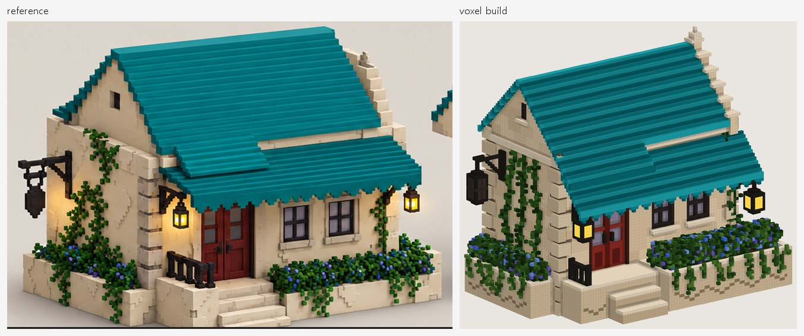
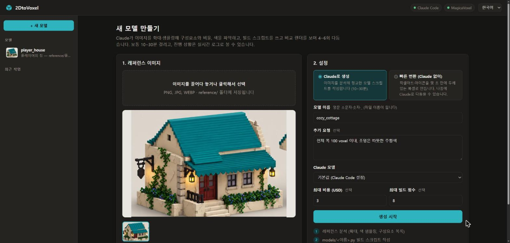
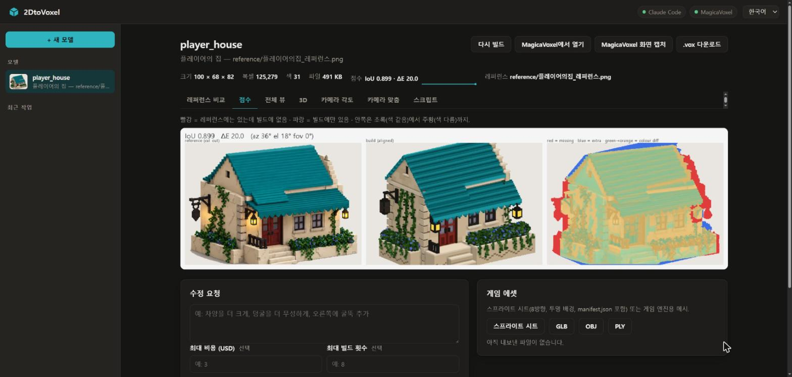
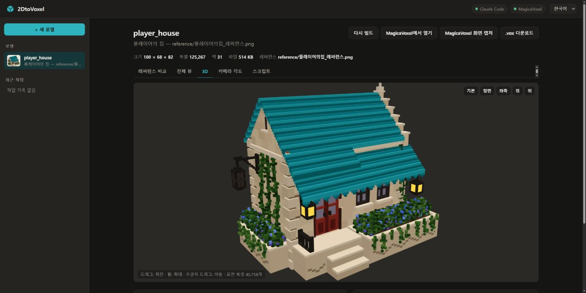
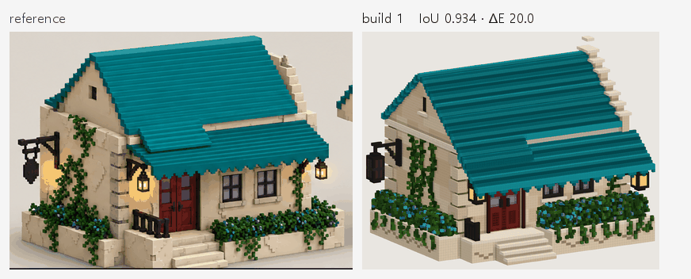
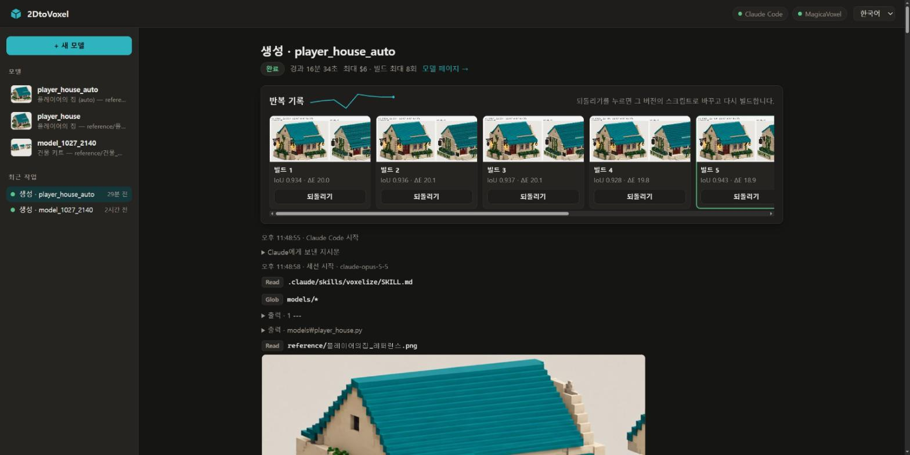
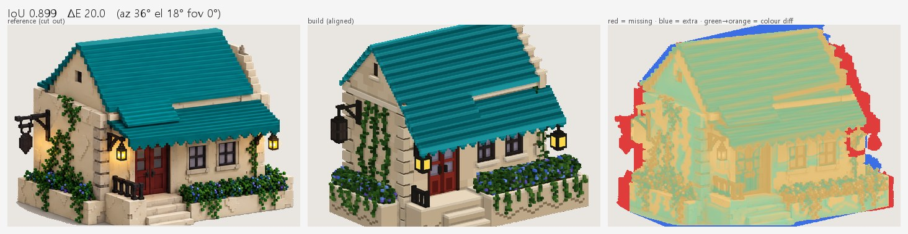
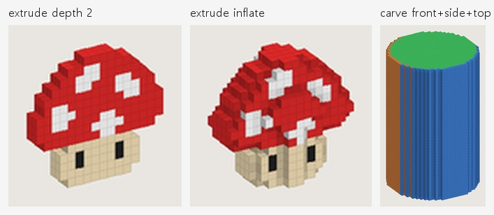
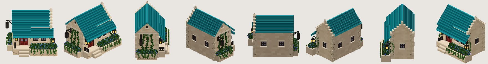

<div align="center">

<picture>
  <source media="(prefers-color-scheme: dark)" srcset=".github/logo-dark.svg">
  
</picture>

# 2DtoVoxel

**그림 한 장을 넣으면, MagicaVoxel에서 이어서 편집할 수 있는 복셀 모델이 나옵니다. Claude가 만들고, 빌드마다 원본 그림과 비교해 점수를 매기며, 계속 다듬습니다.**

[![License: MIT][license-badge]][license]
[![Tests][ci-badge]][ci]
[![Python 3.10+][python-badge]][python]
[![Output: MagicaVoxel .vox][vox-badge]][magicavoxel]

[빠른 시작](#빠른-시작) · [동작 방식](docs/how-it-works.ko.md) · [모델 스크립트](docs/model-scripts.ko.md) · [버그 제보][issues]

[English](README.md) · **한국어**

</div>



## 왜 2DtoVoxel인가?

콘셉트 아트를 손으로 복셀로 옮기려면 블록을 하나하나 찍고 비율을 눈대중으로 맞추느라 몇 시간이 걸리고, 이미지→3D 생성기는 복셀로 깔끔하게 고치기 어려운 메시를 내놓습니다. 2DtoVoxel은 Claude가 모델을 짧고 읽기 쉬운 빌드 스크립트로 쓰고, 빌드마다 원본 그림과 비교해 점수를 매기고, 어긋난 곳을 고칩니다. 결과로 진짜 MagicaVoxel 모델과, 나중에 직접 또는 Claude에게 맡겨 고칠 수 있는 스크립트가 남습니다.

- **복셀 아티스트**는 빈 격자에서 시작하는 대신, 다듬을 만한 첫 버전을 얻습니다.
- **게임 개발자**는 모델과 함께 엔진에 넣을 스프라이트 시트와 GLB/OBJ 메시를 얻습니다.

## 기능

- **원본 그림과 비교해 측정합니다.** 빌드마다 점수(실루엣 겹침과 색 차이)와 빠진 곳·넘친 곳 지도가 나와서, 짐작이 아니라 눈으로 진행 상황을 확인합니다.
- **굳어 버린 결과물이 아닙니다.** 결과는 `.vox`와 짧은 빌드 스크립트입니다. "차양을 더 크게"처럼 말로 수정을 요청하거나 직접 고치면 됩니다.
- **작업 과정을 보고, 언제든 되돌립니다.** 실시간 로그에 빌드마다 점수가 나오고, 이전 버전으로 클릭 한 번에 돌아갈 수 있습니다.
- **레퍼런스와 같은 시점으로 봅니다.** 카메라 각도와 원근을 자동으로 맞춰서 같은 조건에서 비교합니다.
- **필요하면 고해상도로.** 작게 반복한 뒤 최종본만 2~3배 해상도로 빌드하고, 색의 세부는 그림에서 바로 칠해 오며, 어느 영역이든 원래 크기로 확대해 비교합니다. 축마다 256 voxel이 넘는 모델은 MagicaVoxel 오브젝트 여러 개로 알아서 나눠 저장하고, 나무와 덤불에는 복셀 아트풍 잎 뭉치를 만드는 전용 도구가 있습니다.
- **픽셀아트는 몇 초면 됩니다, Claude 없이도.** 스프라이트·아이콘을 평평하거나 둥근 복셀 모델로 바꾸고, 정면·측면·윗면 그림을 교차시켜 깎아 낼 수 있습니다.
- **바로 쓰는 게임 에셋.** manifest가 포함된 8방향 스프라이트 시트, GLB / OBJ / PLY 메시, 팔레트 변형.
- **켜 두어도 안전합니다.** UI는 내 컴퓨터 안에서만 동작하고, 작업은 자기 모델만 건드릴 수 있으며, 작업마다 비용·빌드 횟수 상한이 있고, MagicaVoxel에서 고친 파일은 다시 빌드하기 전에 백업됩니다.
- **원하는 방식으로 씁니다.** English·한국어 웹 UI, Claude Code의 `/voxelize`, `voxtool` 명령줄. API 키 없이 Claude Code 로그인을 그대로 씁니다.

## 언제 쓰나요

**물체 하나**가 담긴 이미지(콘셉트 아트, 렌더 이미지, 잘라 낸 게임 스크린샷, 픽셀아트)를 MagicaVoxel 복셀 모델로 만들고 싶을 때 쓰세요.

장면이나 풍경 전체를 모델 하나로, 사진에서 정확한 3D 복원, 애니메이션, MagicaVoxel 장면 크기(축마다 약 2048 voxel)를 넘는 모델에는 맞지 않습니다.

## 빠른 시작

```bash
git clone https://github.com/NangManCatDev/2DtoVoxel.git
cd 2DtoVoxel && python -m pip install -e .
voxtool ui
```

브라우저에 UI가 열립니다. **+ 새 모델**을 누르고 이미지를 끌어다 놓은 뒤 **생성 시작**을 누르면, 10~30분 뒤 MagicaVoxel에서 열 수 있는 모델이 나옵니다. Claude Code가 없다면 픽셀아트 이미지로 **빠른 변환**을 써 보거나, 명령줄에서 이렇게 하세요.

```bash
voxtool extrude path/to/sprite.png --name my_sprite --inflate
```

## 설치

| 필요한 것                         | 설명                                                                                                                                 |
| --------------------------------- | ------------------------------------------------------------------------------------------------------------------------------------ |
| Python 3.10+                      | `numpy`, `Pillow`, `scipy`는 `pip install -e .`로 함께 설치됨                                                                |
| [Claude Code][claude-code]        | 설치하고 로그인해 두어야 모델을 생성·수정할 수 있음. 사용량은 본인의 Claude 요금제에서 차감                                         |
| [MagicaVoxel][magicavoxel] 0.99.x | 선택 사항. 결과를 열고 편집할 때 필요                                                                                                |
| Windows 10/11                     | 전체 흐름 테스트 완료. macOS / Linux는 CLI와 테스트가 동작함, [플랫폼 참고](docs/troubleshooting.ko.md#플랫폼-참고-및-제한-사항) 참고 |

```bash
python -m pip install -e .      # 의존성과 `voxtool` 명령 설치
```

설치하지 않아도 프로젝트 폴더에서 `py -m voxtool …`(Windows) 또는 `python3 -m voxtool …`(macOS / Linux)로 모든 명령을 쓸 수 있습니다. UI는 Claude Code와 MagicaVoxel을 흔한 위치에서 자동으로 찾고, 못 찾으면 `CLAUDE_CLI` / `MAGICAVOXEL_EXE`를 지정하면 됩니다([설정](docs/cli.ko.md#설정)).

## 사용법

### 웹 UI

`voxtool ui`, `2DtoVoxel.bat`(Windows), `./2dtovoxel.sh`(macOS / Linux) 중 하나로 실행합니다. 콘솔 창이 곧 서버이고, 창을 닫으면 꺼집니다.

1. **+ 새 모델** → 이미지 끌어다 놓기 → 이름 정하기 → **Claude로 생성**(최대 비용·최대 빌드 횟수는 선택) 또는 **빠른 변환** 선택.
2. 실시간 로그를 봅니다. 빌드마다 점수가 함께 나옵니다.
3. 모델 화면에서 레퍼런스와 비교하고, 점수 지도를 보고, 3D로 돌려 보고, MagicaVoxel에서 열고, `.vox`를 받거나 게임 에셋을 내보냅니다.
4. **수정 요청**에 바꿀 내용을 말로 적습니다. "이전 대화 이어서"를 켜면 다시 분석하지 않습니다.
5. 모델을 지우려면 사이드바에서 모델 위에 마우스를 올리고 휴지통 아이콘을 누릅니다. 확인하면 스크립트와 출력물이 `output/_trash/`로 옮겨지므로, 나중에 다시 옮겨 와 되살릴 수 있습니다.

| 새 모델                                    | 모델 화면 (점수 탭)                       | 3D 미리보기                              |
| ------------------------------------------ | ----------------------------------------- | ---------------------------------------- |
|  |  |  |

MagicaVoxel에서 **Render** 탭으로 가면 랜턴 같은 발광 색이 실제로 빛납니다.

### 실제 생성 예시

플레이어의 집 레퍼런스로 실제로 돌린 결과입니다. Claude 모델은 기본값(Opus), 상한은 $6와 빌드 8회, 추가 요청은 "모든 축 110 voxel 이내"였습니다.

| 시간          | 비용  | 빌드       | 점수                                                          |
| ------------- | ----- | ---------- | ------------------------------------------------------------- |
| 16.6분, 102턴 | $4.65 | 8회 (상한) | IoU 0.934 → 0.940 (최고 0.943, 5번째 빌드), ΔE 20.0 → 17.7 |

점수가 계속 오르기만 하지는 않습니다. 4번째 빌드에서 내려갔다가 5번째에서 회복했습니다. 작업 화면은 가장 좋은 빌드를 강조해 보여 주고, **되돌리기**로 그 버전에 돌아갈 수 있습니다.





### 점수 읽는 법

- **IoU** (0~1): 크기와 위치를 맞춘 뒤 모델 실루엣이 레퍼런스 실루엣과 겹치는 정도. 1이 완벽합니다.
- **ΔE**: 둘이 겹치는 부분의 평균 색 차이. 낮을수록 좋습니다.
- **worst**: 빠진 곳(빨강)이나 넘친 곳(파랑)이 가장 큰 영역. 예: `top-right missing 19%`.



### Claude Code 대화에서

```text
/voxelize reference/내이미지.png
```

또는 "reference/내이미지.png 복셀로 만들어줘"처럼 말로 요청해도 됩니다. 다른 프로젝트에서도 `/voxelize`를 쓰려면 `voxtool install-skill`을 실행하세요.

### Claude 없이: 빠른 변환

```bash
voxtool extrude reference/mushroom.png --name mushroom --depth 4 --inflate   # 픽셀아트 → 둥근 복셀
voxtool carve --front f.png --side s.png --top t.png --name vase              # 그림 → 깎아 낸 모델
```



### 게임 에셋

```bash
voxtool sprites models/player_house.py --dirs 8               # 스프라이트 시트 + manifest.json
voxtool export models/player_house.py --format glb            # 또는 obj / ply
voxtool recolor models/player_house.py --hue 120 --only roof,roof_hi,roof_dk
```



## 동작 방식

Claude는 MagicaVoxel 화면을 조작하지 않습니다. Python 빌드 스크립트를 쓰면 `voxtool`이 그것을 `.vox`, 미리보기, 점수로 바꾸고, Claude는 점수가 더 오르지 않을 때까지 가장 큰 차이부터 고칩니다. 배경 제거, 점수가 형태를 맞추는 방법, 카메라 맞춤, UI 작업이 빌드마다 스냅샷을 남기는 방식은 안내서에 있습니다.
→ [2DtoVoxel의 동작 방식](docs/how-it-works.ko.md)

## 모델 스크립트 쓰기

모델은 `models/` 안의 Python 파일 하나로, 작은 DSL(박스, 박공지붕, 계단, 덩굴, 덤불, 빛나는 팔레트 색 등)로 복셀 격자를 만듭니다. Claude가 쓴 스크립트를 고쳐도 되고 직접 써도 됩니다. 안내서에 실행되는 예제와 DSL 전체 레퍼런스가 있습니다.
→ [모델 스크립트 쓰기](docs/model-scripts.ko.md)

## 명령줄

UI에서 하는 일은 모두 `voxtool` 명령으로도 할 수 있습니다: 빌드, 점수, 카메라 맞춤, 변환, 내보내기, MagicaVoxel에서 열기. 레퍼런스에 모든 명령, 출력물 위치, 설정할 수 있는 환경변수와 옵션이 있습니다.
→ [명령줄과 설정](docs/cli.ko.md)

## 문제 해결

빨간 상태 표시, 이상한 점수, 실패한 작업, 플랫폼 관련 질문(macOS / Linux, MagicaVoxel 편집본이 다시 빌드되는 문제)을 더 좋은 결과를 얻는 요령과 함께 정리했습니다.
→ [문제 해결, 요령, 제한 사항](docs/troubleshooting.ko.md)

## 보안

UI는 127.0.0.1에서만 접속을 받고, 무언가를 바꾸는 요청에는 실행할 때 만든 토큰이 있어야 합니다. Claude 작업은 자기 모델 스크립트와 `output/`만 고칠 수 있고 그 모델의 voxtool 명령만 실행할 수 있으며, 그 밖의 것은 거부됩니다. 이 제한은 실수를 막아 줄 뿐 샌드박스는 아닙니다. 모델 스크립트는 `build`가 내 계정 권한으로 실행하는 파이썬 코드이므로, 믿을 수 있는 레퍼런스 이미지만 쓰세요.
→ [SECURITY.md](SECURITY.md)

## 기여하기

이슈와 풀 리퀘스트를 환영합니다. 개발 환경 설정, 테스트, 프로젝트 구조, 규칙(두 언어 유지, UI 작업 권한)은 [CONTRIBUTING.md](CONTRIBUTING.md)에, 변경 내역은 [CHANGELOG.md](CHANGELOG.md)에 있습니다.

## 라이선스

[MIT](LICENSE) © NangManCatDev. `reference/`의 레퍼런스 이미지와 `docs/images/`의 이미지도 프로젝트의 일부로, 같은 라이선스로 사용할 수 있습니다.

## 감사의 말

- ephtracy의 [MagicaVoxel][magicavoxel]과 [.vox 파일 포맷](https://github.com/ephtracy/voxel-model) 문서
- 3D 미리보기에 쓴 [three.js](https://threejs.org/)
- 측정 기반 품질 확인, 작업 스냅샷, 게임 에셋 출력 아이디어는 [aldegad/sprite-gen](https://github.com/aldegad/sprite-gen)에서 영감을 받았습니다.
- [Claude Code][claude-code]로 만들었습니다.

---

<sub>Crafted with [Readme Craft](https://github.com/motiful/readme-craft)</sub>

[license-badge]: https://img.shields.io/badge/license-MIT-0b8691.svg
[license]: LICENSE
[ci-badge]: https://github.com/NangManCatDev/2DtoVoxel/actions/workflows/ci.yml/badge.svg
[ci]: https://github.com/NangManCatDev/2DtoVoxel/actions/workflows/ci.yml
[python-badge]: https://img.shields.io/badge/python-3.10%2B-0b8691.svg
[python]: https://www.python.org/downloads/
[vox-badge]: https://img.shields.io/badge/output-MagicaVoxel%20.vox-0b8691.svg
[magicavoxel]: https://ephtracy.github.io/
[claude-code]: https://claude.com/claude-code
[issues]: https://github.com/NangManCatDev/2DtoVoxel/issues
