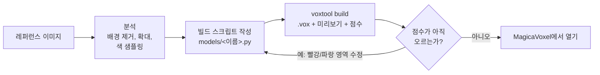

# 2DtoVoxel

[English](README.md) | **한국어**

[](https://github.com/NangManCatDev/2DtoVoxel/actions/workflows/ci.yml) [](LICENSE)

레퍼런스 이미지를 **MagicaVoxel 모델**로 만들어 줍니다. Claude가 그림을 분석해 복셀 빌드 스크립트를 쓰고, 빌드 결과를 레퍼런스와 계속 비교하며(눈으로 보는 것뿐 아니라 측정한 점수로도) 비슷해질 때까지 다듬습니다. 결과물은 MagicaVoxel에서 바로 열어 이어서 편집할 수 있는 `.vox` 파일이고, 원하면 게임용 스프라이트 시트와 메시도 뽑을 수 있습니다.


## 목차

- [동작 방식](#동작-방식)
- [기능](#기능)
- [필요한 것](#필요한-것)
- [설치](#설치)
- [빠른 시작: 웹 UI](#빠른-시작-웹-ui)
- [Claude Code 대화에서 쓰기](#claude-code-대화에서-쓰기)
- [레퍼런스와의 일치도 측정](#레퍼런스와의-일치도-측정)
- [Claude 없이 빠른 변환](#claude-없이-빠른-변환)
- [게임 에셋](#게임-에셋)
- [명령줄 (voxtool)](#명령줄-voxtool)
- [모델 스크립트 직접 쓰기·고치기](#모델-스크립트-직접-쓰기고치기)
- [좋은 결과를 얻는 요령](#좋은-결과를-얻는-요령)
- [설정](#설정)
- [보안과 권한](#보안과-권한)
- [프로젝트 구조](#프로젝트-구조)
- [개발](#개발)
- [플랫폼 참고 및 제한 사항](#플랫폼-참고-및-제한-사항)
- [문제 해결](#문제-해결)
- [감사의 말](#감사의-말)
- [라이선스](#라이선스)

## 동작 방식

Claude는 MagicaVoxel 화면을 직접 조작하지 않습니다. 작은 빌드용 DSL(박스, 박공지붕, 창문, 덩굴, 덤불 등)로 모델을 기술하는 짧은 Python 스크립트를 쓰고, `voxtool`이 그 스크립트를 `.vox` 파일, 미리보기 이미지, 레퍼런스 대비 점수로 바꿉니다.



1. **분석.** 레퍼런스의 배경을 지우고(`ref cutout`), 픽셀 격자를 덧씌워 영역별로 확대해 보고, 실제 색을 뽑아냅니다.
2. **스케일 결정.** 크기를 아는 요소 하나(보통 문, 약 20 voxel 높이)를 기준으로 나머지 치수를 모두 비율로 환산합니다. 레퍼런스는 대부분 원근 이미지라 화면 픽셀로는 잴 수 없기 때문입니다.
3. **스크립트 작성.** 주요 치수를 `models/<이름>.py` 맨 위의 상수로 두어서, 비율 하나를 고치는 일이 한 줄 수정으로 끝나게 합니다.
4. **카메라 맞추기.** `fit-camera`가 모델의 실루엣이 레퍼런스와 가장 잘 겹치는 방위각·고도각·화각을 찾습니다.
5. **빌드, 점수, 수정.** 빌드할 때마다 점수(실루엣 겹침과 색 차이)가 출력되고 차이 이미지가 그려집니다(빨강 = 빠짐, 파랑 = 넘침). Claude는 가장 큰 차이부터 고치고, 점수가 더 오르지 않으면 멈춥니다. 보통 4~6회 반복합니다.

복셀을 손으로 찍는 대신 스크립트로 만들기 때문에 결과가 정확하고, 다시 만들어도 같으며, 나중에 직접 고치거나 Claude에게 고쳐 달라고 하기 쉽습니다.

## 기능

- **웹 UI**와 실시간 진행 로그: 실행한 명령, 빌드마다의 비교 이미지와 점수, Claude의 답변. **English와 한국어** 지원.
- **측정 기반 비교**: 빌드마다 실루엣 IoU, 색 차이(CIE ΔE), 가장 어긋난 영역, 차이 이미지. 모델별 점수 기록.
- **카메라 자동 맞춤**(원근 카메라 포함): 미리보기가 레퍼런스와 같은 시점으로 모델을 봅니다.
- **안전장치**: 작업 중 빌드마다 스냅샷이 남아 어느 버전으로든 되돌릴 수 있고, MagicaVoxel에서 저장한 `.vox`는 빌드 전에 백업하며, 작업별 비용·빌드 횟수 상한을 둘 수 있습니다.
- **Claude 없이 빠른 변환**: 픽셀아트·아이콘을 몇 초 만에 복셀로(평평하게 또는 둥글게), 정면·측면·윗면 그림으로 깎아 내기.
- **게임 에셋**: 8방향 스프라이트 시트와 manifest, OBJ / PLY / GLB 메시, 팔레트 변형.
- **MagicaVoxel 연동**: 모델 열기, MagicaVoxel 창 캡처, `.vox` 다운로드. 발광 색(랜턴)은 발광 재질 그대로 유지.
- **Claude Code 대화에서도 사용 가능**: `/voxelize` 스킬.
- **API 키 불필요**: 이미 로그인된 Claude Code CLI로 생성합니다.

## 필요한 것

| 항목        | 설명                                                                                                              |
| ----------- | ----------------------------------------------------------------------------------------------------------------- |
| OS          | Windows 10/11 (전체 흐름 개발·테스트). macOS / Linux는 [플랫폼 참고](#플랫폼-참고-및-제한-사항)를 보세요.         |
| Python      | 3.10 이상, `numpy`, `Pillow`, `scipy` (`pip install -e .`로 설치됨)                                                |
| Claude Code | 설치되고 로그인된 CLI. Claude로 모델을 생성·수정할 때 필요합니다. 사용량은 본인의 Claude 요금제에서 차감됩니다.  |
| MagicaVoxel | 0.99.x. 선택 사항: 결과를 열고 편집할 때 필요합니다. UI의 3D 탭, 변환, 내보내기는 없어도 동작합니다.              |
| 브라우저    | 최신 브라우저. 3D 탭은 three.js를 CDN에서 불러오므로 인터넷 연결이 필요합니다.                                     |

## 설치

```bash
git clone https://github.com/NangManCatDev/2DtoVoxel.git
cd 2DtoVoxel
python -m pip install -e .        # Windows에서는 py -m pip install -e . 도 됩니다
```

의존성과 함께 `voxtool` 명령이 설치됩니다. 설치하지 않아도 프로젝트 폴더에서 `py -m voxtool …`(Windows) 또는 `python3 -m voxtool …`(macOS / Linux)로 모든 명령을 쓸 수 있습니다.

- **Claude Code**: [claude.com/claude-code](https://claude.com/claude-code)에서 설치하고 한 번 로그인해 두세요. UI는 `PATH`에 있는 `claude`를 찾고, 없으면 VS Code의 Claude Code 확장에 들어 있는 실행 파일을 찾습니다(VS Code Insiders, Cursor 포함).
- **MagicaVoxel**: [ephtracy.github.io](https://ephtracy.github.io/)에서 받으세요. 흔한 위치(바탕화면·다운로드·홈 폴더·`C:\Program Files`·`C:\` 아래의 `MagicaVoxel*` 폴더, macOS는 `/Applications`)에 있으면 자동으로 찾습니다. 그 밖의 위치라면 `MAGICAVOXEL_EXE`를 지정하세요.

## 빠른 시작: 웹 UI

1. 프로젝트 폴더에서 **실행합니다**: `2DtoVoxel.bat` 더블클릭(Windows), `./2dtovoxel.sh`(macOS / Linux), 또는 `voxtool ui`. 브라우저에 **http://127.0.0.1:8765/** 가 열립니다.
   - 콘솔 창이 곧 서버입니다. UI를 쓰는 동안 켜 두고, 다 쓰면 창을 닫거나 Ctrl+C를 누르면 꺼집니다.
   - 8765 포트가 사용 중이면 다음 빈 포트를 씁니다. 실제 주소는 콘솔에 나옵니다.
2. 오른쪽 위에서 **언어를 고릅니다**(English / 한국어). 상태 표시가 초록색이면 Claude Code와 MagicaVoxel을 찾은 것입니다.
3. **"+ 새 모델"을 누르고** 레퍼런스 이미지를 끌어다 놓은 뒤 모델 이름(영문 소문자·숫자·`_`)을 정합니다. 그리고 고릅니다.
   - **Claude로 생성**: 필요하면 추가 요청을 적고, Claude 모델(Opus가 가장 정교하고, Sonnet이 빠르고 저렴)을 고르고, **최대 비용**과 **최대 빌드 횟수**를 정합니다. 10~30분 정도 걸립니다.
   - **빠른 변환 (Claude 없이)**: 픽셀아트·평면 이미지용. 두께를 정하고 필요하면 "둥글게"를 켭니다. 몇 초면 끝납니다.
4. **실시간 로그를 봅니다.** 빌드마다 점수가 함께 나옵니다. 페이지를 떠났다 돌아와도 됩니다.
5. **모델 화면**에는 레퍼런스 비교, 점수 이미지, 전체 뷰, 돌려 보는 3D, 카메라 각도, 카메라 맞춤, 스크립트 탭과 다시 빌드·MagicaVoxel에서 열기·MagicaVoxel 화면 캡처·.vox 다운로드 버튼이 있습니다.
6. 모델 화면 아래의 **수정 요청**에 바꿀 내용을 적습니다("차양을 더 크게"). 이전 대화를 이어서 하면 다시 분석하지 않아 보통 더 저렴합니다.
7. 모델 화면의 **게임 에셋**: 스프라이트 시트, GLB, OBJ, PLY와 다운로드 링크.

MagicaVoxel에서 **Render** 탭으로 가면 랜턴 같은 발광 재질이 실제로 빛나는 것을 볼 수 있습니다.

| 새 모델                                       | 모델 화면 (점수 탭)                             | 3D 미리보기                                |
| --------------------------------------------- | ----------------------------------------------- | ------------------------------------------ |
|     |        |    |

### 반복 기록과 되돌리기

작업 화면에는 Claude 작업의 빌드가 하나하나 점수 이미지와 숫자가 담긴 카드로 나오고, 가장 좋은 빌드가 강조됩니다. **되돌리기**를 누르면 그 버전의 스크립트를 `models/<이름>.py`에 다시 넣고 빌드합니다. 바뀌기 전 스크립트는 작업 폴더(`output/_jobs/<id>/iter/`)에 보관됩니다. "작업 전"은 Claude가 시작하기 전의 스크립트로 되돌립니다.

## Claude Code 대화에서 쓰기

Claude Code에서 프로젝트 폴더를 열고 이렇게 실행합니다.

```
/voxelize reference/내이미지.png
```

또는 "reference/내이미지.png 복셀로 만들어줘"처럼 말로 요청해도 됩니다. [.claude/skills/voxelize/SKILL.md](.claude/skills/voxelize/SKILL.md)의 스킬이 요청 종류(정교한 모델, 빠른 변환, 수정, 게임 에셋)를 나누고 분석 → 스크립트 → 빌드 → 점수 과정을 안내합니다. 프로젝트 규칙과 그동안 배운 요령은 [CLAUDE.md](CLAUDE.md)에 있습니다.

다른 폴더에서도 `/voxelize`를 쓰려면 `voxtool install-skill`을 실행하세요(`~/.claude/skills/`로 복사).

## 레퍼런스와의 일치도 측정

```bash
voxtool build models/player_house.py          # 스크립트에 REFERENCE가 있으면 점수도 매김
voxtool score models/player_house.py          # 점수만 JSON으로
voxtool fit-camera models/player_house.py     # 가장 잘 맞는 VIEW(방위각, 고도각, fov) + 겹침 이미지
```

- **IoU** (0~1): 넓이와 중심을 맞춘 뒤 모델 실루엣이 레퍼런스 실루엣과 겹치는 정도. 1이 완벽한 일치입니다.
- **ΔE**: 둘이 겹치는 부분의 평균 색 차이(CIE76). 낮을수록 좋고, 조명 차이 때문에 0이 되지는 않습니다.
- **worst**: 빠진 곳(빨강)이나 넘친 곳(파랑)이 가장 큰 3×3 영역. 예: `top-right missing 19%`.


점수는 목표가 아니라 관찰입니다. 원근 레퍼런스와 정사영 미리보기는 완벽히 같아질 수 없습니다. 무엇을 고칠지는 점수로 찾고, 어떻게 고칠지는 이미지를 보고 정하세요.

## Claude 없이 빠른 변환

```bash
voxtool extrude reference/mushroom.png --name mushroom --depth 3            # 평평한 판
voxtool extrude reference/mushroom.png --name mushroom --depth 4 --inflate  # 둥글게
voxtool carve --front f.png --side s.png --top t.png --name vase --height 64
```

- `extrude`는 확대 저장된 픽셀아트의 픽셀 크기를 자동으로 찾고, 배경을 지우고, 원래 색을 유지합니다.
- `carve`는 최대 세 장의 정사영 그림(정면, 왼쪽에서 본 측면, 정면이 아래로 오는 윗면)의 실루엣을 교차시키고, 표면 복셀마다 가장 정면으로 보이는 그림의 색을 칠합니다.
- 둘 다 `models/<이름>.base.vox`와 그것을 불러오는 스크립트 `models/<이름>.py`를 만듭니다. 이후 DSL로(또는 "수정 요청"으로) 디테일을 더할 수 있습니다.


## 게임 에셋

```bash
voxtool sprites models/player_house.py --dirs 8 --scale 4      # 스프라이트 시트 + manifest.json
voxtool export models/player_house.py --format glb             # 또는 obj / ply
voxtool recolor models/player_house.py --swap roof=#a33b2b roof_hi=#c24a36 --label red_roof
voxtool recolor models/player_house.py --hue 120,240 --only roof,roof_hi,roof_dk
```

- **스프라이트**: 투명 배경에 선명한 픽셀. 모든 프레임이 같은 크기이고 모델의 바닥 중심이 같은 기준점에 오므로, 게임에서 방향을 바꿔도 튀지 않습니다. `manifest.json`에 프레임별 위치·방향·방위각이 들어 있습니다.
- **메시**: 같은 색의 면을 큰 사각형으로 합칩니다(greedy meshing). Y가 위쪽이고, 모델은 x/z 중심에서 y = 0 위에 서 있으며 정면이 +Z를 향합니다. 복셀 하나는 기본 0.1 단위(`--scale`)입니다. GLB는 정점 색을 쓰고 발광 색은 발광 재질이 됩니다. OBJ는 `.mtl`과 팔레트 텍스처가 함께 나옵니다.
- **변형**: 팔레트의 이름 붙은 색을 바꾸거나 색상을 회전합니다. 발광 색은 그대로 둡니다.

결과는 `output/<이름>/sprites/`, `export/`, `variants/`에 저장됩니다.


## 명령줄 (voxtool)

프로젝트 폴더에서 실행합니다. `voxtool`은 `pip install -e .` 후에 쓸 수 있고, 아니면 `py -m voxtool`(Windows)이나 `python3 -m voxtool`을 쓰세요.

| 명령                                                      | 하는 일                                                                                 |
| --------------------------------------------------------- | --------------------------------------------------------------------------------------- |
| `voxtool build models/<이름>.py [--open] [--no-score]`    | `output/<이름>/`에 빌드(`.vox`, 미리보기, 비교, 점수). `--open`은 MagicaVoxel에서 열기   |
| `voxtool score models/<이름>.py`                          | `REFERENCE`와 비교한 점수를 JSON으로 출력                                                |
| `voxtool fit-camera models/<이름>.py [--fovs 0,25,45]`    | 가장 잘 맞는 `VIEW`를 찾고 `_fit.png` 작성                                               |
| `voxtool angles models/<이름>.py 30,20 42,15,30`          | `az,el[,fov]` 카메라들을 레퍼런스 옆에 렌더 → `_angles.png`                              |
| `voxtool render <파일.vox> [--az 30 --el 30 --fov 0]`     | 아무 `.vox`(MagicaVoxel이 만든 파일 포함)의 미리보기 시트                                |
| `voxtool open <파일.vox>` / `voxtool shot`                | MagicaVoxel에서 열기 / 창 캡처(Windows)                                                  |
| `voxtool ref grid\|crop\|sample\|palette\|cutout <이미지>`  | 레퍼런스 분석 도구(픽셀 격자, 확대 크롭, 지점 색, 주요 색, 배경 제거)                    |
| `voxtool compare <a.png> <b.png> ...`                     | 이미지를 나란히 붙이기                                                                  |
| `voxtool extrude <이미지> --name N [--depth 4 --inflate]` | 이미지·픽셀아트 → 복셀, Claude 없이                                                      |
| `voxtool carve --front f [--side s --top t] --name N`     | 실루엣 → 복셀, Claude 없이                                                               |
| `voxtool sprites <스크립트\|vox> [--dirs 8 --scale 4]`     | 스프라이트 시트 + `manifest.json`                                                        |
| `voxtool export <스크립트\|vox> --format glb\|obj\|ply`     | 메시 내보내기                                                                           |
| `voxtool recolor <스크립트\|vox> --swap 이름=#hex \| --hue 30` | 팔레트 변형                                                                          |
| `voxtool ui [--port 8765] [--no-browser]`                 | 웹 UI 실행                                                                              |
| `voxtool install-skill [--dest ~/.claude/skills]`         | 모든 프로젝트에서 `/voxelize` 쓰기                                                       |

## 모델 스크립트 직접 쓰기·고치기

모델 하나는 `models/` 안의 Python 파일 하나이고, 다음을 담습니다.

- `NAME`: 출력 폴더와 파일 이름
- `REFERENCE` (선택): 레퍼런스 이미지 경로. 있으면 비교 이미지와 점수가 만들어집니다.
- `VIEW` (선택): 미리보기 카메라. 예: `{"azimuth": 36, "elevation": 18, "fov": 0}`. 방위각 0은 정면을, 90은 왼쪽 면을 봅니다. `fov`가 0보다 크면 원근 카메라입니다.
- `SCORE_VIEW` (선택): 점수용 카메라가 `VIEW`와 다를 때(변환 결과는 정면에서 점수를 매김)
- `CUTOUT` (선택): 배경 제거 설정. 물체가 여러 개인 시트면 `{"keep": "all"}`
- `build()`: `Model`을 반환합니다.

**좌표.** `x`는 오른쪽, `y`는 안쪽(**`y = 0`이 정면**, MagicaVoxel 기본 카메라가 보는 면), `z`는 위쪽입니다. 박스는 위치와 크기로 지정합니다. `box(x, y, z, w, d, h, 색)`은 `x … x+w-1` 범위 등을 채우고, 격자 밖은 잘려 나갑니다. `region=` 인자는 항상 `(x, y, z, w, d, h)` 순서입니다. 저장되는 오브젝트 하나는 축마다 최대 256 voxel, 색은 최대 255개입니다.

```python
from voxtool import Model

NAME = "tiny_hut"
VIEW = {"azimuth": 36, "elevation": 20}


def build() -> Model:
    m = Model(40, 34, 32, seed=1)                  # 격자 크기: x(폭), y(깊이), z(높이)
    m.pal.add("wall", "#dcc3a0"); m.pal.add("wall2", "#d2b893")
    m.pal.add("roof", "#0b8691"); m.pal.add("roof_hi", "#1ba3ad")
    m.pal.add("door", "#8c2b22"); m.pal.add("glass", "#8a8094")
    m.pal.add("lamp", "#ffd84a", emit=4)            # MagicaVoxel Render 탭에서 빛남
    m.pal.add("leaf", "#2c5a19"); m.pal.add("leaf2", "#3d7524")

    m.shell(6, 8, 0, 28, 18, 16, "wall", t=2, top=False)          # 벽, y=8이 정면
    m.bricks(["wall", "wall2"], target="wall", bw=6, bh=3)       # 돌 블록 질감
    roof = (4, 6, 16, 32, 22)                                     # 지붕 바닥 영역 x, y, z, w, d
    m.gable_wall(*roof, "x", "wall", region=(6, 8, 28, 18))       # 지붕 아래 박공벽
    m.gable_roof(*roof, "x", ["roof_hi", "roof"], t=2)            # 용마루는 x 방향, 줄무늬 판자
    m.box(17, 8, 0, 6, 2, 10, "door")                             # 문, 깊이 2
    m.box(9, 8, 6, 5, 1, 5, "glass"); m.box(26, 8, 6, 5, 1, 5, "glass")
    m.box(15, 7, 9, 1, 1, 2, "lamp")                              # 벽 앞의 등
    m.blob(10, 5, 2, 3.5, 2.5, 2.5, ["leaf", "leaf2"])            # 덤불
    m.blob(30, 5, 2, 3.5, 2.5, 2.5, ["leaf", "leaf2"])
    return m
```

`models/tiny_hut.py`로 저장하고 `voxtool build models/tiny_hut.py --open`을 실행하면 이렇게 나옵니다.


코너석, 계단식 박공, 차양, 랜턴, 화단, 덩굴까지 들어간 실제 예시는 [models/player_house.py](models/player_house.py)를 보세요.

### DSL 레퍼런스

모든 메서드는 `Model`에 있습니다([voxtool/model.py](voxtool/model.py)). `c`는 팔레트 이름, 팔레트 번호, 또는 `None`(깎기)입니다.

| 분류          | 메서드                                                                     | 용도                                                                         |
| ------------- | -------------------------------------------------------------------------- | ---------------------------------------------------------------------------- |
| 팔레트        | `m.pal.add(name, hex, emit=0, glass=0, metal=0, rough=0.5)`                | 이름 붙은 색 등록. `emit`은 발광, `glass`는 투명, `metal`은 금속 재질         |
|               | `m.pal.ramp(name, [hex, ...])`                                             | `name0`, `name1`, … 명암 변형 등록                                           |
| 기본 도형     | `box(x, y, z, w, d, h, c, only_empty=False, only_filled=False)`            | 꽉 찬 박스 (`c=None`이면 깎기)                                               |
|               | `carve(x, y, z, w, d, h)`                                                  | 박스 영역 비우기                                                             |
|               | `shell(x, y, z, w, d, h, c, t=1, top=True, bottom=True)`                   | 벽 두께 `t`인 속 빈 박스                                                     |
|               | `set(x, y, z, c)` / `get(x, y, z)`                                         | 복셀 하나                                                                    |
|               | `line(p0, p1, c, r=0)`                                                     | 3D 선. `r`을 주면 정육면체 붓으로 굵게                                       |
|               | `ellipsoid(cx, cy, cz, rx, ry, rz, c)`                                     | 타원체                                                                       |
|               | `cylinder(cx, cy, z, r, h, c, axis="z")`                                   | z, x, y 방향 원기둥                                                          |
|               | `where(x, y, z, w, d, h, fn, c)`                                           | `fn(X, Y, Z)`(numpy 벡터 연산)가 참인 곳을 채움 — 어떤 모양이든 가능          |
|               | `paint_fn(x, y, z, w, d, h, fn)`                                           | 복셀마다 다시 칠하기. `fn`이 팔레트 번호를 반환                              |
| 건축          | `gable_roof(x, y, z, w, d, ridge, c, slope=1.0, t=2, fill=None)`           | 박공지붕. 색 목록을 주면 단마다 번갈아 칠해 판자·기와 느낌                   |
|               | `gable_wall(x, y, z, w, d, ridge, c, slope=1.0, region=None)`              | 같은 지붕 아래를 정확히 맞춰 채움 (박공벽, 다락)                             |
|               | `shed_roof(x, y, z, w, d, down, c, slope=0.5, t=2)`                        | 외쪽지붕 / 현관 차양                                                         |
|               | `stairs(x, y, z, w, steps, c, rise=1, run=2, direction="-y")`              | 일자 계단                                                                    |
| 질감·유기물   | `bricks(colors, target, bw=6, bh=3, mortar=None, p=None, region=None)`     | 기존 복셀에 엇갈린 돌·벽돌 무늬                                              |
|               | `vary(colors, target, p=None, region=None)`                                | 무작위로 색을 바꿔 평평한 면에 변화 주기                                     |
|               | `blob(cx, cy, cz, rx, ry, rz, colors, noise=0.35, density=1.0)`            | 울퉁불퉁한 타원체: 덤불, 나뭇잎, 바위                                        |
|               | `vine(x, y, z, length, colors, wall="-y", drift=0.35, leaf=0.6, spread=1)` | 벽을 타고 아래로 늘어진 덩굴                                                 |
|               | `sprinkle(colors, prob, target, region=None)`                              | 표면 복셀 일부를 무작위로 다시 칠하기 (덤불 속 꽃)                           |
|               | `scatter_on_top(region, colors, prob, target=None)`                        | 드러난 윗면 위에 복셀 올리기                                                 |
| 오브젝트·파일 | `with m.part(name): ...`                                                   | 블록 안에서 그린 복셀이 `.vox`의 별도 오브젝트가 됨 (키트 시트)               |
|               | `Model.from_vox(path)` / `m.paste_vox(path, x, y, z)`                      | 기존 `.vox`(변환 결과나 MagicaVoxel 편집본)에서 시작 / 붙여 넣기              |
| 변형·출력     | `mirror_x(x0, x1)` / `copy(x, y, z, w, d, h, dx, dy, dz)`                  | 영역 대칭 복사 / 복제                                                        |
|               | `stats()` / `save(path)`                                                   | 요약(색별 복셀 개수) / `.vox` 저장 (MagicaVoxel에서 저장된 파일은 먼저 백업)  |

## 좋은 결과를 얻는 요령

- **깔끔한 레퍼런스를 쓰세요.** 대상 하나, 3/4 시점, 단순한 배경. `voxtool ref cutout`으로 한 번 확인하세요. 점수는 배경 제거가 잘 될수록 정확합니다.
- **중요한 것을 "추가 요청"에 적으세요.** 크기 제한, 꼭 살려야 할 디테일, 단순화해도 되는 부분 등.
- **오래 걸리는 작업에는 상한을 두세요.** 작업별 최대 비용과 최대 빌드 횟수.
- **"수정 요청"은 한 번에 하나씩 하세요.** "현관 지붕을 3 voxel 낮게"처럼 짧고 구체적인 요청이 긴 목록보다 잘 됩니다.
- **단순한 그림은 빠른 변환으로 시작**하고 Claude로 다듬으세요. 처음부터 생성하는 것보다 빠르고 저렴합니다.
- **손으로 고친 결과는 별도 파일로 저장하세요**(MagicaVoxel *다른 이름으로 저장*). [플랫폼 참고](#플랫폼-참고-및-제한-사항)를 보세요.

## 설정

| 설정                    | 방법                                                                    |
| ----------------------- | ----------------------------------------------------------------------- |
| Claude Code CLI 위치    | 환경변수 `CLAUDE_CLI` = `claude` 실행 파일의 전체 경로                  |
| MagicaVoxel 위치        | 환경변수 `MAGICAVOXEL_EXE` = `MagicaVoxel.exe`(macOS는 `.app`)의 전체 경로 |
| 포트                    | `voxtool ui --port 9000` (사용 중이면 다음 빈 포트)                     |
| 브라우저 자동 열기 끄기 | `voxtool ui --no-browser`                                               |
| UI 언어                 | 오른쪽 위 선택 상자. 처음에는 브라우저 언어를 따릅니다.                  |
| 작업별 상한             | UI의 "최대 비용 (USD)", "최대 빌드 횟수" 칸                              |

## 보안과 권한

- 서버는 **127.0.0.1에서만** 접속을 받습니다. 무언가를 바꾸는 요청에는 실행할 때마다 새로 만들어 페이지에 넣어 둔 토큰이 있어야 하고, `Host` 헤더도 로컬이어야 합니다.
- Claude 작업은 `--permission-mode dontAsk`로 헤드리스 실행되고, 좁은 허용 목록을 받습니다. 그 모델의 스크립트와 `output/` 아래 파일만 만들거나 고칠 수 있고, 그 모델의 voxtool 명령(그리고 `ref`, `render`, `compare`, `ls`)만 실행할 수 있습니다. 공용 라이브러리, `CLAUDE.md`, `.claude/`, 다른 모델은 건드릴 수 없고, 임의 코드 실행(`python -c`)은 거부됩니다.
- Claude는 레퍼런스 이미지를 읽습니다. 믿을 수 있는 이미지만 쓰세요.

자세한 내용: [SECURITY.md](SECURITY.md)

## 프로젝트 구조

```
2DtoVoxel/
├─ 2DtoVoxel.bat / 2dtovoxel.sh   웹 UI 실행 파일 (Windows / macOS, Linux)
├─ reference/                     입력 이미지
├─ models/                        모델별 빌드 스크립트 (변환 결과는 <이름>.base.vox도)
├─ voxtool/                       라이브러리 + CLI (`voxtool`)
│  ├─ vox_io.py                   .vox 읽기/쓰기, MagicaVoxel 편집본 백업
│  ├─ model.py                    빌드 DSL (Model, Palette)
│  ├─ render.py                   카메라(정사영 / 원근), 미리보기
│  ├─ reftools.py                 레퍼런스 분석 도구, 배경 제거
│  ├─ score.py                    측정 기반 비교, 카메라 맞춤
│  ├─ convert.py                  extrude / carve (Claude 없이)
│  ├─ export.py                   메시, 스프라이트 시트, 팔레트 변형
│  ├─ __main__.py                 CLI
│  └─ ui/                         웹 UI (server.py, jobs.py, i18n.py, static/)
├─ tests/                         pytest 테스트 (임시 워크스페이스에서 CLI와 서버까지 실행)
├─ output/                        생성물 (git 제외, 필요할 때 다시 만들어짐)
├─ docs/images/                   이 README에 쓰인 이미지
├─ .claude/skills/voxelize/       /voxelize 스킬
├─ .github/workflows/ci.yml       Windows + Ubuntu, Python 3.10 / 3.12 테스트
├─ CLAUDE.md, CHANGELOG.md, SECURITY.md
└─ pyproject.toml, requirements.txt
```

## 개발

```bash
python -m pip install -e ".[dev]"
python -m pytest -q
```

테스트는 임시 워크스페이스에서 모델 빌드, 점수, 변환, 내보내기, CLI, 실제 UI 서버까지 돌립니다. CI는 Windows와 Ubuntu, Python 3.10과 3.12에서 실행합니다. 변경 내역은 [CHANGELOG.md](CHANGELOG.md)에 있습니다.

## 플랫폼 참고 및 제한 사항

- **Windows**에서는 전체 흐름(UI, Claude 작업, MagicaVoxel 열기·캡처)을 실제로 써 봤습니다. **macOS / Linux**에서는 CLI와 테스트가 돌아가고(CI가 Ubuntu를 확인), UI는 Claude 작업을 `python3 -m voxtool`로 실행하며, macOS에서는 `open -a`로 MagicaVoxel을 엽니다. 창 캡처(`shot`)는 Windows 전용이고, 그 환경에서의 전체 Claude 흐름은 아직 작성자가 직접 해 보지 않았습니다.
- **"다시 빌드"와 Claude의 수정은 스크립트로 `.vox`를 새로 만듭니다.** 기존 파일이 MagicaVoxel에서 저장된 것이면(손으로 고친 내용이 있을 수 있으므로) 먼저 `output/<이름>/<이름>_edited_<시각>.vox`로 복사하고, 모델 화면에 백업 목록이 나옵니다. 손으로 고친 내용이 새 빌드에 반영되지는 않으므로, 이어서 작업하려면 MagicaVoxel에서 *다른 이름으로 저장*하거나 `Model.from_vox`로 그 파일에서 시작하는 스크립트를 만드세요.
- 저장되는 오브젝트 하나는 축마다 256 voxel, 색은 255개까지입니다(MagicaVoxel의 제한). 더 큰 장면은 `m.part()`로 나누세요.
- 실행할 때마다 결과가 조금씩 다릅니다. 생성에는 10~30분 정도 걸리고, 비용은 Claude 모델과 요금제에 따라 다릅니다.

## 문제 해결

| 증상                                     | 해결 방법                                                                                              |
| ---------------------------------------- | ------------------------------------------------------------------------------------------------------ |
| "Claude Code" 표시가 빨간색              | CLI를 찾지 못한 것입니다. Claude Code를 설치하고 로그인하거나 `CLAUDE_CLI`를 지정한 뒤 UI를 다시 실행하세요. |
| "MagicaVoxel" 표시가 빨간색              | `MAGICAVOXEL_EXE`를 지정하고 UI를 다시 실행하세요. 열기·캡처를 뺀 나머지 기능은 그대로 됩니다.            |
| 브라우저가 열리지 않음                   | 콘솔 창에 나온 주소를 직접 여세요.                                                                     |
| 3D 탭에 오류가 나옴                      | three.js를 CDN에서 불러오려면 인터넷 연결이 필요합니다. 다른 탭은 오프라인에서도 됩니다.                 |
| 점수가 이상함                            | `voxtool ref cutout <이미지>`로 배경 제거를 확인하세요. 물체가 여러 개면 `CUTOUT = {"keep": "all"}`.     |
| "MagicaVoxel 화면 캡처"가 실패함         | MagicaVoxel이 실행 중이어야 합니다(Windows 전용). 먼저 모델을 여세요.                                   |
| 작업이 실패하거나 멈춤                   | "최근 작업"에서 열어 빨간 항목을 읽고, 괜찮았던 빌드로 **되돌리기**한 뒤 다시 시도하세요.               |
| 코드를 업데이트했는데 UI가 예전 그대로임 | 콘솔 창을 닫고 UI를 다시 실행한 뒤 페이지를 새로고침하세요.                                             |
| "models/<이름>.py 가 이미 있습니다"      | 다른 이름을 쓰거나, 그 모델을 열어 "수정 요청"을 사용하세요.                                            |

## 감사의 말

- ephtracy의 [MagicaVoxel](https://ephtracy.github.io/)과 [.vox 파일 포맷](https://github.com/ephtracy/voxel-model) 문서
- 3D 미리보기에 쓴 [three.js](https://threejs.org/)
- 측정 기반 품질 확인, 작업 스냅샷, 게임 에셋 출력 아이디어는 [aldegad/sprite-gen](https://github.com/aldegad/sprite-gen)에서 영감을 받았습니다.
- [Claude Code](https://claude.com/claude-code)로 만들었습니다.

## 라이선스

[MIT](LICENSE) © NangManCatDev. `reference/`의 레퍼런스 이미지와 `docs/images/`의 이미지도 프로젝트의 일부로, 같은 라이선스로 사용할 수 있습니다.
