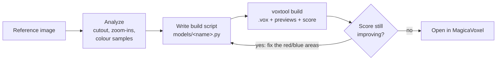

# 2DtoVoxel

**English** | [한국어](README.ko.md)

[](https://github.com/NangManCatDev/2DtoVoxel/actions/workflows/ci.yml) [](LICENSE)

Turn a reference image into a **MagicaVoxel model**. Claude studies the picture, writes a voxel build script, and keeps comparing its build with the reference, using measured scores as well as its eyes, until they match. You get a `.vox` file you can open and keep editing in MagicaVoxel, plus game-ready sprite sheets and meshes if you want them.


## Contents

- [How it works](#how-it-works)
- [Features](#features)
- [Requirements](#requirements)
- [Installation](#installation)
- [Quick start: web UI](#quick-start-web-ui)
- [Using it from a Claude Code chat](#using-it-from-a-claude-code-chat)
- [Measuring the match](#measuring-the-match)
- [Quick conversion without Claude](#quick-conversion-without-claude)
- [Game assets](#game-assets)
- [Command line (voxtool)](#command-line-voxtool)
- [Writing or editing a model script](#writing-or-editing-a-model-script)
- [Tips for good results](#tips-for-good-results)
- [Configuration](#configuration)
- [Security and permissions](#security-and-permissions)
- [Project structure](#project-structure)
- [Development](#development)
- [Platform notes and limitations](#platform-notes-and-limitations)
- [Troubleshooting](#troubleshooting)
- [Acknowledgements](#acknowledgements)
- [License](#license)

## How it works

Claude doesn't click around inside MagicaVoxel. It writes a short Python script that describes the model with a small building DSL (boxes, gable roofs, windows, vines, bushes…), and `voxtool` turns that script into a `.vox` file, preview images, and a score against the reference.



1. **Analyze.** The reference's background is removed (`ref cutout`), then Claude overlays a pixel grid, zooms into each region, and samples the real colours.
2. **Plan the scale.** One element with a known size (usually the door, about 20 voxels tall) sets the scale for everything else, because most references are perspective renders that you can't measure in screen pixels.
3. **Write the script.** Key dimensions become constants at the top of `models/<name>.py`, so fixing a proportion is a one-line change.
4. **Fit the camera.** `fit-camera` finds the azimuth, elevation and field of view at which the model's silhouette best matches the reference.
5. **Build, score, fix.** Every build prints a score (silhouette overlap and colour difference) and draws a diff image: red = missing, blue = extra. Claude fixes the biggest differences first and stops when the score stops improving, usually after 4–6 rounds.

A script instead of hand-placed voxels means the result is exact, reproducible, and easy to change later, either by you or by asking Claude.

## Features

- **Web UI** with a live progress log (commands, the comparison image and score of every build, Claude's replies), in **English and Korean**.
- **Measured comparison**: silhouette IoU, colour difference (CIE ΔE), the worst regions, and a diff image for every build, with a score history per model.
- **Automatic camera fitting**, including a perspective camera, so previews look at the model the way the reference does.
- **Safety net**: every build in a job is snapshotted and can be restored; builds back up `.vox` files you saved from MagicaVoxel; per-job cost and build limits.
- **Quick conversion without Claude**: pixel art or icons → voxels in seconds (flat or rounded), or front/side/top drawings → a carved model.
- **Game assets**: 8-direction sprite sheets with a manifest, OBJ / PLY / GLB meshes, palette variants.
- **MagicaVoxel integration**: open the model, capture the MagicaVoxel window, download the `.vox`. Glowing colours (lanterns) stay emissive.
- **Works from a Claude Code chat too**, through the `/voxelize` skill.
- **No API key**: generation runs through the Claude Code CLI you are already logged in to.

## Requirements

| Item        | Notes                                                                                                                          |
| ----------- | ------------------------------------------------------------------------------------------------------------------------------ |
| OS          | Windows 10/11 (developed and tested end to end). macOS / Linux: see [Platform notes](#platform-notes-and-limitations).         |
| Python      | 3.10 or newer, with `numpy`, `Pillow` and `scipy` (installed by `pip install -e .`)                                            |
| Claude Code | The CLI, installed and logged in. Needed to generate or change models with Claude. Usage counts toward your Claude plan.       |
| MagicaVoxel | 0.99.x. Optional: for opening and editing the results. The UI's 3D tab, conversions and exports work without it.               |
| Browser     | Any modern browser. The 3D tab loads three.js from a CDN, so it needs an internet connection.                                 |

## Installation

```bash
git clone https://github.com/NangManCatDev/2DtoVoxel.git
cd 2DtoVoxel
python -m pip install -e .        # on Windows you can use: py -m pip install -e .
```

This installs the dependencies and a `voxtool` command. Without installing, every command also works as `py -m voxtool …` (Windows) or `python3 -m voxtool …` (macOS / Linux) from the project folder.

- **Claude Code**: install it from [claude.com/claude-code](https://claude.com/claude-code) and log in once. The UI finds `claude` on your `PATH`, or the copy bundled with the Claude Code extension for VS Code (also VS Code Insiders and Cursor).
- **MagicaVoxel**: download it from [ephtracy.github.io](https://ephtracy.github.io/). It is detected automatically in common places (a `MagicaVoxel*` folder on the Desktop, in Downloads, in your home folder, in `C:\Program Files` or under `C:\`; `/Applications` on macOS). Otherwise set `MAGICAVOXEL_EXE`.

## Quick start: web UI

1. **Start it** from the project folder: double-click `2DtoVoxel.bat` (Windows), run `./2dtovoxel.sh` (macOS / Linux), or run `voxtool ui`. Your browser opens **http://127.0.0.1:8765/**.
   - The console window *is* the server. Leave it open while you use the UI; close it or press Ctrl+C to stop.
   - If 8765 is taken, the next free port is used. The console prints the actual address.
2. **Pick a language** in the top-right corner (English / 한국어). Green status chips mean Claude Code and MagicaVoxel were found.
3. **Click "+ New model"**, drag in a reference image, and give the model a name (lowercase letters, digits, `_`). Then choose:
   - **Generate with Claude**: optionally add extra requests, pick a Claude model (Opus is the most detailed, Sonnet faster and cheaper), and set a **max cost** and **max builds**. Takes about 10–30 minutes.
   - **Quick convert (no Claude)**: for pixel art and flat images; set a thickness and optionally "rounded". Takes seconds.
4. **Watch the live log.** Each build appears with its score; you can leave the page and come back.
5. **On the model page** you get tabs for the reference comparison, the score image, all views, an interactive 3D view, camera angles, the camera fit and the script, plus buttons to rebuild, open in MagicaVoxel, capture MagicaVoxel and download the `.vox`.
6. **Request changes** at the bottom of the model page ("make the awning bigger"). You can continue the previous conversation, which skips re-analysis and is usually cheaper.
7. **Game assets** on the model page: sprite sheet, GLB, OBJ, PLY, with download links.

In MagicaVoxel, switch to the **Render** tab to see emissive materials such as lanterns actually glow.

| New model                                      | Model page (score tab)                          | 3D preview                                 |
| ---------------------------------------------- | ----------------------------------------------- | ------------------------------------------ |
|  |       |     |

### Iterations and restore

The job page shows every build of a Claude job as a card with its score image and numbers, with the best one highlighted. **Restore** puts that version of the script back into `models/<name>.py` and rebuilds; the script it replaces is kept in the job folder (`output/_jobs/<id>/iter/`). "Before this job" restores the script as it was before Claude started.

## Using it from a Claude Code chat

Open the project folder in Claude Code and run:

```
/voxelize reference/my_image.png
```

or just ask in plain words, e.g. "make a voxel model of reference/my_image.png". The skill in [.claude/skills/voxelize/SKILL.md](.claude/skills/voxelize/SKILL.md) routes the request (full model, quick conversion, changes, game assets) and walks Claude through analyze → script → build → score. Project conventions and lessons learned live in [CLAUDE.md](CLAUDE.md).

To use `/voxelize` in other folders too, run `voxtool install-skill` (copies it to `~/.claude/skills/`).

## Measuring the match

```bash
voxtool build models/player_house.py          # also scores when the script has a REFERENCE
voxtool score models/player_house.py          # score only, as JSON
voxtool fit-camera models/player_house.py     # best VIEW (azimuth, elevation, fov) + overlay image
```

- **IoU** (0–1): how much the model's silhouette overlaps the reference's, after scaling and moving it so the areas and centres match. 1 is a perfect match.
- **ΔE**: average colour difference (CIE76) where both overlap. Lower is better; lighting differences keep it above zero.
- **worst**: the 3×3 regions with the most missing (red) or extra (blue) area, e.g. `top-right missing 19%`.


The score is an observation, not the goal: a perspective reference and an orthographic preview can't match perfectly. Use the score to find what to fix, and the images to decide how.

## Quick conversion without Claude

```bash
voxtool extrude reference/mushroom.png --name mushroom --depth 3            # flat slab
voxtool extrude reference/mushroom.png --name mushroom --depth 4 --inflate  # rounded
voxtool carve --front f.png --side s.png --top t.png --name vase --height 64
```

- `extrude` detects the pixel size of upscaled pixel art automatically, removes the background, and keeps the original colours.
- `carve` intersects the silhouettes of up to three orthographic drawings (front; side seen from the left; top with the front at the bottom) and colours each surface voxel from the view that sees it best.
- Both write `models/<name>.base.vox` and a script `models/<name>.py` that loads it, so you (or "Request changes") can add details with the DSL.


## Game assets

```bash
voxtool sprites models/player_house.py --dirs 8 --scale 4      # sprite sheet + manifest.json
voxtool export models/player_house.py --format glb             # or obj / ply
voxtool recolor models/player_house.py --swap roof=#a33b2b roof_hi=#c24a36 --label red_roof
voxtool recolor models/player_house.py --hue 120,240 --only roof,roof_hi,roof_dk
```

- **Sprites**: crisp pixels on a transparent background, every frame the same size with the model's ground centre at the same anchor, so switching directions in a game doesn't make it jump. `manifest.json` lists each frame's rectangle, direction and azimuth.
- **Meshes**: faces of one colour are merged into large rectangles (greedy meshing). Y is up, the model stands on y = 0 centred on x/z with its front towards +Z, and one voxel is 0.1 units by default (`--scale`). GLB uses vertex colours, glowing colours become emissive materials; OBJ comes with a `.mtl` and a palette texture.
- **Variants**: swap named palette colours or rotate hues; glowing colours are left alone.

Outputs go to `output/<name>/sprites/`, `export/` and `variants/`.


## Command line (voxtool)

Run from the project folder. `voxtool` works after `pip install -e .`; otherwise use `py -m voxtool` (Windows) or `python3 -m voxtool`.

| Command                                                   | What it does                                                                                 |
| --------------------------------------------------------- | -------------------------------------------------------------------------------------------- |
| `voxtool build models/<name>.py [--open] [--no-score]`    | Builds into `output/<name>/` (`.vox`, previews, comparison, score). `--open` opens MagicaVoxel. |
| `voxtool score models/<name>.py`                          | Scores against `REFERENCE` and prints JSON                                                    |
| `voxtool fit-camera models/<name>.py [--fovs 0,25,45]`    | Finds the best `VIEW` and writes `_fit.png`                                                   |
| `voxtool angles models/<name>.py 30,20 42,15,30`          | Renders `az,el[,fov]` cameras next to the reference → `_angles.png`                           |
| `voxtool render <file.vox> [--az 30 --el 30 --fov 0]`     | Preview sheet for any `.vox`, including MagicaVoxel's own                                    |
| `voxtool open <file.vox>` / `voxtool shot`                | Opens a file in MagicaVoxel / captures its window (Windows)                                  |
| `voxtool ref grid\|crop\|sample\|palette\|cutout `     | Reference study tools (pixel grid, zoomed crop, colour at points, dominant colours, cutout)   |
| `voxtool compare <a.png> <b.png> ...`                     | Side-by-side image                                                                           |
| `voxtool extrude  --name N [--depth 4 --inflate]`    | Image / pixel art → voxels, no Claude                                                        |
| `voxtool carve --front f [--side s --top t] --name N`     | Silhouettes → voxels, no Claude                                                              |
| `voxtool sprites <script\|vox> [--dirs 8 --scale 4]`       | Sprite sheet + `manifest.json`                                                               |
| `voxtool export <script\|vox> --format glb\|obj\|ply`       | Mesh export                                                                                  |
| `voxtool recolor <script\|vox> --swap n=#hex \| --hue 30`   | Palette variants                                                                             |
| `voxtool ui [--port 8765] [--no-browser]`                 | Starts the web UI                                                                            |
| `voxtool install-skill [--dest ~/.claude/skills]`         | Makes `/voxelize` available in every project                                                 |

## Writing or editing a model script

Every model is a Python file in `models/` with:

- `NAME`: output folder and file name.
- `REFERENCE` (optional): path to the reference image; enables the comparison and the score.
- `VIEW` (optional): preview camera, e.g. `{"azimuth": 36, "elevation": 18, "fov": 0}`. Azimuth 0 looks straight at the front, 90 at the left side; `fov` > 0 is a perspective camera.
- `SCORE_VIEW` (optional): camera used for scoring if it differs from `VIEW` (conversions score from the front).
- `CUTOUT` (optional): background-removal settings, e.g. `{"keep": "all"}` for a sheet with several objects.
- `build()`: returns a `Model`.

**Coordinates.** `x` goes right, `y` goes into the scene (**`y = 0` is the front**, the side MagicaVoxel's default camera looks at), and `z` goes up. Boxes are given as position + size: `box(x, y, z, w, d, h, color)` fills `x … x+w-1` and so on. Anything outside the grid is clipped. A `region=` argument is always `(x, y, z, w, d, h)`. Each saved object can be at most 256 voxels per axis, with up to 255 colours.

```python
from voxtool import Model

NAME = "tiny_hut"
VIEW = {"azimuth": 36, "elevation": 20}


def build() -> Model:
    m = Model(40, 34, 32, seed=1)                  # grid size: x (width), y (depth), z (height)
    m.pal.add("wall", "#dcc3a0"); m.pal.add("wall2", "#d2b893")
    m.pal.add("roof", "#0b8691"); m.pal.add("roof_hi", "#1ba3ad")
    m.pal.add("door", "#8c2b22"); m.pal.add("glass", "#8a8094")
    m.pal.add("lamp", "#ffd84a", emit=4)            # glows in MagicaVoxel's Render tab
    m.pal.add("leaf", "#2c5a19"); m.pal.add("leaf2", "#3d7524")

    m.shell(6, 8, 0, 28, 18, 16, "wall", t=2, top=False)          # walls, y=8 is the front face
    m.bricks(["wall", "wall2"], target="wall", bw=6, bh=3)       # stone-block texture
    roof = (4, 6, 16, 32, 22)                                     # footprint x, y, z, w, d
    m.gable_wall(*roof, "x", "wall", region=(6, 8, 28, 18))       # gable ends under the roof
    m.gable_roof(*roof, "x", ["roof_hi", "roof"], t=2)            # ridge along x, striped planks
    m.box(17, 8, 0, 6, 2, 10, "door")                             # door, 2 deep
    m.box(9, 8, 6, 5, 1, 5, "glass"); m.box(26, 8, 6, 5, 1, 5, "glass")
    m.box(15, 7, 9, 1, 1, 2, "lamp")                              # lamp in front of the wall
    m.blob(10, 5, 2, 3.5, 2.5, 2.5, ["leaf", "leaf2"])            # bushes
    m.blob(30, 5, 2, 3.5, 2.5, 2.5, ["leaf", "leaf2"])
    return m
```

Save it as `models/tiny_hut.py` and run `voxtool build models/tiny_hut.py --open`:


For a full, real example (quoins, crow-stepped parapet, awning, lanterns, planters, vines) see [models/player_house.py](models/player_house.py).

### DSL reference

All methods live on `Model` ([voxtool/model.py](voxtool/model.py)). `c` is a palette name, a palette index, or `None` (carve).

| Group              | Method                                                                     | Purpose                                                                                    |
| ------------------ | -------------------------------------------------------------------------- | ------------------------------------------------------------------------------------------ |
| Palette            | `m.pal.add(name, hex, emit=0, glass=0, metal=0, rough=0.5)`                | Register a named colour; `emit` glows, `glass` is transparent, `metal` metallic            |
|                    | `m.pal.ramp(name, [hex, ...])`                                             | Register `name0`, `name1`, … shade variants                                                |
| Primitives         | `box(x, y, z, w, d, h, c, only_empty=False, only_filled=False)`            | Solid box (`c=None` carves)                                                                |
|                    | `carve(x, y, z, w, d, h)`                                                  | Empty a box                                                                                |
|                    | `shell(x, y, z, w, d, h, c, t=1, top=True, bottom=True)`                   | Hollow box with wall thickness `t`                                                         |
|                    | `set(x, y, z, c)` / `get(x, y, z)`                                         | Single voxel                                                                               |
|                    | `line(p0, p1, c, r=0)`                                                     | 3D line; `r` gives it a cube brush                                                         |
|                    | `ellipsoid(cx, cy, cz, rx, ry, rz, c)`                                     | Ellipsoid                                                                                  |
|                    | `cylinder(cx, cy, z, r, h, c, axis="z")`                                   | Cylinder along z, x or y                                                                   |
|                    | `where(x, y, z, w, d, h, fn, c)`                                           | Fill where `fn(X, Y, Z)` (vectorized numpy) is true — any shape                            |
|                    | `paint_fn(x, y, z, w, d, h, fn)`                                           | Recolour per voxel; `fn` returns palette indices                                           |
| Architecture       | `gable_roof(x, y, z, w, d, ridge, c, slope=1.0, t=2, fill=None)`           | Gable roof; a colour list alternates per course (planks / shingles)                        |
|                    | `gable_wall(x, y, z, w, d, ridge, c, slope=1.0, region=None)`              | Infill that meets that roof exactly (gable ends, attic)                                    |
|                    | `shed_roof(x, y, z, w, d, down, c, slope=0.5, t=2)`                        | Lean-to roof / porch awning                                                                |
|                    | `stairs(x, y, z, w, steps, c, rise=1, run=2, direction="-y")`              | Straight stairs                                                                            |
| Texture & organic  | `bricks(colors, target, bw=6, bh=3, mortar=None, p=None, region=None)`     | Running-bond stone / brick pattern on existing voxels                                      |
|                    | `vary(colors, target, p=None, region=None)`                                | Random recolour to break up flat surfaces                                                  |
|                    | `blob(cx, cy, cz, rx, ry, rz, colors, noise=0.35, density=1.0)`            | Noisy ellipsoid: bushes, foliage, rocks                                                    |
|                    | `vine(x, y, z, length, colors, wall="-y", drift=0.35, leaf=0.6, spread=1)` | Vine hanging down a wall                                                                   |
|                    | `sprinkle(colors, prob, target, region=None)`                              | Recolour random surface voxels (flowers in a bush)                                         |
|                    | `scatter_on_top(region, colors, prob, target=None)`                        | Place voxels on top of exposed surfaces                                                    |
| Objects & files    | `with m.part(name): ...`                                                   | Voxels drawn inside become a separate object in the `.vox` (kit sheets)                    |
|                    | `Model.from_vox(path)` / `m.paste_vox(path, x, y, z)`                      | Start from / paste in an existing `.vox` (a conversion, or a MagicaVoxel edit)              |
| Transform & output | `mirror_x(x0, x1)` / `copy(x, y, z, w, d, h, dx, dy, dz)`                  | Mirror or duplicate a region                                                               |
|                    | `stats()` / `save(path)`                                                   | Summary (voxel count per colour) / write a `.vox` (backs up a MagicaVoxel-saved file first) |

## Tips for good results

- **Use a clear reference**: one object, a 3/4 view, an even background. Check `voxtool ref cutout` once; the score is only as good as the cutout.
- **Say what matters** in "Extra requests": a size limit, details that must be kept, or parts that can be simplified.
- **Set limits** for long runs: a max cost and max builds per job.
- **Change one thing at a time** with "Request changes". Short, concrete requests ("lower the porch roof by 3 voxels") work better than long lists.
- **Start simple images with Quick convert**, then refine with Claude; it is faster and cheaper than generating from scratch.
- **Keep manual edits in a separate file** (MagicaVoxel *Save As*); see [Platform notes](#platform-notes-and-limitations).

## Configuration

| Setting                  | How                                                                      |
| ------------------------ | ------------------------------------------------------------------------ |
| Claude Code CLI location | Environment variable `CLAUDE_CLI` = full path to the `claude` executable |
| MagicaVoxel location     | Environment variable `MAGICAVOXEL_EXE` = full path to `MagicaVoxel.exe` (or the `.app` on macOS) |
| Port                     | `voxtool ui --port 9000` (falls back to the next free port)              |
| Don't open a browser     | `voxtool ui --no-browser`                                                |
| UI language              | Picker in the top-right corner; defaults to your browser's language      |
| Per-job limits           | "Max cost (USD)" and "Max builds" fields in the UI                       |

## Security and permissions

- The server listens on **127.0.0.1 only**; every request that changes something needs a random per-launch token embedded in the page, and the `Host` header must be local.
- Each Claude job runs headless with `--permission-mode dontAsk` and a narrow allow-list: it may only create or edit that model's script and files under `output/`, and run only voxtool commands for that model (plus `ref`, `render`, `compare`, `ls`). The shared library, `CLAUDE.md`, `.claude/` and other models are off-limits, and arbitrary code (`python -c`) is refused.
- Claude reads your reference images; only use images you trust.

Details: [SECURITY.md](SECURITY.md).

## Project structure

```
2DtoVoxel/
├─ 2DtoVoxel.bat / 2dtovoxel.sh   launchers for the web UI (Windows / macOS, Linux)
├─ reference/                     input images
├─ models/                        one build script per model (+ <name>.base.vox for conversions)
├─ voxtool/                       library + CLI (`voxtool`)
│  ├─ vox_io.py                   .vox reader/writer, MagicaVoxel-edit backups
│  ├─ model.py                    building DSL (Model, Palette)
│  ├─ render.py                   Camera (orthographic / perspective), previews
│  ├─ reftools.py                 reference study tools, background cutout
│  ├─ score.py                    measured comparison, camera fitting
│  ├─ convert.py                  extrude / carve (no Claude)
│  ├─ export.py                   meshes, sprite sheets, palette variants
│  ├─ __main__.py                 the CLI
│  └─ ui/                         web UI (server.py, jobs.py, i18n.py, static/)
├─ tests/                         pytest suite (runs the CLI and the server in temp workspaces)
├─ output/                        generated files (git-ignored; rebuilt on demand)
├─ docs/images/                   images used in this README
├─ .claude/skills/voxelize/       the /voxelize skill
├─ .github/workflows/ci.yml       tests on Windows + Ubuntu, Python 3.10 / 3.12
├─ CLAUDE.md, CHANGELOG.md, SECURITY.md
└─ pyproject.toml, requirements.txt
```

## Development

```bash
python -m pip install -e ".[dev]"
python -m pytest -q
```

The tests build models, score them, convert, export, run the CLI and start the real UI server in temporary workspaces. CI runs them on Windows and Ubuntu with Python 3.10 and 3.12. Changes are listed in [CHANGELOG.md](CHANGELOG.md).

## Platform notes and limitations

- **Windows** is where the whole flow (UI, Claude jobs, MagicaVoxel open and capture) has been used. **macOS / Linux**: the CLI and tests run (CI covers Ubuntu), the UI starts Claude jobs with `python3 -m voxtool`, and MagicaVoxel is opened with `open -a` on macOS; window capture (`shot`) is Windows-only, and the full Claude flow there has not been tried by the author yet.
- **"Rebuild" and Claude's changes regenerate the `.vox` from the script.** If the existing file was saved from MagicaVoxel (so it may hold hand edits), it is first copied to `output/<name>/<name>_edited_<time>.vox`, and the model page lists these backups. Hand edits are not carried into the rebuilt model, so to keep working on them, use *Save As* in MagicaVoxel, or start a script from it with `Model.from_vox`.
- Each saved object is limited to 256 voxels per axis and 255 colours (MagicaVoxel's limits); use `m.part()` for bigger scenes.
- Results differ from run to run. Generation takes about 10–30 minutes; the cost depends on the Claude model and your plan.

## Troubleshooting

| Symptom                                    | What to do                                                                                                   |
| ------------------------------------------ | ------------------------------------------------------------------------------------------------------------ |
| "Claude Code" chip is red                  | The CLI wasn't found. Install Claude Code and log in, or set `CLAUDE_CLI`, then restart the UI.              |
| "MagicaVoxel" chip is red                  | Set `MAGICAVOXEL_EXE`, then restart the UI. Everything except open / capture still works.                     |
| The browser didn't open                    | Open the address printed in the console window yourself.                                                     |
| The 3D tab shows an error                  | It needs internet access to load three.js from the CDN. The other tabs work offline.                         |
| The score looks wrong                      | Check `voxtool ref cutout `; for a sheet with several objects set `CUTOUT = {"keep": "all"}`.           |
| "Capture MagicaVoxel" fails                | MagicaVoxel must be running (Windows only). Open the model in it first.                                       |
| A job failed or stopped                    | Open it from "Recent jobs" and read the red entries; use **Restore** on a good build, then retry.            |
| The UI looks old after updating the code   | Close the console window, start the UI again, and reload the page.                                           |
| "models/<name>.py already exists"          | Pick another name, or open that model and use "Request changes".                                             |

## Acknowledgements

- [MagicaVoxel](https://ephtracy.github.io/) by ephtracy, and the [.vox file format](https://github.com/ephtracy/voxel-model) documentation.
- [three.js](https://threejs.org/) for the 3D preview.
- Ideas for measured QA gates, run snapshots and game-asset outputs were inspired by [aldegad/sprite-gen](https://github.com/aldegad/sprite-gen).
- Built with [Claude Code](https://claude.com/claude-code).

## License

[MIT](LICENSE) © NangManCatDev. The reference images in `reference/` and the images in `docs/images/` are part of the project and may be used under the same license.
