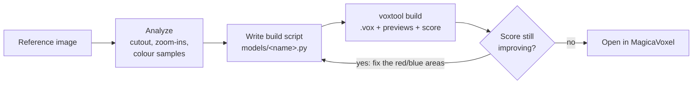

# 2DtoVoxel

**English** · [한국어](README.ko.md)

**2DtoVoxel turns a picture of one object (concept art, a 3D render, a game screenshot, pixel art) into a voxel model for [MagicaVoxel][magicavoxel] (a `.vox` file).** [Claude Code][claude-code] looks at the picture and writes the model as a short Python build script. The included `voxtool` library turns that script into a `.vox` file, renders previews, and measures how closely the result matches the picture. Claude then reads the measurements, fixes the script, and builds again until the match stops improving. You get the `.vox` file and the script. You can open the `.vox` and keep editing it in MagicaVoxel, and you or Claude can change the script later.

It also does things that don't need Claude: it converts pixel art into voxels in seconds, carves a model from front, side and top drawings, and exports game assets (sprite sheets, GLB / OBJ / PLY meshes, palette variants).

[![License: MIT][license-badge]][license] [![Tests][ci-badge]][ci] [![Python 3.10+][python-badge]][python] [![Output: MagicaVoxel .vox][vox-badge]][magicavoxel]


## At a glance

| | |
|---|---|
| **What it is** | An image-to-voxel tool. Claude Code writes the model as code, and the code is scored against your picture. |
| **Input** | One picture of one object (PNG / JPG / WEBP). Pictures of other sides are optional and get scored too. |
| **Output** | A MagicaVoxel `.vox` file, the Python build script that produces it, preview images and a score. Optional: sprite sheets, GLB / OBJ / PLY meshes, recoloured variants. |
| **How the AI part works** | Claude runs in Claude Code with a narrow allow-list. It analyses the picture, writes `models/<name>.py`, builds it with `voxtool`, reads the score and the difference images, and repeats, usually 4–6 times. |
| **Without the AI** | `voxtool extrude` (pixel art → voxels), `voxtool carve` (front / side / top silhouettes → voxels), exports, and all the preview and scoring tools work without Claude. |
| **Ways to use it** | A local web UI (English / Korean), the `/voxelize` skill inside Claude Code, or the `voxtool` command line. |
| **Requirements** | Python 3.10+ with numpy, Pillow and scipy. Claude Code (logged in) to generate models. MagicaVoxel is optional, for opening the results. |
| **Cost and time** | Generation takes about 10–30 minutes. It uses your Claude Code login, so usage counts toward your Claude plan. One real run cost $4.65 ([details](#a-real-generation-run)). There is no separate API key. |
| **Platforms** | Windows 10/11 is tested end to end. The CLI and the tests also run on macOS and Linux (CI: Windows and Ubuntu). |
| **License** | MIT |

## Contents

- [Gallery](#gallery)
- [How it works](#how-it-works)
- [Install](#install)
- [Quick start](#quick-start)
- [The web UI](#the-web-ui)
- [Using it from a Claude Code chat](#using-it-from-a-claude-code-chat)
- [The score and the other checks](#the-score-and-the-other-checks)
- [A real generation run](#a-real-generation-run)
- [Model scripts](#model-scripts)
- [Conversions without Claude](#conversions-without-claude)
- [Game assets](#game-assets)
- [Command-line reference](#command-line-reference)
- [Output files](#output-files)
- [Tips for good results](#tips-for-good-results)
- [Limitations](#limitations)
- [Troubleshooting](#troubleshooting)
- [Security](#security)
- [Project layout](#project-layout)
- [Development](#development)
- [Further documentation](#further-documentation)
- [License and acknowledgements](#license-and-acknowledgements)

## Gallery

These models were made with 2DtoVoxel from pictures in [`reference/`](reference/). Each row shows the reference, the build from the reference's camera, and the same build turned 90° and 180°. A single picture doesn't show those sides, so Claude infers them, and the [four-side check](#what-the-score-cant-see) catches them when they come out flat.


| Row | Model | IoU | ΔE |
|---|---|---|---|
| 1 | Stone cottage | 0.973 | 10.3 |
| 2 | Courthouse | 0.965 | 14.2 |
| 3 | Bell tower with an annex | 0.966 | 10.6 |
| 4 | Street lamp | 0.910 | 6.6 |
| 5 | Five tall trees (one object each) | 0.911 | 10.3 |
| 6 | Bench, barrel and two posts (one object each) | 0.947 | 9.6 |

IoU is how much the silhouettes overlap (1 = perfect). ΔE is the average colour difference (lower is better). Both are measured from the reference's side; see [the score](#the-score-and-the-other-checks).

## How it works

Claude never clicks around in MagicaVoxel. Everything goes through a script and the `voxtool` command line:



1. **Analyze the picture.** `voxtool ref cutout` removes the background. Claude overlays a pixel grid, zooms into each region, samples the real colours and lists the parts (walls, roof, openings, decorations, lights, plants…).
2. **Choose a scale.** One element of known size sets the scale for everything else. On a house that's usually the door, about 20 voxels tall. Most references are perspective renders, so screen pixels can't be measured directly.
3. **Write the build script.** `models/<name>.py` describes the model with a small Python DSL: boxes, hollow shells, gable roofs, stairs, brick textures, vines, trees and more. Key sizes are constants at the top, so changing a proportion is a one-line edit.
4. **Fit the camera.** `voxtool fit-camera` searches azimuth, elevation and field of view for the camera whose silhouette best matches the picture, so later comparisons are like for like.
5. **Build, measure, fix.** `voxtool build` writes the `.vox` and previews. It also scores the build against the picture and draws a difference image (red = missing, blue = extra). Claude fixes the biggest differences first and stops when the score hasn't improved for two builds in a row.
6. **Check what the score can't see.** The score only looks from the reference's direction. Each build therefore also renders the model from four sides and reports objects that are flat from the side or have floating pieces ([details](#what-the-score-cant-see)).
7. **Optional high-resolution finish.** Once the shape is right, the same script can be built 2–3× finer, and the voxels the picture shows can be painted with the picture's own pixels.

Why a script instead of placing voxels directly: the result is exact and reproducible, and it is easy to change. "Make the awning bigger" becomes an edit to one or two numbers, not a re-generation.

## Install

| Requirement | Needed for | Notes |
|---|---|---|
| Python 3.10 or newer | everything | `numpy`, `Pillow` and `scipy` are installed with the package |
| [Claude Code][claude-code], installed and logged in | generating and changing models | Usage counts toward your Claude plan. The UI finds `claude` on your `PATH` or inside the Claude Code extension for VS Code / VS Code Insiders / Cursor; otherwise set `CLAUDE_CLI` |
| [MagicaVoxel][magicavoxel] 0.99.x | opening and editing results (optional) | Found automatically on the Desktop, in Downloads, in your home folder, in `C:\Program Files`, under `C:\`, or in `/Applications` on macOS; otherwise set `MAGICAVOXEL_EXE` |
| Internet connection | the 3D tab of the web UI only | It loads three.js from a CDN. Everything else works offline (Claude itself needs its usual connection) |

```bash
git clone https://github.com/NangManCatDev/2DtoVoxel.git
cd 2DtoVoxel
python -m pip install -e .
```

This installs the dependencies and a `voxtool` command. Without installing, every command also works from the project folder as `py -m voxtool …` on Windows or `python3 -m voxtool …` on macOS / Linux. Run commands from the project folder: models, references and outputs are looked up relative to it.

## Quick start

### 1. Generate a model with the web UI (needs Claude Code)

```bash
voxtool ui
```

On Windows you can also double-click `2DtoVoxel.bat`; on macOS / Linux run `./2dtovoxel.sh`. Your browser opens at `http://127.0.0.1:8765`. Click **+ New model**, drop in a picture, give it a name and press **Start generating**. After 10–30 minutes the model appears in the sidebar, ready to view in 3D, download, or open in MagicaVoxel.

### 2. Ask Claude Code directly

In Claude Code, opened in this folder:

```text
/voxelize reference/my_picture.png
```

or just write "make a voxel model of reference/my_picture.png". Claude follows the same steps as the UI job and reports the file, the final score and what it simplified. `voxtool install-skill` copies the skill to `~/.claude/skills` so `/voxelize` works in other projects too.

### 3. Convert pixel art without Claude

```bash
voxtool extrude path/to/sprite.png --name my_sprite --inflate
```

This writes `models/my_sprite.py` (plus `models/my_sprite.base.vox`) and builds it into `output/my_sprite/my_sprite.vox` in a few seconds.

## The web UI

Start it with `voxtool ui` (options: `--port 9000`, `--no-browser`), `2DtoVoxel.bat` or `./2dtovoxel.sh`. The console window that opens is the server; close it to stop the UI. If port 8765 is taken, the next free port is used and printed in the console. The language picker is in the top-right corner (English / Korean; it defaults to your browser's language).

The sidebar lists your models and recent jobs. Two status chips in the top-right corner show whether Claude Code and MagicaVoxel were found. A red chip means the tool wasn't found: set `CLAUDE_CLI` or `MAGICAVOXEL_EXE` and restart.

| New model | Model page (score tab) | 3D preview |
|---|---|---|
|  |  |  |

### Creating a model

**+ New model** opens a form:

1. **Reference image.** Drag a PNG, JPG or WEBP onto the box, or click to choose one. It is saved to `reference/`.
2. **Model name.** Lowercase letters, digits and `_`. It becomes the file name (`models/<name>.py`, `output/<name>/`).
3. **Mode.**
   - **Generate with Claude** analyses the picture and writes a detailed model script (10–30 minutes).
   - **Quick convert (no Claude)** turns pixel art or a flat image into a voxel slab in seconds. It has two options: **Thickness (voxels)**, and **Rounded**, which makes the slab thicker in the middle. You can refine the result with Claude later.
4. **Extra requests** (optional, Claude mode), for example "keep it under 80 voxels wide, add windows on the back, warm orange lights".
5. **Claude model.** **Opus** (most detailed; preselected), **Sonnet** (faster, cheaper), or **Default**, which uses your Claude Code setting. With Default, the job stops right away if that setting turns out to be Haiku, because its scripts weren't usable.
6. **Max cost (USD)** and **Max builds** (optional). These are hard limits per job: the cost limit is passed to Claude Code, and a job that goes two builds past its build limit is stopped.

### Following a job

The job page shows a live log: Claude's messages, every command it runs, and the images it looks at. Each build becomes a card with its score and comparison image, and a chart shows the score per build. The best build is highlighted. When the job has finished, **Restore** on any card puts that version of the script back and rebuilds it. The current script is kept in the job folder first. **Stop job** cancels a running job.


### The model page

The model page shows the size, voxel count, colour count, the file and the reference, plus the score history. These tabs appear when the matching file exists:

| Tab | What it shows |
|---|---|
| **Reference comparison** | The reference next to the build |
| **Score** | The difference image: red = in the reference but missing from the build, blue = extra in the build, green → orange inside = colour difference. One row per reference picture |
| **Close-up** | The area with the largest difference at the reference's full resolution: reference, build, difference |
| **All views** | 3/4 view, front, back, left, right, top, and the opposite 3/4 view |
| **All sides** | The model a quarter turn apart, starting at the reference's side |
| **3D** | An interactive viewer (drag to rotate, wheel to zoom, right-drag to pan; front / left / back / top presets) |
| **Camera angles** | Renders at the camera angles Claude tried |
| **Camera fit** | The result of `fit-camera` |
| **Script** | The build script, with a link to open it in VS Code |

The buttons are **Rebuild**, **Open in MagicaVoxel**, **Capture MagicaVoxel** (Windows; it saves what MagicaVoxel is showing, to confirm the file loaded) and **Download .vox**. In MagicaVoxel, switch to the **Render** tab to see lanterns and other glowing colours light up.

- **Request changes**: describe the change in plain words ("make the awning bigger", "add a chimney on the right"). Claude edits the script and rebuilds. Tick **Continue the previous conversation** to reuse the earlier session. It skips the re-analysis and is usually cheaper. The same model, cost and build limits are available.
- **Game assets**: export a sprite sheet (8 directions, transparent, with `manifest.json`) or a GLB / OBJ / PLY mesh. Exported files are listed on the page.
- **Backups**: if the `.vox` had been saved from MagicaVoxel (so it may hold hand edits), a rebuild first copies it to `<name>_edited_<time>.vox`. The model page lists these copies.

### Deleting and the trash

Hover a model in the sidebar and click the bin icon. The confirmation lists what will be moved and warns about other models that use this one, MagicaVoxel edits and running jobs. The script, the base `.vox` (if any) and the output folder move to `output/_trash/<name>_<time>/`. The reference image stays. **Trash**, below the model list, restores a deleted model, which is refused if the name is taken again. **Delete forever** and **Empty trash** are the only actions in the UI that erase files.

## Using it from a Claude Code chat

The repository contains a Claude Code skill, [`.claude/skills/voxelize/SKILL.md`](.claude/skills/voxelize/SKILL.md), and project instructions in [`CLAUDE.md`](CLAUDE.md). With Claude Code open in this folder, `/voxelize <image>` (or a plain request) runs the full workflow:

1. study the picture (`ref cutout`, `ref grid`, `ref crop`, `ref palette`, `ref sample`);
2. write `models/<slug>.py` and fit the camera;
3. build, read the score and images, and fix, usually 4–6 rounds;
4. optionally finish at higher resolution and paint colours from the picture;
5. open the result in MagicaVoxel and capture the window to confirm it loaded (Windows).

The skill also covers the no-Claude paths (extrude, carve) and game-asset exports, so "make a sprite sheet of this model" works too. It is written in Korean, but Claude follows it in any language.

## The score and the other checks

Every build of a script that has a `REFERENCE` prints a line like:

```text
score: iou=0.940 dE=17.7 worst: top-right missing 19%, bottom extra 7%
```

- **IoU** (0–1): how much the model's silhouette overlaps the reference's once size and position are matched. 1 is perfect.
- **ΔE**: the average colour difference where they overlap (CIE76 on slightly blurred images). Lower is better; lighting differences keep it above zero even for a perfect shape.
- **worst**: up to three areas (of a 3 × 3 grid over the reference) with the most missing (red) or extra (blue) shape.


How it is measured: the reference's background is removed, the object is scaled to 320 px tall, and the build is rendered from `VIEW` (or `SCORE_VIEW`) with a transparent background. The render is then scaled so the two silhouette areas are equal and moved so their centroids coincide, so the model's absolute size doesn't matter, only its shape and colours. The history of every build is kept in `output/<name>/<name>_scores.jsonl`.

The score is an observation, not the goal. A perspective reference and an orthographic preview can never match perfectly. If sticking something out to raise the score would hide the door or windows, keeping the important visible parts is the better choice.

### What the score can't see

A score from one direction can't tell a round tree crown from a board facing the camera, and it can't see a roof floating one voxel above its walls. This happened: UI jobs once filled tree outlines with a single layer of voxels. They scored IoU 0.914 and were flat from every other side. So each build also reports:

| Output | Meaning |
|---|---|
| `_turn.png` | The model from four sides, a quarter turn apart, starting at the reference's side |
| `depth: 0.85` | Per object, the median over horizontal slices of (front-to-back depth ÷ width), seen from the reference's direction. Under 0.5 it is marked `(thin)`. A house or a round crown is around 0.7–1, a board facing the camera near 0.1. Signs, fences and wall panels are thin on purpose |
| `loose: 2 pieces, 41 voxels (size at centre: …)` | Pieces of an object that touch nothing else of it (touching by a face, edge or corner counts; each `part()` is its own object), with their size and centre in design units. Specks left by carving, leaves detached from a trunk, or a floating roof show up here. `m.remove_loose()` deletes small ones |
| `_zoom_<region>.png` | A full-resolution close-up of the area with the largest difference, written when that area is more than 8 % off |

UI job prompts and the `/voxelize` skill tell Claude to look at these and fix them, unless the object really is flat or floating.

### More than one picture

If you have pictures of other sides, list them in the script with the camera each one shows the object from:

```python
REFERENCE = "reference/knight_front.png"
VIEW = {"azimuth": 0, "elevation": 0}
EXTRA_REFERENCES = [
    ("reference/knight_side.png", {"azimuth": 90, "elevation": 0}),
    ("reference/knight_back.png", {"azimuth": 180, "elevation": 0}),
]
```

Every build then scores each picture separately (`score knight_side.png: iou=…`), adds a row per picture to `_score.png`, and prints the mean over all views. For orthographic drawings the cameras are: front 0, left 90, back 180, right 270, and `"elevation": 90` for a top view. For renders or photos, `voxtool fit-camera models/<name>.py --ref 1` finds the camera of the first extra picture. `voxtool carve` adds its side and top drawings to this list itself. Sides you have pictures of are then measured, not guessed.

## A real generation run

An actual run on the player-house reference, with Opus, limits of $6 and 8 builds, and the extra request "Keep it under 110 voxels on every axis":

| Time | Cost | Builds | Score |
|---|---|---|---|
| 16.6 min, 102 turns | $4.65 | 8 (the limit) | IoU 0.934 → 0.940 (best 0.943 at build 5), ΔE 20.0 → 17.7 |

Scores don't only go up: build 4 got worse and build 5 recovered. The job page highlights the best build, and **Restore** puts it back.


## Model scripts

Every model is a Python file in `models/`. The `.vox` is always rebuilt from the script, so the script is the source of truth. Claude writes and edits these files, and you can too.

### What a script contains

| Name | Required | Meaning |
|---|---|---|
| `NAME` | yes | Output folder and file name |
| `build()` | yes | Returns a `Model` |
| `REFERENCE` | no | Path to the reference picture. It enables the comparison image and the score |
| `VIEW` | no | Preview camera, e.g. `{"azimuth": 36, "elevation": 18, "fov": 0}`. Azimuth 0 looks straight at the front, 90 at the left side. `fov` > 0 is a perspective camera |
| `SCORE_VIEW` | no | Camera used for scoring if it differs from `VIEW` (conversions score from the front) |
| `CUTOUT` | no | Background-removal settings, e.g. `{"keep": "all"}` for a sheet with several objects |
| `EXTRA_REFERENCES` | no | More pictures of the same object, each as `(path, view)` or `(path, view, cutout)`; [see above](#more-than-one-picture) |
| `RES` | no | Voxels per design unit, used as `Model(..., res=RES)`. `voxtool build --res N` overrides it for one build |

### Coordinates

`x` goes right, `y` goes into the scene (**`y = 0` is the front**, the side MagicaVoxel's default camera looks at) and `z` goes up. Boxes are position + size: `box(x, y, z, w, d, h, color)` fills `x … x+w-1` and so on, and anything outside the grid is clipped. A `region=` argument is always `(x, y, z, w, d, h)`, with z third. Colours are registered by name and used by name, up to 255. A colour with `emit` > 0 glows in MagicaVoxel's renderer.

### Example

```python
from voxtool import Model

NAME = "tiny_hut"
VIEW = {"azimuth": 36, "elevation": 20}


def build() -> Model:
    m = Model(40, 34, 32, seed=1)                  # grid size: x (width), y (depth), z (height)
    m.pal.add("wall", "#dcc3a0"); m.pal.add("wall2", "#d2b893")
    m.pal.add("roof", "#0b8691"); m.pal.add("roof_hi", "#1ba3ad")
    m.pal.add("door", "#8c2b22"); m.pal.add("glass", "#8a8094")
    m.pal.add("lamp", "#ffd84a", emit=4)            # glows in MagicaVoxel's Render tab
    m.pal.add("leaf", "#2c5a19"); m.pal.add("leaf2", "#3d7524")

    m.shell(6, 8, 0, 28, 18, 16, "wall", t=2, top=False)          # walls, y=8 is the front face
    m.bricks(["wall", "wall2"], target="wall", bw=6, bh=3)       # stone-block texture
    roof = (4, 6, 16, 32, 22)                                     # footprint x, y, z, w, d
    m.gable_wall(*roof, "x", "wall", region=(6, 8, 28, 18))       # gable ends under the roof
    m.gable_roof(*roof, "x", ["roof_hi", "roof"], t=2)            # ridge along x, striped planks
    m.box(17, 8, 0, 6, 2, 10, "door")                             # door, 2 deep
    m.box(9, 8, 6, 5, 1, 5, "glass"); m.box(26, 8, 6, 5, 1, 5, "glass")
    m.box(15, 7, 9, 1, 1, 2, "lamp")                              # lamp in front of the wall
    m.blob(10, 5, 2, 3.5, 2.5, 2.5, ["leaf", "leaf2"])            # bushes
    m.blob(30, 5, 2, 3.5, 2.5, 2.5, ["leaf", "leaf2"])
    return m
```

Save it as `models/tiny_hut.py` and run `voxtool build models/tiny_hut.py --open`:


A full real example (quoins, crow-stepped parapet, awning, lanterns, planters, vines) is [models/player_house.py](models/player_house.py).

### What the DSL offers

All methods live on `Model` in [voxtool/model.py](voxtool/model.py). `c` is a palette name, a palette index, or `None` (carve). The [full reference with every parameter](docs/model-scripts.md#dsl-reference) is in the docs.

| Group | Methods |
|---|---|
| Palette | `m.pal.add(name, hex, emit=0, glass=0, metal=0, rough=0.5)`, `m.pal.ramp(name, [hex, ...])` |
| Primitives | `box`, `carve`, `shell` (hollow box), `set` / `get`, `line`, `ellipsoid`, `cylinder`, `where` (any shape from a numpy test), `paint_fn` |
| Architecture | `gable_roof`, `gable_wall` (infill that meets the roof), `shed_roof`, `stairs` |
| Texture and organic | `bricks` (running-bond stone), `vary`, `blob` (bushes, rocks), `vine`, `sprinkle`, `scatter_on_top` |
| Plants | `tube` (curved, tapering trunk or branch), `foliage` (voxel-art leaf clumps), `crown_depth` (turns lobes measured on a picture into a round crown), `tree` (styles `round`, `column`, `cone`, `tiered`, `branched`, `spread`) |
| Fitting the reference | `carve_to_reference` (cut voxels that land on the background), `paint_reference` (paint visible voxels with the picture's pixels) |
| Checks and variants | `loose_pieces`, `remove_loose`, `damage` (a broken variant: chipped edges, holes, cracks, rubble) |
| Objects and files | `with m.part(name):` (separate object in the `.vox`), `Model.from_vox`, `m.paste_vox` |
| Transform and output | `mirror_x`, `copy`, `stats`, `save` |

Conventions that pay off: keep key dimensions in constants at the top and derive everything else from them. Build in this order: walls → texture → roof → openings → decoration → plants (last, with `only_empty`). Check the per-colour counts that `build` prints, because a colour with 0 voxels usually means a wrong `region` order.

### High resolution

- **`RES`**: write the script in design units, add `RES = 1` at the top and use `Model(w, d, h, res=RES)`. Each design voxel becomes `RES³` voxels: round shapes, roofs and bushes get smoother and textures finer, while the coordinates stay the same. Iterate at `RES = 1`, try `voxtool build models/<name>.py --res 3`, then set `RES = 3` in the script, because `--res` only applies to that one build.
- **`m.paint_reference(REFERENCE, VIEW)`** as the last line of `build()` paints every voxel the picture shows with the picture's own pixels (shading, stains, patterns). It works best once the silhouette matches well (IoU ≥ 0.95). `tol` keeps colours from bleeding across materials.
- **`voxtool score models/<name>.py --zoom top-right`** (or `--zoom x0,y0,x1,y1` in reference pixels) compares one area at the reference's full resolution, because the 320 px score hides small details.


Objects bigger than 256 voxels on an axis are saved as 256-voxel tiles in one MagicaVoxel group automatically. MagicaVoxel shows scenes up to about 2048 voxels per axis.

### Trees and bushes

Use the plant tools rather than balls of voxels: `tube` for trunks and branches, `foliage` for crowns made of small leaf clumps, `tree` for a whole tree. Lobes measured on a picture all lie in one plane facing the camera. Pass them through `crown_depth(lobes, x, y, VIEW)` (or `tree(..., lobes=..., view=VIEW)`) so the crown is round from every side and keeps the same outline from the reference's side. When the reference is itself voxel art, match its grain (one reference cube = one voxel) instead of raising `RES`.


## Conversions without Claude

```bash
voxtool extrude reference/mushroom.png --name mushroom --depth 4 --inflate   # pixel art → voxels
voxtool carve --front f.png --side s.png --top t.png --name vase              # drawings → carved model
```

- **extrude** detects the pixel size of upscaled pixel art (or use `--pixel N`), reduces the colours, and stacks the image `--depth` voxels deep. `--inflate` makes it rounded, thicker in the middle like a pillow. `--max-size` (default 128) caps the size, and `--keep largest|all` chooses which objects of the picture to keep.
- **carve** keeps a voxel only if it falls inside every given silhouette (front required; side and top optional), then colours it from the view in which it lies closest to the surface. The side view is seen from the left by default (`--side-from right` for the other side), and the top view has the front at the bottom of the picture. `--height` (default 64) sets the model's height.

Both write `models/<name>.base.vox` (the converted voxels) and a script `models/<name>.py` that loads it with `Model.from_vox`, so you or Claude can add details with the DSL afterwards. Both also build it right away. Carve's script lists the side and top drawings in `EXTRA_REFERENCES`, so every build scores all of them.


## Game assets

```bash
voxtool sprites models/player_house.py --dirs 8               # sprite sheet + manifest.json
voxtool export models/player_house.py --format glb            # or obj / ply
voxtool recolor models/player_house.py --hue 120 --only roof,roof_hi,roof_dk
```

- **Sprites**: renders `--dirs` directions (default 8) with crisp pixels on a transparent background into `<name>_sheet.png`, one PNG per frame, and `manifest.json`. Every frame has the same size, and the model's ground centre sits at the same anchor point, so switching directions in a game doesn't make it jump. Options: `--el` (camera elevation), `--fov`, `--scale` (pixels per voxel, default 4), `--columns`.
- **Meshes**: faces of one colour are merged into large rectangles (greedy meshing). OBJ comes with `.mtl` and a palette texture, like MagicaVoxel's own export. PLY has vertex colours. GLB is glTF 2.0 with vertex colours and glowing colours as emissive materials. Y is up, the model stands on y = 0 centred on x/z with its front facing +Z, and `--scale` sets the size of one voxel (default 0.1 units).
- **Palette variants**: `--swap roof=#a33b2b` (with `--label red`) replaces named colours, and `--hue 30,180` rotates hues, optionally limited with `--only`. Each variant is a `.vox` plus a preview.

All of these accept a model script or any `.vox` file, including one saved by MagicaVoxel.


## Command-line reference

`voxtool` is `py -m voxtool` (Windows) or `python3 -m voxtool` (macOS / Linux) if you didn't install the package. Run it from the project folder.

| Command | What it does |
|---|---|
| `voxtool build models/<name>.py [--open] [--no-score] [--res N] [--az A --el E] [--scale 8]` | Builds the script into `output/<name>/`: the `.vox`, previews, four sides, checks, comparison and score. `--open` opens the result in MagicaVoxel |
| `voxtool score models/<name>.py [--res N] [--zoom AREA]` | Prints the score as JSON (extra pictures under `views`). `--zoom top-right` or `--zoom x0,y0,x1,y1` writes a full-resolution close-up instead |
| `voxtool fit-camera models/<name>.py [--fovs 0,25,45] [--ref N]` | Finds the camera that best matches the reference (or extra picture N) and prints a `VIEW = {...}` line to paste into the script |
| `voxtool angles models/<name>.py 30,20 42,15,30` | Renders several `az,el[,fov]` cameras next to the reference |
| `voxtool render <file.vox> [--az 30 --el 30 --fov 0] [--out f.png]` | Preview sheet of any `.vox`, including MagicaVoxel's own |
| `voxtool open <file.vox>` | Opens a file in MagicaVoxel |
| `voxtool shot [--out f.png]` | Captures the MagicaVoxel window (Windows) |
| `voxtool ref grid  [--step 50]` | The picture with a labelled pixel grid, for reading coordinates |
| `voxtool ref crop  x0 y0 x1 y1 [--zoom 3]` | An enlarged crop with a fine grid |
| `voxtool ref palette  [--k 16] [--box x0 y0 x1 y1]` | Dominant colours with their share |
| `voxtool ref sample  x,y x,y ...` | The colour at given points |
| `voxtool ref cutout  [--keep largest\|all]` | The background-removed picture that the score uses |
| `voxtool compare <a.png> <b.png> ... [--out f.png]` | Images side by side |
| `voxtool extrude  --name N [--depth 4] [--inflate] [--pixel P] [--max-size 128] [--keep all]` | Pixel art / flat image → voxels |
| `voxtool carve --front f [--side s] [--top t] --name N [--height 64] [--side-from left\|right]` | Silhouettes → voxels |
| `voxtool sprites <script\|vox> [--dirs 8] [--el E] [--fov F] [--scale 4] [--columns C]` | Sprite sheet + `manifest.json` |
| `voxtool export <script\|vox> --format glb\|obj\|ply [--scale 0.1]` | Mesh export |
| `voxtool recolor <script\|vox> (--swap name=#hex ... [--label L] \| --hue 30,180) [--only names]` | Palette variants |
| `voxtool ui [--port 8765] [--no-browser]` | Starts the web UI |
| `voxtool install-skill [--dest ~/.claude/skills]` | Copies `/voxelize` to your user skills folder |

| Environment variable | Purpose |
|---|---|
| `CLAUDE_CLI` | Full path to the `claude` executable, if the UI doesn't find it |
| `MAGICAVOXEL_EXE` | Full path to `MagicaVoxel.exe` (or the `.app` on macOS) |

## Output files

Everything generated goes to `output/<name>/`. The folder is git-ignored and can be rebuilt at any time from the script.

| File / folder | Content |
|---|---|
| `<name>.vox` | The model |
| `<name>_iso.png`, `_sheet.png` | 3/4 preview; all views (front, back, left, right, top, both 3/4 views) |
| `<name>_turn.png` | Four sides, a quarter turn apart |
| `<name>_compare.png` | The reference next to the build |
| `<name>_score.png`, `_scores.jsonl` | Difference image (one row per reference picture); score history |
| `<name>_zoom_<area>.png` | Full-resolution close-up |
| `<name>_angles.png`, `_fit.png`, `_fit_ref<N>.png` | Camera tries; camera fit |
| `<name>_edited_<time>.vox` | Backup of a file you had saved from MagicaVoxel, made before a rebuild overwrote it |
| `sprites/`, `export/`, `variants/` | Sprite sheet + manifest, meshes, palette variants |

Elsewhere: `output/_jobs/<id>/` holds each UI job's log (`job.json`) and per-build snapshots (`iter/`), `output/_trash/` holds deleted models, and `output/_ref/` holds reference study images and cached cutouts. Conversion bases (`models/<name>.base.vox`) live next to their scripts and are meant to be committed.

## Tips for good results

- **Use a clear reference**: one object, a 3/4 view, an even background. Check `voxtool ref cutout ` once, because the score is only as good as the cutout.
- **Say what matters** in "Extra requests": a size limit, details that must stay, parts that may be simplified.
- **Set limits** for long runs: a max cost and max builds per job.
- **Change one thing at a time** with "Request changes". A short, concrete request ("lower the porch roof by 3 voxels") works better than a long list.
- **Start simple images with Quick convert**, then refine with Claude. It's faster and cheaper than generating from scratch.
- **Give more pictures when you have them.** Side and back views go in `EXTRA_REFERENCES`, so those sides are measured instead of guessed.
- **Ask for detail at the end**: once the shape scores well, ask for "the final version at res 3, painted from the reference". Iterating at high resolution is slower and doesn't fix proportions.
- **Keep hand edits in a separate file** (MagicaVoxel *Save As*), see [Limitations](#limitations).

## Limitations

- **One object per picture works best.** Whole scenes or landscapes as one model, exact 3D reconstruction from photos, and animation are out of scope.
- **Hidden sides are inferred.** From one picture, Claude guesses the back and the sides. The four-side check catches flat or floating results, but it can't know what the real back looks like; give extra pictures for that.
- **Results vary between runs**, and the score never reaches 1: perspective references, lighting and fine texture keep it below that.
- **Rebuilding regenerates the `.vox` from the script.** Hand edits made in MagicaVoxel are backed up (`_edited_<time>.vox`) but not carried into the rebuilt model. To keep working on them, save under another name in MagicaVoxel, or start a script from that file with `Model.from_vox`.
- **MagicaVoxel limits**: 256 voxels per axis per object (bigger models are tiled automatically), about 2048 per axis for the whole scene, 255 colours.
- **Platforms**: the whole flow (UI, Claude jobs, opening and capturing MagicaVoxel) is used on Windows. On macOS / Linux the CLI and tests run (CI covers Ubuntu), the UI starts Claude jobs with `python3 -m voxtool`, and MagicaVoxel opens with `open -a` on macOS. Window capture is Windows-only, and the full Claude flow there hasn't been tried by the author yet.
- **Big models are slow**: millions of voxels take tens of seconds to build, and the 3D tab shows them coarser.

## Troubleshooting

| Symptom | What to do |
|---|---|
| "Claude Code" chip is red | Install Claude Code and log in, or set `CLAUDE_CLI`, then restart the UI |
| "MagicaVoxel" chip is red | Set `MAGICAVOXEL_EXE` and restart. Everything except opening and capturing still works |
| The browser didn't open | Open the address printed in the console window |
| The 3D tab shows an error | It needs internet access for three.js. The other tabs work offline |
| The score looks wrong | Check `voxtool ref cutout `. For a sheet with several objects, set `CUTOUT = {"keep": "all"}` |
| "Capture MagicaVoxel" fails | MagicaVoxel must be running (Windows only). Open the model in it first |
| A job failed or stopped | Open it from "Recent jobs" and read the red entries. Restore a good build, then retry |
| The UI looks old after updating | Close the console window, start the UI again, and reload the page |
| "models/&lt;name&gt;.py already exists" | Pick another name, or open that model and use "Request changes" |
| Deleted a model by mistake | Open **Trash** below the model list and click **Restore** |

More in [docs/troubleshooting.md](docs/troubleshooting.md).

## Security

The web UI starts Claude Code with file access, so it is built to stay on your computer and to give each job as little as possible:

- The server listens on **127.0.0.1** only. Requests whose `Host` header isn't `127.0.0.1` or `localhost` are rejected (DNS rebinding), and every request that changes something must carry a random token created at startup.
- Files are served only from `output/` and `reference/`, with path checks.
- Each job runs `claude -p --permission-mode dontAsk` with an allow-list for that one model. It may edit only `models/<name>.py` and files under `output/`, and run only `voxtool build|angles|score|fit-camera models/<name>.py`, `voxtool ref|render|compare` and `ls`, through Bash or PowerShell. Everything else, including `python -c`, is refused. This exists because a job once edited the shared library and rebuilt another model.

**This is not a sandbox.** The model script is Python, and `build` runs it with your user account's rights. A script could therefore read or change other files or reach the network. Claude has no reason to write such code, but a reference image with hidden instructions could try to make it. Use pictures you trust, read a job's script if its log looks odd, and run 2DtoVoxel in a virtual machine, a container or under a separate user account if you need real isolation. Don't expose the UI port to a network. Details: [SECURITY.md](SECURITY.md).

## Project layout

```text
2DtoVoxel/
├─ 2DtoVoxel.bat / 2dtovoxel.sh   start the web UI (Windows / macOS, Linux)
├─ reference/                     input pictures
├─ models/                        one build script per model (+ <name>.base.vox for conversions)
├─ voxtool/                       the library and the `voxtool` CLI
│  ├─ vox_io.py                   .vox reader/writer (SIZE/XYZI/RGBA/MATL + scene graph), tiling, edit backups
│  ├─ model.py                    the building DSL (Model, Palette)
│  ├─ render.py                   cameras (orthographic / perspective) and preview renders
│  ├─ reftools.py                 reference study tools and background cutout
│  ├─ score.py                    scoring, camera fitting, full-resolution alignment
│  ├─ convert.py                  extrude / carve (no Claude)
│  ├─ export.py                   meshes, sprite sheets, palette variants
│  ├─ __main__.py                 the CLI
│  └─ ui/                         web UI: server.py, jobs.py (Claude jobs, prompts, permissions), static/
├─ tests/                         pytest suite (runs the real CLI and UI server in temporary folders)
├─ docs/                          detailed guides (English + Korean) and README images
├─ output/                        generated files (git-ignored)
├─ .claude/skills/voxelize/       the /voxelize skill
└─ CLAUDE.md                      instructions for Claude Code working in this repository
```

## Development

```bash
python -m pip install -e ".[dev]"
python -m pytest -q
```

The tests build, score, convert and export models, run the CLI, and start the real UI server, all in temporary workspaces without network access. They take about 20 seconds. CI runs them on Windows and Ubuntu with Python 3.10 and 3.12. Contribution guidelines (two languages, UI job permissions, tests, changelog) are in [CONTRIBUTING.md](CONTRIBUTING.md), and changes are listed in [CHANGELOG.md](CHANGELOG.md).

## Further documentation

| Guide | Contents |
|---|---|
| [How it works](docs/how-it-works.md) | The `.vox` writer, the preview renderer, background removal, the score, camera fitting, the plant tools, UI jobs, conversions, meshes and sprites |
| [Model scripts](docs/model-scripts.md) | The full DSL reference with every parameter, high-resolution work, plants, measured examples |
| [Command line](docs/cli.md) | Every command, outputs and configuration |
| [Troubleshooting](docs/troubleshooting.md) | Problems, tips, platform notes and limitations |
| [SECURITY.md](SECURITY.md) | What the UI and jobs may do, and what the allow-list does not do |

## License and acknowledgements

[MIT](LICENSE) © NangManCatDev. The reference images in `reference/` and the images in `docs/images/` are part of the project and may be used under the same license.

- [MagicaVoxel][magicavoxel] by ephtracy, and the [.vox file format](https://github.com/ephtracy/voxel-model) documentation.
- [three.js](https://threejs.org/) for the 3D preview.
- Ideas for measured quality checks, run snapshots and game-asset outputs were inspired by [aldegad/sprite-gen](https://github.com/aldegad/sprite-gen).
- Built with [Claude Code][claude-code].

[license-badge]: https://img.shields.io/badge/license-MIT-0b8691.svg
[license]: LICENSE
[ci-badge]: https://github.com/NangManCatDev/2DtoVoxel/actions/workflows/ci.yml/badge.svg
[ci]: https://github.com/NangManCatDev/2DtoVoxel/actions/workflows/ci.yml
[python-badge]: https://img.shields.io/badge/python-3.10%2B-0b8691.svg
[python]: https://www.python.org/downloads/
[vox-badge]: https://img.shields.io/badge/output-MagicaVoxel%20.vox-0b8691.svg
[magicavoxel]: https://ephtracy.github.io/
[claude-code]: https://claude.com/claude-code
