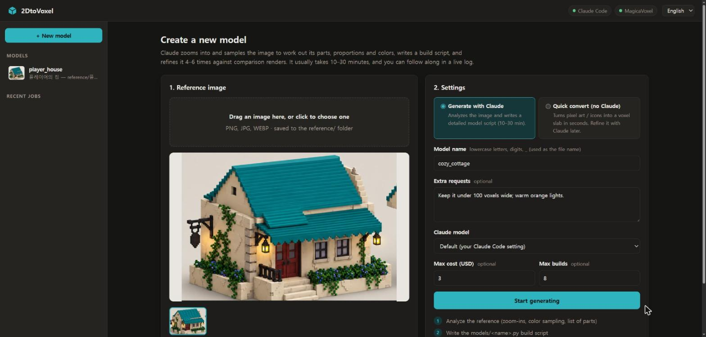
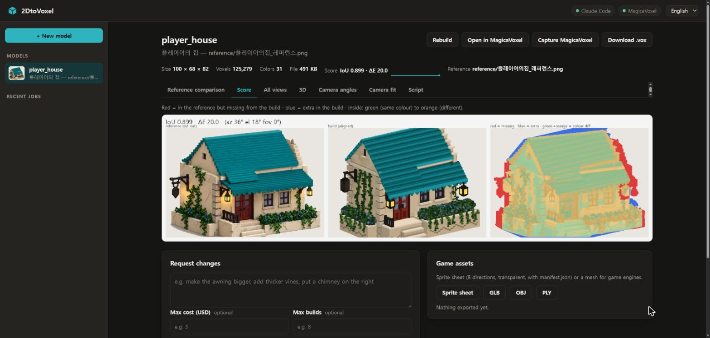
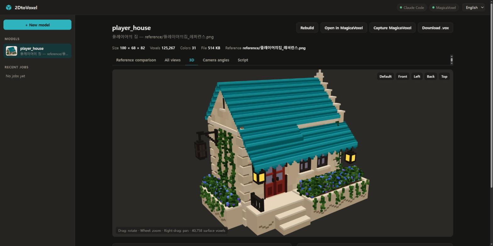
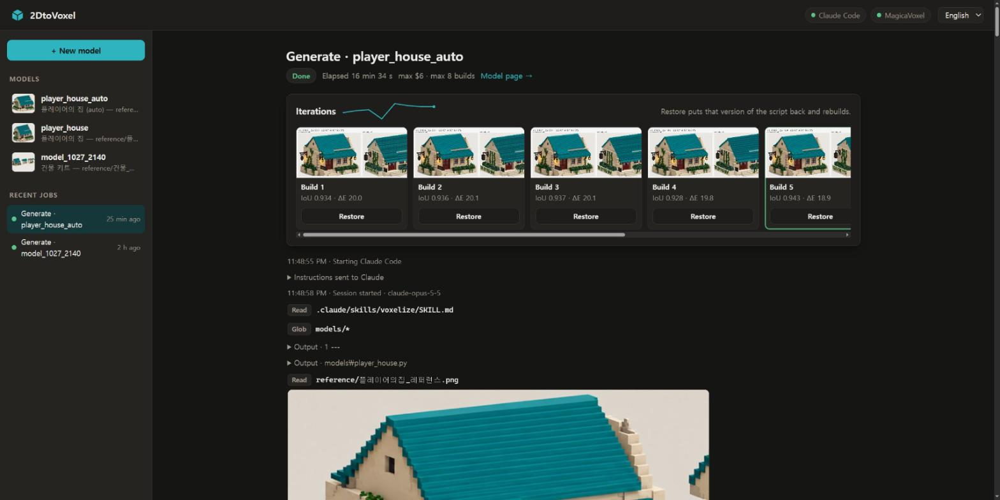

<div align="center">

<picture>
  <source media="(prefers-color-scheme: dark)" srcset=".github/logo-dark.svg">
  
</picture>

# 2DtoVoxel

**Give it a picture, get a voxel model you can keep editing in MagicaVoxel. Claude builds it, measures every build against your image, and keeps refining it.**

[![License: MIT][license-badge]][license]
[![Tests][ci-badge]][ci]
[![Python 3.10+][python-badge]][python]
[![Output: MagicaVoxel .vox][vox-badge]][magicavoxel]

[Quick Start](#quick-start) · [How It Works](docs/how-it-works.md) · [Model Scripts](docs/model-scripts.md) · [Report a Bug][issues]

**English** · [한국어](README.ko.md)

</div>


## Why 2DtoVoxel?

Turning concept art into voxels by hand means hours of placing blocks and eyeballing proportions, and image-to-3D generators hand you a mesh you can't cleanly edit as voxels. 2DtoVoxel has Claude write the model as a short, readable build script, score every build against your picture, and fix what's off. You end up with a real MagicaVoxel model, and a script that you or Claude can change later.

- **Voxel artists** get a faithful first version to refine instead of starting from an empty grid.
- **Game developers** get the model plus sprite sheets and GLB/OBJ meshes for their engine.

## Features

- **Measured against your image.** Every build gets a score (silhouette overlap and colour difference) and a map of what's missing and what's extra, so you see progress instead of guessing.
- **Editable, not baked.** The result is a `.vox` plus a short build script. Ask for changes in plain words ("make the awning bigger") or edit it yourself.
- **Watch it work, rewind any time.** A live log shows every build with its score, and any earlier version is one click away.
- **Same camera as the reference.** The camera angle and perspective are fitted automatically, so comparisons are like for like.
- **Pixel art in seconds, no Claude needed.** Sprites and icons become flat or rounded voxel models; front/side/top drawings can be carved into one.
- **Game-ready exports.** 8-direction sprite sheets with a manifest, GLB / OBJ / PLY meshes, and palette variants.
- **Safe to leave running.** The UI stays on your computer, each job can only touch its own model, cost and build limits are per job, and files you edited in MagicaVoxel are backed up before a rebuild.
- **Use it your way.** A web UI in English and Korean, `/voxelize` in Claude Code, or the `voxtool` command line. No API key: it uses your Claude Code login.

## When to use

Use 2DtoVoxel when you have an image of **one object** (concept art, a render, a cropped game screenshot, pixel art) and want it as a voxel model in MagicaVoxel.

It is not for whole scenes or landscapes as one model, exact 3D reconstruction from photos, animation, or pieces larger than 256 voxels per axis (split those into parts).

## Quick Start

```bash
git clone https://github.com/NangManCatDev/2DtoVoxel.git
cd 2DtoVoxel && python -m pip install -e .
voxtool ui
```

Your browser opens the UI. Click **+ New model**, drop in an image and press **Start generating**; 10–30 minutes later you have a model to open in MagicaVoxel. Without Claude Code, try a pixel-art image with **Quick convert**, or from the command line:

```bash
voxtool extrude path/to/sprite.png --name my_sprite --inflate
```

## Install

| Requirement | Notes |
|---|---|
| Python 3.10+ | `numpy`, `Pillow` and `scipy` come with `pip install -e .` |
| [Claude Code][claude-code] | Installed and logged in, to generate and change models. Usage counts toward your Claude plan |
| [MagicaVoxel][magicavoxel] 0.99.x | Optional, to open and edit the results |
| Windows 10/11 | Tested end to end. macOS / Linux run the CLI and tests; see the [platform notes](docs/troubleshooting.md#platform-notes-and-limitations) |

```bash
python -m pip install -e .      # installs the dependencies and the `voxtool` command
```

Without installing, every command also works as `py -m voxtool …` (Windows) or `python3 -m voxtool …` (macOS / Linux) from the project folder. The UI finds Claude Code and MagicaVoxel in the usual places; otherwise set `CLAUDE_CLI` / `MAGICAVOXEL_EXE` ([configuration](docs/cli.md#configuration)).

## Usage

### Web UI

Start it with `voxtool ui`, `2DtoVoxel.bat` (Windows) or `./2dtovoxel.sh` (macOS / Linux). The console window is the server; close it to stop.

1. **+ New model** → drop in an image → name it → choose **Generate with Claude** (optionally with a max cost and max builds) or **Quick convert**.
2. Watch the live log; each build shows up with its score.
3. On the model page, compare with the reference, read the score map, rotate the model in 3D, open it in MagicaVoxel, download the `.vox`, or export game assets.
4. **Request changes** in plain words. Tick "Continue the previous conversation" to skip re-analysis.

| New model | Model page (score tab) | 3D preview |
|---|---|---|
|  |  |  |

In MagicaVoxel, switch to the **Render** tab to see lanterns and other glowing colours light up.

### A real generation run

An actual run on the player-house reference, with the default Claude model (Opus), limits of $6 and 8 builds, and the extra request "Keep it under 110 voxels on every axis":

| Time | Cost | Builds | Score |
|---|---|---|---|
| 16.6 min, 102 turns | $4.65 | 8 (the limit) | IoU 0.934 → 0.940 (best 0.943 at build 5), ΔE 20.0 → 17.7 |

Scores don't only go up: build 4 got worse and build 5 recovered. The job page highlights the best build, and **Restore** puts it back.




### Reading the score

- **IoU** (0–1): how much the model's silhouette overlaps the reference's once size and position are matched. 1 is perfect.
- **ΔE**: the average colour difference where they overlap. Lower is better.
- **worst**: the areas with the most missing (red) or extra (blue) shape, for example `top-right missing 19%`.


### From a Claude Code chat

```text
/voxelize reference/my_image.png
```

Or just ask: "make a voxel model of reference/my_image.png". Run `voxtool install-skill` to use `/voxelize` in other projects too.

### Without Claude: quick conversion

```bash
voxtool extrude reference/mushroom.png --name mushroom --depth 4 --inflate   # pixel art → rounded voxels
voxtool carve --front f.png --side s.png --top t.png --name vase              # drawings → carved model
```


### Game assets

```bash
voxtool sprites models/player_house.py --dirs 8               # sprite sheet + manifest.json
voxtool export models/player_house.py --format glb            # or obj / ply
voxtool recolor models/player_house.py --hue 120 --only roof,roof_hi,roof_dk
```


## How It Works

Claude never clicks around in MagicaVoxel. It writes a Python build script, `voxtool` turns it into a `.vox`, previews and a score, and Claude fixes the biggest differences until the score stops improving. The guide explains the background removal, how the score aligns shapes, the camera fitting and how UI jobs snapshot every build.
→ [How 2DtoVoxel works](docs/how-it-works.md)

## Writing Model Scripts

A model is a Python file in `models/` that builds a voxel grid with a small DSL: boxes, gable roofs, stairs, vines, bushes, and palette colours that can glow. You can edit what Claude wrote or write your own; the guide has a runnable example and the full DSL reference.
→ [Writing model scripts](docs/model-scripts.md)

## Command Line

Every UI action is also a `voxtool` command: build, score, fit the camera, convert, export, open in MagicaVoxel. The reference lists every command, where outputs go, and the environment variables and flags you can set.
→ [Command line and configuration](docs/cli.md)

## Troubleshooting

Red status chips, a score that looks off, a failed job, and platform questions (macOS / Linux, MagicaVoxel edits being rebuilt) are covered in the troubleshooting guide, together with tips for better results.
→ [Troubleshooting, tips and limitations](docs/troubleshooting.md)

## Security

The UI listens on 127.0.0.1 only, and every change needs a token created at launch. Each Claude job may only edit its own model script and `output/`, and run voxtool commands for that model; everything else is refused. Only use reference images you trust.
→ [SECURITY.md](SECURITY.md)

## Contributing

Issues and pull requests are welcome. Setup, tests, the project structure and the conventions (two languages, UI job permissions) are in [CONTRIBUTING.md](CONTRIBUTING.md); changes are listed in [CHANGELOG.md](CHANGELOG.md).

## License

[MIT](LICENSE) © NangManCatDev. The reference images in `reference/` and the images in `docs/images/` are part of the project and may be used under the same license.

## Acknowledgements

- [MagicaVoxel][magicavoxel] by ephtracy, and the [.vox file format](https://github.com/ephtracy/voxel-model) documentation.
- [three.js](https://threejs.org/) for the 3D preview.
- Ideas for measured quality checks, run snapshots and game-asset outputs were inspired by [aldegad/sprite-gen](https://github.com/aldegad/sprite-gen).
- Built with [Claude Code][claude-code].

---

<sub>Crafted with [Readme Craft](https://github.com/motiful/readme-craft)</sub>

[license-badge]: https://img.shields.io/badge/license-MIT-0b8691.svg
[license]: LICENSE
[ci-badge]: https://github.com/NangManCatDev/2DtoVoxel/actions/workflows/ci.yml/badge.svg
[ci]: https://github.com/NangManCatDev/2DtoVoxel/actions/workflows/ci.yml
[python-badge]: https://img.shields.io/badge/python-3.10%2B-0b8691.svg
[python]: https://www.python.org/downloads/
[vox-badge]: https://img.shields.io/badge/output-MagicaVoxel%20.vox-0b8691.svg
[magicavoxel]: https://ephtracy.github.io/
[claude-code]: https://claude.com/claude-code
[issues]: https://github.com/NangManCatDev/2DtoVoxel/issues
