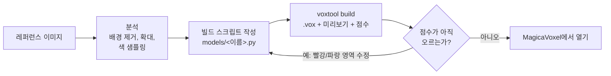
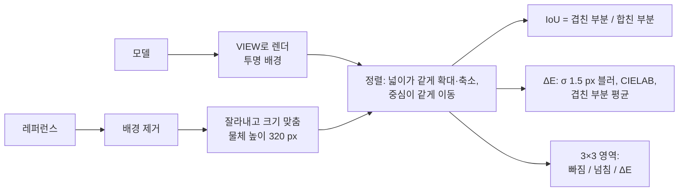
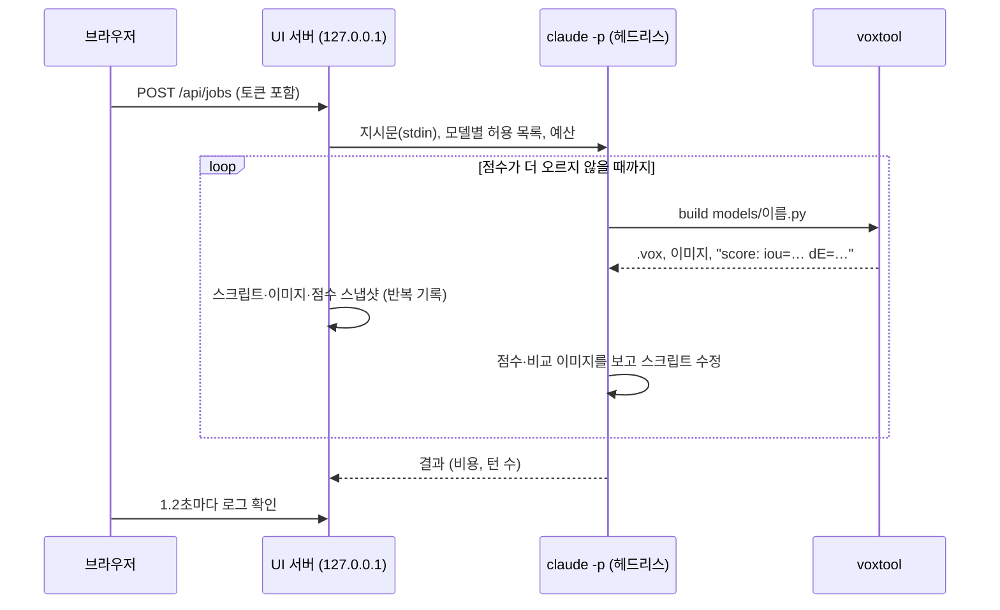

# 2DtoVoxel의 동작 방식

[English](how-it-works.md) | **한국어** · ← [README로 돌아가기](../README.ko.md)

## 전체 흐름

Claude는 MagicaVoxel 화면을 직접 조작하지 않습니다. 작은 빌드용 DSL(박스, 박공지붕, 창문, 덩굴, 덤불 등)로 모델을 기술하는 짧은 Python 스크립트를 쓰고, `voxtool`이 그 스크립트를 `.vox` 파일, 미리보기 이미지, 레퍼런스 대비 점수로 바꿉니다.

1. **분석.** 레퍼런스의 배경을 지우고(`ref cutout`), 픽셀 격자를 덧씌워 영역별로 확대해 보고, 실제 색을 뽑아냅니다.
2. **스케일 결정.** 크기를 아는 요소 하나(보통 문, 약 20 voxel 높이)를 기준으로 나머지 치수를 모두 비율로 환산합니다. 레퍼런스는 대부분 원근 이미지라 화면 픽셀로는 잴 수 없기 때문입니다.
3. **스크립트 작성.** 주요 치수를 `models/<이름>.py` 맨 위의 상수로 두어서, 비율 하나를 고치는 일이 한 줄 수정으로 끝나게 합니다.
4. **카메라 맞추기.** `fit-camera`가 모델의 실루엣이 레퍼런스와 가장 잘 겹치는 방위각·고도각·화각을 찾습니다.
5. **빌드, 점수, 수정.** 빌드할 때마다 점수(실루엣 겹침과 색 차이)가 출력되고 차이 이미지가 그려집니다(빨강 = 빠짐, 파랑 = 넘침). Claude는 가장 큰 차이부터 고치고, 점수가 더 오르지 않으면 멈춥니다. 보통 4~6회 반복합니다. 점수는 레퍼런스 방향에서만 재므로, 빌드는 모델을 네 방향에서 보여 주고 깊이와 떨어진 조각도 검사합니다([점수가 못 보는 것](#점수가-못-보는-것)).

복셀을 손으로 찍는 대신 스크립트로 만들기 때문에 결과가 정확하고, 다시 만들어도 같으며, 나중에 직접 고치거나 Claude에게 고쳐 달라고 하기 쉽습니다.

## 스크립트에서 `.vox`까지

모델은 `[x, y, z]`로 인덱싱하는 `uint8` numpy 배열(0 = 빈칸, 1~255 = 팔레트 번호)과 256칸 RGBA 팔레트, 그리고 발광·유리·금속 색마다의 재질 정보입니다. `Model.save()`는 MagicaVoxel의 청크 형식(버전 200)으로 씁니다. 오브젝트마다 `SIZE` + `XYZI` 한 쌍, 작은 씬 그래프(오브젝트마다 `nTRN` → `nGRP` → `nTRN` → `nSHP`, 위치는 변환에 기록), `LAYR`, `RGBA`, 재질마다 `MATL` 하나입니다. `m.part()`는 블록 안에서 그린 복셀을 기록해 두었다가 별도 오브젝트로 저장합니다.

`XYZI`는 좌표를 축마다 1바이트로 저장하므로 오브젝트 하나는 축마다 256 voxel을 넘을 수 없습니다. 이보다 큰 격자(나 부품)는 256칸 조각으로 나뉩니다. 빈 조각은 버리고, 나머지는 이름 붙은 `nGRP` 하나 아래에 넣어 MagicaVoxel에서 함께 움직이게 합니다. 파일을 다시 읽을 때는 모든 오브젝트를 변환 위치대로 한 격자에 합칩니다. `res`를 쓰면 DSL은 좌표를 설계 단위로 유지한 채 더 고운 격자에 옮깁니다. 박스는 설계 단위 칸을 통째로 채우고, 곡면과 지붕 경사는 복셀마다 계산하므로 그냥 커지는 대신 매끄러워집니다.

덮어쓰기 전에는 기존 파일의 청크 목록을 확인합니다. 우리 쓰기 코드는 `rOBJ`, `rCAM`, `NOTE`를 절대 만들지 않지만 MagicaVoxel은 저장할 때 항상 넣습니다. 그래서 이런 청크가 있으면 손으로 고친 내용이 있을 수 있다고 보고 먼저 `<이름>_edited_<시각>.vox`로 복사합니다.

## 미리보기 렌더러

미리보기는 GPU 없이 화가 알고리즘(painter's algorithm)으로 그립니다.

1. 6개 면 방향마다 *드러난* 면(옆 칸이 비어 있는 면)을 찾고, 그중 카메라를 향한 면만 남깁니다.
2. 면의 네 꼭짓점을 투영합니다. 정사영 카메라는 방위각과 고도각을 쓰고, 원근 카메라는 격자를 감싸는 구가 화각 안에 들어오도록 배치하며, 중심의 복셀 하나가 정사영일 때와 같은 크기가 되도록 크기를 맞춥니다.
3. 먼 면부터 가까운 면 순서로 2배 해상도에서 다각형을 칠한 뒤 줄입니다(안티에일리어싱). 보이는 면이 15만 개를 넘으면 다각형을 하나씩 칠하기가 느려지므로, 큰 모델은 numpy z-버퍼로 그립니다. 면마다 1픽셀보다 촘촘한 점들을 찍고, 픽셀마다 가장 가까운 면을 남기는 방식입니다(1024 × 1024 지형이 11초 대신 약 3초). 렌더 크기도 3000픽셀 안으로 줄입니다.
4. 방향별 고정 밝기(위 1.00, 정면 0.90, 왼쪽 0.76, 오른쪽 0.70, 뒤 0.62, 아래 0.50)와 앰비언트 오클루전(면 주변의 채워진 이웃 하나당 −5.5%)으로 음영을 줍니다. 발광 색은 음영을 주지 않습니다.

그래서 등록한 색은 정면에서 약 0.9배로 보입니다. 레퍼런스 정면에서 뽑은 색을 0.9로 나눈 값이 좋은 시작값인 이유입니다.

## 레퍼런스 배경 제거

점수는 레퍼런스의 배경을 지운 뒤에야 의미가 있습니다. `cutout()`은 이렇게 동작합니다.

1. 이미지에 투명도가 있으면 그것을 그대로 씁니다.
2. 없으면 가장자리 4픽셀 띠의 중앙값을 배경색으로 보고, 그와 가까운 픽셀(RGB 거리 24 미만)을 배경 후보로 표시합니다. 바닥의 옅은 그림자(배경보다 조금 어두운 저채도 픽셀)도 후보에 넣습니다.
3. 후보 중 **이미지 가장자리와 이어진 영역만** 배경으로 봅니다. 그래서 물체 안쪽의 밝은 부분은 살아남습니다.
4. 물체에 둘러싸인 후보 영역은, 크고 그중 30% 이상이 배경색과 거의 똑같으면 뚫린 공간(예: 접지 그림자 때문에 바깥과 끊긴 아치 안쪽)으로, 아니면 물체의 일부로 채웁니다.
5. 가장자리의 단색 띠를 지우고, 잡티를 정리하고, 작은 구멍을 메운 뒤 가장 큰 물체만 남깁니다(`keep="all"`이면 전부).

## 점수

넓이와 중심으로 맞추기 때문에 점수는 이미지 안에서의 모델 크기나 위치와 무관하고, 형태와 색만 남습니다. 비율이 틀린 모델도 정렬 뒤에 숨을 수 없습니다. 넘친 부분은 파랑, 빠진 부분은 빨강으로 드러납니다. ΔE는 살짝 흐린 이미지에서 잰 CIE76 색차라서 질감의 잡음보다 전체 색이 더 중요하고, 형태가 완벽해도 조명 차이 때문에 0이 되지는 않습니다.

점수는 목표가 아니라 관찰입니다. 원근 레퍼런스와 정사영 미리보기는 완벽히 같아질 수 없습니다. 무엇을 고칠지는 점수로 찾고, 어떻게 고칠지는 이미지를 보고 정하세요.

### 점수가 못 보는 것

한 방향에서 잰 점수로는 둥근 수관과 카메라를 향한 판을 구별할 수 없고, 벽 위에 한 칸 떠 있는 지붕도 보이지 않습니다. 실제로 UI 작업이 나무에 그렇게 한 적이 있습니다. 외곽선을 복셀 한 겹으로 채워 IoU 0.914를 받았지만, 다른 방향에서 보면 모두 납작했습니다. 그래서 빌드마다 다음도 함께 알려 줍니다.

- **`_turn.png`**: 레퍼런스 방향에서 시작해 90°씩 돌려 본 모델(옆면이 보이도록 고도각은 15°~35° 사이로 맞춤).
- **`depth:`**: 물체마다 설계 단위 2칸 높이의 수평 구간으로 자르고, 폭이 6칸 이상인 구간마다 앞뒤 폭(`VIEW`의 방위각 기준, 2~98 백분위)을 좌우 폭으로 나눕니다. 그 비율의 중앙값(복셀 수로 가중)을 출력하고, 0.5 미만이면 `(thin)`을 붙입니다. 집이나 둥근 수관은 0.7~1쯤, 카메라를 향한 판은 0.1 근처입니다. 간판·울타리·벽 패널은 원래 얇습니다.
- **`loose:`**: 자기 물체의 나머지와 닿지 않은 조각(면·모서리·꼭짓점 중 하나라도 맞닿으면 이어진 것으로 보는 연결 요소. `part()`마다 별도 물체이고, 가장 큰 조각이 본체)과 그 크기, 중심 위치(설계 단위). 깎다 남은 부스러기, 줄기에서 떨어진 수관, 뜬 지붕이 여기 걸립니다. 작은 것은 `m.remove_loose()`로 지웁니다.
- **그림이 여러 장일 때.** 같은 물체의 그림이 더 있으면 각각 그 그림의 카메라와 함께 `EXTRA_REFERENCES`에 넣습니다. 그림마다 `REFERENCE`와 똑같이 점수를 매겨 `_score.png`에 한 줄씩, 출력에 `score <파일>:` 줄로 보여 주고, 마지막 줄에 모든 방향의 평균을 냅니다. `fit-camera --ref N`은 N번째 그림의 카메라를 찾습니다. `carve`는 측면·윗면 그림을 알아서 여기 넣습니다. 그러면 그림이 있는 면은 추측하지 않고 재게 됩니다.

점수를 낸 뒤에는 빠짐과 넘침이 가장 큰 영역(그 영역의 8 %를 넘을 때)을 원래 해상도로 확대한 `_zoom_<영역>.png`도 만듭니다.

### 확대 비교와 레퍼런스에서 가져오는 색

`score --zoom`과 `paint_reference()`는 모델을 320 px가 아니라 레퍼런스 **원래** 해상도 위에 겹칩니다. 먼저 모델의 면을 한 번 래스터화해 실루엣의 넓이와 무게중심을 재고, 이것으로 점수와 같은 정렬을 계산한 뒤, 면을 레퍼런스 캔버스 위에 바로 다시 래스터화합니다. 그러면 레퍼런스의 픽셀마다 어느 복셀 면이 보이는지 알 수 있습니다.

- `--zoom`은 그 캔버스의 한 영역을 잘라 레퍼런스, 빌드, 차이를 나란히 보여 줍니다.
- `paint_reference()`는 면마다 덮는 레퍼런스 픽셀의 평균을 내고, 그 면의 미리보기 음영으로 나눈 뒤(미리보기가 레퍼런스를 재현하도록), 복셀의 보이는 면들을 평균합니다. 면이 1.5픽셀보다 작아지면 면 버퍼를 최대 4배 곱게 그려 작은 복셀도 자기 픽셀을 받게 합니다. 새 색이 원래 색과 너무 다르면(밝기를 절반만 반영한 Lab 거리, `tol`) 원래 색을 유지하므로, 형태가 조금 어긋난 곳에서 재질 사이에 색이 번지지 않습니다. 받아들인 색은 원래 색별로 따로 줄이므로(median cut), 255색 팔레트 안에서도 재질마다 자기 색조를 유지합니다.
- `carve_to_reference()`는 복셀 중심을 모두 카메라로 투영해, 레퍼런스 배경에 떨어지는 것을 깎습니다. 정렬은 면적이 아니라 외곽의 높이와 외곽 상자 중심으로 맞춥니다. 면적을 맞추면 깎을 때마다 모델이 다시 커지고, 그래서 또 깎이기 때문입니다.

### 식물

`foliage()`는 수관을 세 단계로 만듭니다. 넘겨준 잎 덩어리, 그 위에 퍼뜨린 3분의 1 크기의 작은 덩어리(바깥 끝이 원래 반지름 안팎으로 흔들림), 작은 덩어리마다 붙인 `clump` 복셀 크기의 잎 뭉치입니다. 어느 복셀을 어느 뭉치가 채우는지는 가장 가까운 뭉치 중심을 k-d 트리(scipy)로 찾아 정하므로, 뭉치가 수천 개여도 1초가 걸리지 않습니다. 복셀마다 뭉치 반지름을 해시로 조금씩 흔들어 가장자리가 복셀 단위로 들쭉날쭉해집니다. 명암은 뭉치 안에서의 높이, 뭉치가 바깥쪽에 있는 정도, 수관 안에서의 높이에 약간의 무작위를 더해 정하고, 가장 어두운 색으로 작은 덩어리를 줄인 속을 채워 뭉치 사이 틈이 그림자로 보이게 합니다. `crown_depth()`는 카메라 기준으로 계산합니다. 외곽이 맞닿은 덩어리끼리 한 무리(층 하나, 사이프러스의 수관 전체)가 되고, 무리마다 `VIEW`에서 본 외곽이 측정한 폭과 높이가 되는 똑바로 선 타원체를 정합니다. 외곽선이 허락하면 위에서 볼 때 둥글게, 그러기엔 외곽이 낮으면 더 얕게 잡습니다. 그런 다음 각 덩어리의 복사본을 그 덩어리 자신의 시선 방향을 따라, 시선이 타원체 안을 지나는 구간에 놓습니다. 시선 방향으로 옮기므로 레퍼런스 방향의 외곽선은 그대로이고, 타원체 안에 머무르므로 다른 어느 방향에서 봐도 수관이 둥글고 똑바로 섭니다. `tube()`는 Catmull-Rom 곡선의 점 사이를 둥근 원뿔로 채우고, `tree()`는 스타일에 맞게 잎 덩어리를 배치한 뒤 줄기를 가장 높은 덩어리 안까지 올리고, 뿌리와 덩어리마다 가지를 붙이고, `foliage()`를 부릅니다.

## 카메라 맞춤

전체 미리보기를 수백 번 렌더하면 느리기 때문에, `fit-camera`는 점으로 실루엣을 만듭니다. 모델의 드러난 복셀 중심(최대 30,000개)을 후보 카메라로 투영해 160픽셀 마스크에 찍고, 복셀 반 개 정도 두껍게 한 뒤, 넓이가 레퍼런스와 같도록 한 번 다시 맞추고 IoU로 비교합니다. 먼저 거친 격자(방위각 한 바퀴를 15°마다, 고도각 0~60°를 10°마다, 화각 0 / 25 / 45°, 카메라 504개)를 시도하고, 상위 세 개 주변을 촘촘히 다시 찾습니다. 마지막 후보는 실제 렌더로 한 번 더 점수를 매깁니다. 100 voxel 크기 모델에서 3초 정도 걸립니다.

## UI 작업

서버는 워크스페이스에서 `claude -p --output-format stream-json --permission-mode dontAsk --allowedTools …`를 실행하므로, Claude는 `CLAUDE.md`와 `/voxelize` 스킬도 읽고 시작합니다. 스트림의 이벤트 하나하나가 로그 항목이 됩니다(답변, 명령, Claude가 본 이미지. 이미지는 복사해 두어 반복마다 따로 남습니다). `build models/<이름>.py` 명령의 결과가 오면 서버가 `score:` 줄을 읽고 스크립트와 비교·점수·미리보기 이미지를 반복 기록으로 스냅샷합니다. **되돌리기**는 스냅샷을 다시 복사하고 빌드합니다. 빌드 횟수 상한은 지시문에 적고, 상한보다 두 번 더 빌드하면 작업을 멈춰서 강제합니다. 비용 상한은 Claude Code에 `--max-budget-usd`로 넘깁니다. 작업은 `output/_jobs/<id>/job.json`에 저장되고 서버가 시작할 때 다시 불러옵니다.

작업마다 받는 허용 목록(자기 스크립트와 `output/`만 수정, 자기 모델의 voxtool 명령만 실행)은 [SECURITY.md](../SECURITY.md)에 설명되어 있습니다.

## 변환

- **extrude**는 확대 저장된 픽셀아트의 픽셀 크기를 찾습니다. 블록마다 한 점씩 뽑아 반복했을 때 이미지의 98.5% 이상이 재현되는 가장 큰 블록 크기(최대 32)입니다. 블록마다 한 점을 뽑고 색을 최대 255개로 줄입니다(median cut). `--inflate`를 쓰면 픽셀마다 윤곽선에서 멀수록 두꺼워집니다: `1 + (depth − 1) · √(거리 / 최대 거리)`.
- **carve**는 주어진 모든 실루엣 안에 들어가는 복셀만 남기고(visual hull), 표면에서 가장 가깝게 보이는 그림의 색을 칠합니다.

## 메시와 스프라이트

메시 내보내기는 **greedy meshing**으로 면을 합칩니다. 방향과 층마다 드러난 면과 색의 지도를 만들고, 한 줄씩 훑으며 같은 색이 이어지는 동안 사각형을 옆으로 늘리고, 줄 전체가 맞는 동안 아래로 늘립니다. 플레이어의 집은 복셀 면 55,246개가 사각형 10,776개로 줄어듭니다. 좌표는 올바른 회전으로 Y-up이 되므로 면의 방향(반시계)이 유지됩니다.

스프라이트 시트는 방향마다 투명 배경에 선명한 픽셀로 렌더하고, 모델의 바닥 중심을 모든 프레임에 투영합니다. 프레임 크기는 모든 방향에서 그 점을 기준으로 가장 넓게 퍼진 범위라서, 기준점이 모든 프레임에서 같은 픽셀에 옵니다.
