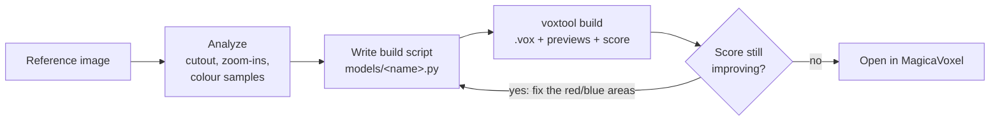
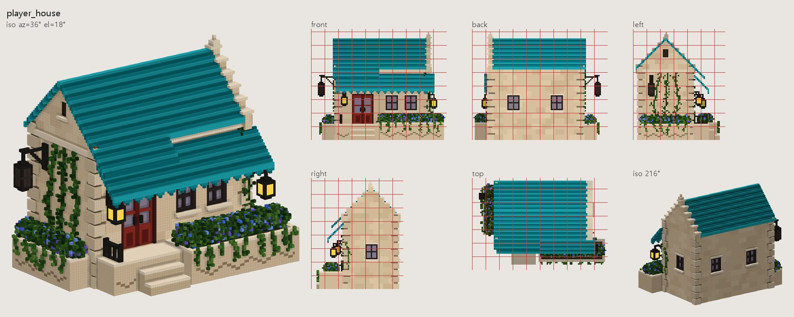
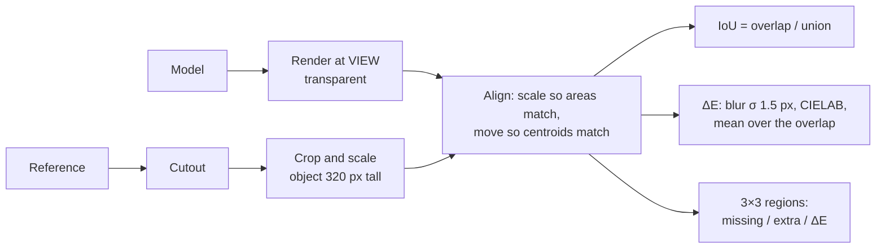
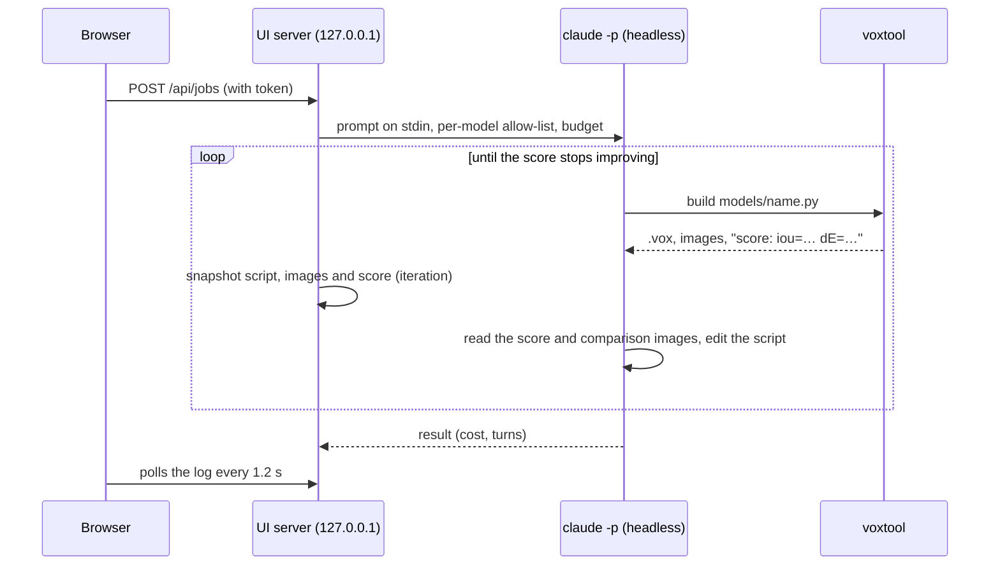

# How 2DtoVoxel works

**English** | [한국어](how-it-works.ko.md) · ← [Back to README](../README.md)

## The loop

Claude doesn't click around inside MagicaVoxel. It writes a short Python script that describes the model with a small building DSL (boxes, gable roofs, windows, vines, bushes…), and `voxtool` turns that script into a `.vox` file, preview images, and a score against the reference.

1. **Analyze.** The reference's background is removed (`ref cutout`), then Claude overlays a pixel grid, zooms into each region, and samples the real colours.
2. **Plan the scale.** One element with a known size (usually the door, about 20 voxels tall) sets the scale for everything else, because most references are perspective renders that you can't measure in screen pixels.
3. **Write the script.** Key dimensions become constants at the top of `models/<name>.py`, so fixing a proportion is a one-line change.
4. **Fit the camera.** `fit-camera` finds the azimuth, elevation and field of view at which the model's silhouette best matches the reference.
5. **Build, score, fix.** Every build prints a score (silhouette overlap and colour difference) and draws a diff image: red = missing, blue = extra. Claude fixes the biggest differences first and stops when the score stops improving, usually after 4–6 rounds.

A script instead of hand-placed voxels means the result is exact, reproducible, and easy to change later, either by you or by asking Claude.

## From script to `.vox`

A model is a numpy array of `uint8` indexed `[x, y, z]` (0 = empty, 1–255 = palette index), plus a 256-entry RGBA palette and a material for each glowing, glass or metal colour. `Model.save()` writes MagicaVoxel's chunk format (version 200): one `SIZE` + `XYZI` pair per object, a small scene graph (`nTRN` → `nGRP` → `nTRN` → `nSHP` per object, with each object's position in its transform), `LAYR`, `RGBA` and one `MATL` per material. `m.part()` records which voxels were drawn inside each block and saves them as separate objects.

`XYZI` stores each coordinate in one byte, so an object can't exceed 256 voxels per axis. A bigger grid (or part) is cut into 256-voxel tiles; empty tiles are dropped, and the rest go under one named `nGRP` so they move together in MagicaVoxel. Reading a file back merges every object into one grid by its transform. With `res`, the DSL keeps coordinates in design units and maps them onto the finer grid: boxes cover whole design voxels, while round shapes and roof slopes are evaluated per voxel, so they get smoother instead of just bigger.

Before overwriting, the writer lists the chunks of the existing file. Our writer never produces `rOBJ`, `rCAM` or `NOTE`, but MagicaVoxel always does when it saves. So if any such chunk is present, the file may hold hand edits and is first copied to `<name>_edited_<time>.vox`.

## Preview renderer

The previews are drawn without a GPU, with the painter's algorithm:

1. For each of the 6 face directions, find the *exposed* faces (the neighbouring cell is empty) and keep those that face the camera.
2. Project their 4 corners. The orthographic camera uses azimuth and elevation; the perspective camera is placed so the grid's bounding sphere fits the field of view, and sizes are normalised so one voxel at the centre stays as big as in orthographic mode.
3. Sort the faces far to near and fill them as polygons at 2× resolution, then downsample (anti-aliasing). Past 150,000 visible faces, drawing polygons one by one gets slow, so big models go through a numpy z-buffer instead: every face is sampled on a grid of points under a pixel apart and each pixel keeps the nearest face (a 1024 × 1024 terrain renders in about 3 seconds instead of 11). Renders are also scaled down to stay within 3000 pixels.
4. Shade with a fixed brightness per direction (top 1.00, front 0.90, left 0.76, right 0.70, back 0.62, bottom 0.50) and ambient occlusion (−5.5 % per filled neighbour around the face). Glowing colours are not shaded.

The colours you register are therefore multiplied by about 0.9 on front faces, which is why a colour sampled from the front of a reference, divided by 0.9, is a good starting value.

## Reference cutout

Scores only make sense once the reference's background is gone. `cutout()`:

1. Uses the image's own transparency if it has any.
2. Otherwise estimates the background colour as the median of a 4-pixel border strip and marks pixels close to it (RGB distance < 24) as background-like. Soft floor shadows count too: low-saturation pixels a little darker than the background.
3. Keeps as background only the background-like areas **connected to the image border**, so pale parts inside the object survive.
4. Treats an enclosed background-like area as a see-through opening (for example the space under an arch, cut off from the outside by a contact shadow) if it is large and at least 30 % of its pixels match the background almost exactly; otherwise it is filled as part of the object.
5. Removes uniform letterbox bars at the edges, cleans specks, fills small holes, and keeps the largest object (or all objects with `keep="all"`).

## Score

Aligning by area and centroid makes the score independent of the model's absolute size and position in the image; what remains is shape and colour. Wrong proportions can't hide behind the alignment: the excess shows up blue and the gaps red. ΔE is CIE76 on slightly blurred images, so texture noise matters less than overall colour; lighting differences keep it above zero even for a perfect shape.

The score is an observation, not the goal: a perspective reference and an orthographic preview can't match perfectly. Use the score to find what to fix, and the images to decide how.

### Close-ups and colours from the reference

`score --zoom` and `paint_reference()` lay the model over the reference at its **full** resolution instead of 320 px. The model's faces are rasterised once to measure the silhouette's area and centroid, the same alignment as the score is computed from those, and the faces are rasterised again straight onto the reference canvas. That gives, for every reference pixel, the voxel face it shows.

- `--zoom` crops one area of that canvas: reference, build and the difference side by side.
- `paint_reference()` averages the reference pixels each face covers, divides by that face's preview shading (so a preview reproduces the reference), and averages a voxel's visible faces. If faces would be smaller than 1.5 pixels, the face buffer is drawn up to 4× finer so small voxels still get their own pixels. A voxel keeps its colour when the new one is too far from it (Lab distance with lightness counted at half, `tol`), which stops colours bleeding across materials where the shape is slightly off. The accepted colours are reduced per original colour (median cut) so each material keeps its own shades within the 255-colour palette.
- `carve_to_reference()` projects every voxel centre through the camera and cuts those that land outside the reference cutout. It aligns by the outline's height and bounding-box centre rather than by area: matching areas would scale the model up after every cut, which then cuts more.

### Plants

`foliage()` builds a crown in three levels: the lobes you give, sub-lobes about a third their size spread over each lobe (their outer edges wobble around the lobe's radius), and clumps of `clump` voxels over each sub-lobe. Which voxels a clump fills is decided with a k-d tree query of the nearest clump centres (scipy), so a crown of thousands of clumps takes a fraction of a second, and a hashed per-voxel wobble of the clump radius makes the edge jagged at the voxel level. A voxel's shade comes from its height on its clump, how far out its clump sits and its height in the crown, plus a little noise; the darkest colour fills shrunken copies of the sub-lobes, so the gaps between clumps read as shadow. `crown_depth()` works in the camera's frame: for each lobe it finds how wide the crown is at that height (from the lobes at about the same height), takes the depth a round crown would have at the lobe's distance from the centre, and then limits it by the outline. A copy `s` voxels further back shows `s · sin(elevation)` higher on screen, so the room above a lobe up to the measured outline, divided by `sin(elevation)`, is how far back copies may go; the room below it limits copies in front. `tube()` fills round cones between points of a Catmull-Rom curve, and `tree()` lays out lobes for a style, runs the trunk up into the highest lobe, adds roots and a limb per lobe, and calls `foliage()`.

## Camera fitting

Rendering hundreds of full previews would be slow, so `fit-camera` builds silhouettes from points: the centres of the model's exposed voxels (up to 30,000) are projected with a candidate camera, drawn into a 160-pixel mask, thickened by about half a voxel, rescaled once so the area matches the reference, and compared by IoU. It first tries a coarse grid — every 15° of azimuth around the full circle, elevation 0–60° in steps of 10°, field of view 0 / 25 / 45° (504 cameras) — then refines around the three best. The winner is scored once more with a real render. A 100-voxel model takes about 3 seconds.

## UI jobs

The server starts `claude -p --output-format stream-json --permission-mode dontAsk --allowedTools …` in the workspace, so Claude also reads `CLAUDE.md` and the `/voxelize` skill. Every event in the stream becomes a log entry: replies, commands, and the images Claude looks at (copied, so each iteration keeps its own). When the result of a `build models/<name>.py` command arrives, the server parses its `score:` line and snapshots the script and the comparison, score and preview images as an iteration. **Restore** copies a snapshot back and rebuilds. The build limit is stated in the prompt and enforced by stopping the job two builds past it; the cost limit is passed to Claude Code as `--max-budget-usd`. Each job is saved to `output/_jobs/<id>/job.json` and reloaded when the server starts.

The allow-list each job gets (edit only its own script and `output/`, run only voxtool commands for its own model) is described in [SECURITY.md](../SECURITY.md).

## Conversions

- **extrude** finds the pixel size of upscaled pixel art: the largest block size (up to 32) for which repeating one sample per block reproduces at least 98.5 % of the image. It takes one sample per block and reduces the colours to at most 255 (median cut). With `--inflate`, each pixel's thickness grows with its distance from the outline: `1 + (depth − 1) · √(distance / max distance)`.
- **carve** keeps a voxel only if it falls inside every given silhouette (the visual hull), then colours it from the view in which it lies closest to the surface.

## Meshes and sprites

Mesh export merges faces with **greedy meshing**: for every direction and layer it takes the map of exposed faces and their colours, scans it row by row, grows a rectangle along the row while the colour stays the same, then grows it downwards while whole rows match. The player house goes from 55,246 voxel faces to 10,776 rectangles. Coordinates are turned Y-up with a proper rotation, so faces stay counter-clockwise.

Sprite sheets render each direction with crisp pixels on a transparent background and project the model's ground centre into every frame. The frame size is the largest extent around that point over all directions, so the anchor stays on the same pixel in every frame.
