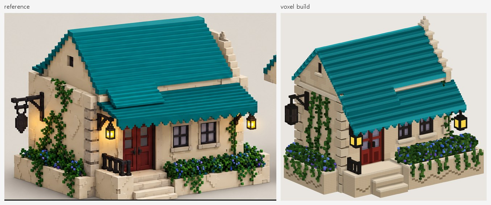
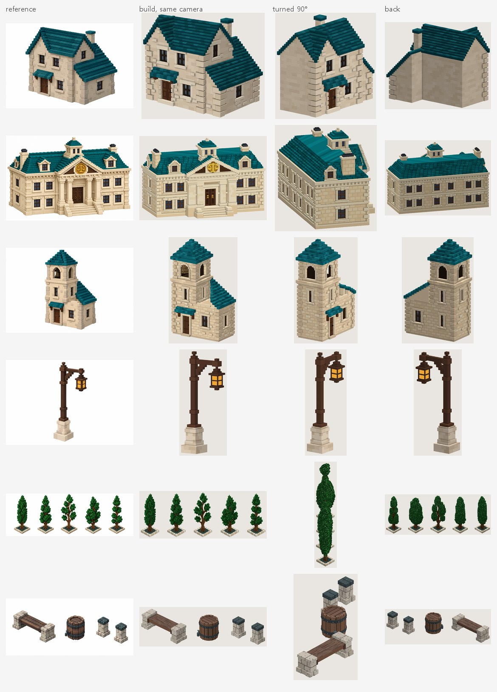

[English](index.md) · **한국어**

**2DtoVoxel은 물체 하나가 담긴 그림을 [MagicaVoxel](https://ephtracy.github.io/)용 복셀 모델로 바꿔 주는 무료 오픈소스 도구입니다.** 그림은 콘셉트 아트, 3D 렌더, 게임 스크린샷, 픽셀아트 무엇이든 됩니다. [Claude Code](https://claude.com/claude-code)가 그림을 보고 모델을 짧은 Python 빌드 스크립트로 씁니다. 함께 들어 있는 `voxtool` 라이브러리가 `.vox` 파일을 만들고, 미리보기를 렌더링하고, 결과가 그림과 얼마나 맞는지 잽니다. Claude는 그 수치를 읽고 스크립트를 고쳐 다시 빌드하고, 더 나아지지 않을 때 멈춥니다.

손으로 계속 편집할 수 있는 `.vox` 파일과 그것을 만드는 스크립트가 남습니다. 소스 코드, 이슈, 전체 README는 GitHub에 있습니다: **[NangManCatDev/2DtoVoxel](https://github.com/NangManCatDev/2DtoVoxel)** (MIT 라이선스).



## 하는 일

| | |
|---|---|
| **입력** | 물체 하나가 담긴 그림 한 장(PNG / JPG / WEBP). 다른 면을 찍은 그림을 더 주면 그것도 채점합니다. |
| **출력** | MagicaVoxel `.vox` 파일, 그것을 만드는 Python 스크립트, 네 방향 미리보기와 점수. 선택: 스프라이트 시트, GLB / OBJ / PLY 메시, 색 바꾼 변형. |
| **Claude로** | Claude Code가 그림을 분석해 `models/<이름>.py`를 쓰고, 빌드하고, 점수와 차이 이미지를 읽고, 다시 고칩니다. 보통 4~6번 반복합니다. |
| **Claude 없이** | `voxtool extrude`는 픽셀아트를 복셀로, `voxtool carve`는 정면·측면·윗면 그림으로 모델을 몇 초 만에 만듭니다. 내보내기, 미리보기, 채점 도구도 Claude 없이 동작합니다. |
| **쓰는 방법** | 로컬 웹 UI(한국어 / 영어), Claude Code의 `/voxelize` 스킬, `voxtool` 명령줄. |
| **필요한 것** | Python 3.10+(numpy, Pillow, scipy). 모델 생성에는 로그인된 Claude Code. MagicaVoxel은 결과를 열어 볼 때만 필요합니다. |

## 갤러리

각 줄은 레퍼런스 그림, 레퍼런스와 같은 카메라로 본 빌드, 그리고 같은 빌드를 90°, 180° 돌린 모습입니다. 그림 한 장에는 옆면과 뒷면이 없어서 Claude가 추론합니다.



레퍼런스와의 실루엣 겹침(IoU, 1 = 완벽): 돌집 0.973, 법원 0.965, 종탑 0.966, 가로등 0.910, 키 큰 나무 다섯 그루 0.911, 벤치·통·기둥 0.947.

## 동작 방식

Claude는 MagicaVoxel을 클릭하지 않습니다. 모든 작업은 스크립트와 `voxtool` 명령줄로 합니다.

1. **그림 분석.** 배경을 지우고, 영역별로 확대하고, 실제 색을 뽑고, 부품을 나눕니다.
2. **축척 정하기.** 문처럼 크기를 아는 요소 하나로 전체 크기를 정합니다.
3. **빌드 스크립트 작성.** 상자, 속 빈 벽, 박공지붕, 계단, 벽돌 질감, 덩굴, 나무 등을 만드는 작은 Python DSL을 씁니다.
4. **카메라 맞추기.** 실루엣이 그림과 가장 잘 맞는 카메라를 찾습니다.
5. **빌드, 측정, 수정.** 빌드할 때마다 그림과 비교해 점수(실루엣 겹침, 색 차이)와 차이 이미지를 만듭니다. 빨강은 빠진 곳, 파랑은 남는 곳입니다.
6. **그림 한 장이 못 보여 주는 것 확인.** 빌드마다 네 방향에서 렌더링하고, 납작하거나 떠 있는 부분을 알려 줍니다.
7. **선택: 고해상도 마무리.** 같은 스크립트를 2~3배 촘촘하게 빌드하고, 그림의 실제 픽셀로 칠합니다.

복셀을 손으로 찍지 않고 스크립트로 쓰기 때문에 결과가 정확하고, 다시 만들 수 있고, 고치기 쉽습니다. "차양을 더 크게"는 숫자 한두 개를 바꾸는 일입니다. 자세한 내용: [동작 원리](how-it-works.ko.md).

## 설치

```bash
git clone https://github.com/NangManCatDev/2DtoVoxel.git
cd 2DtoVoxel
python -m pip install -e .
```

또는 패키지만 설치해서 아무 폴더에서나 쓸 수 있습니다: `pip install 2dtovoxel`. 그다음 `voxtool ui`로 웹 UI를 열고 **+ 새 모델**을 눌러 그림을 넣고 **생성 시작**을 누르세요. Claude Code 대화에서는 `/voxelize reference/my_picture.png`가 같은 일을 합니다.

## 자주 묻는 질문

**그림을 MagicaVoxel `.vox` 파일로 바꿀 수 있나요?**
네, 그게 이 도구의 목적입니다. 결과는 MagicaVoxel 0.99.x에서 열리고, 부품마다 별도 오브젝트로 나눌 수도 있습니다.

**API 키가 필요한가요?**
아니요. Claude Code 로그인으로 실행되고, 사용량은 Claude 요금제에 포함됩니다.

**시간과 비용은 얼마나 드나요?**
모델 하나에 10~30분 정도입니다. 실제 한 번은 Opus로 16.6분, $4.65가 들었습니다. 작업마다 비용 한도와 빌드 횟수 한도가 있습니다.

**AI 없이 픽셀아트를 복셀로 바꿀 수 있나요?**
네. `voxtool extrude sprite.png --name my_sprite --inflate`는 Claude 없이 몇 초 만에 복셀 모델을 만듭니다.

**게임에 쓸 수 있나요?**
네. `voxtool export`는 GLB, OBJ, PLY 메시를, `voxtool sprites`는 N방향 스프라이트 시트와 manifest를, `voxtool recolor`는 팔레트 변형을 만듭니다.

**사진으로 3D를 복원하는 도구인가요?**
아니요. 그림 한 장에 물체 하나일 때 가장 잘 되고, 그림에 없는 면은 추론합니다. 다른 면 그림을 더 주면 그것도 채점합니다.

**어떤 운영체제에서 되나요?**
전체 흐름은 Windows 10/11에서 씁니다. 명령줄과 테스트는 macOS, Linux에서도 돌아갑니다.

## 문서

- [동작 원리](how-it-works.ko.md): 점수, 카메라 맞추기, 배경 제거, 점검 항목.
- [모델 스크립트](model-scripts.ko.md): 빌드 스크립트 형식과 전체 DSL 레퍼런스.
- [명령줄 레퍼런스](cli.ko.md): 모든 `voxtool` 명령과 옵션.
- [문제 해결](troubleshooting.ko.md): 자주 생기는 문제와 해결법.
- GitHub의 [README](https://github.com/NangManCatDev/2DtoVoxel/blob/main/README.ko.md)와 [변경 기록](https://github.com/NangManCatDev/2DtoVoxel/blob/main/CHANGELOG.md).
