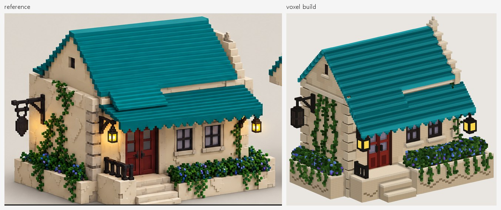
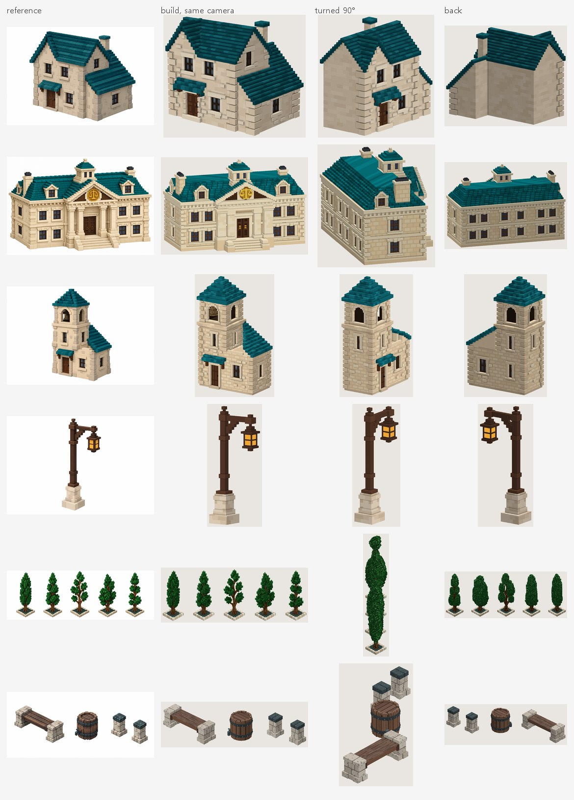

**English** · [한국어](index.ko.md)

**2DtoVoxel is a free, open-source tool that turns a picture of one object into a voxel model for [MagicaVoxel](https://ephtracy.github.io/).** The picture can be concept art, a 3D render, a game screenshot or pixel art. [Claude Code](https://claude.com/claude-code) looks at it and writes the model as a short Python build script. The included `voxtool` library builds the `.vox` file, renders previews and measures how closely the build matches the picture. Claude reads the measurements, fixes the script and builds again until the match stops improving.

You get an editable `.vox` file and the script that makes it. Source code, issues and the full README are on GitHub: **[NangManCatDev/2DtoVoxel](https://github.com/NangManCatDev/2DtoVoxel)** (MIT license).



## What it does

| | |
|---|---|
| **Input** | One picture of one object (PNG / JPG / WEBP). Pictures of other sides are optional and get scored too. |
| **Output** | A MagicaVoxel `.vox` file, the Python script that builds it, previews from four sides and a score. Optional: sprite sheets, GLB / OBJ / PLY meshes and recoloured variants. |
| **With Claude** | Claude Code analyses the picture, writes `models/<name>.py`, builds it, reads the score and the difference images, and repeats, usually 4–6 times. |
| **Without Claude** | `voxtool extrude` turns pixel art into voxels and `voxtool carve` builds a model from front / side / top drawings, in seconds. Exports and all preview and scoring tools work without Claude too. |
| **Ways to use it** | A local web UI (English / Korean), the `/voxelize` skill in Claude Code, or the `voxtool` command line. |
| **Requirements** | Python 3.10+ (numpy, Pillow, scipy). Claude Code, logged in, to generate models. MagicaVoxel is optional, for opening the results. |

## Gallery

Each row shows the reference picture, the build from the reference's camera, and the same build turned 90° and 180°. A single picture doesn't show those sides, so Claude infers them.



Silhouette overlap with the reference (IoU, 1 = perfect): stone cottage 0.973, courthouse 0.965, bell tower 0.966, street lamp 0.910, five tall trees 0.911, bench, barrel and posts 0.947.

## How it works

Claude never clicks around in MagicaVoxel. Everything goes through a script and the `voxtool` command line:

1. **Analyze the picture.** The background is removed, and Claude zooms into each region, samples the real colours and lists the parts.
2. **Choose a scale** from one element of known size, such as a door.
3. **Write the build script** with a small Python DSL: boxes, hollow shells, gable roofs, stairs, brick textures, vines, trees and more.
4. **Fit the camera** whose silhouette best matches the picture.
5. **Build, measure, fix.** Every build is scored against the picture (silhouette overlap and colour difference) with a difference image: red is missing, blue is extra.
6. **Check what one picture can't show.** Each build is also rendered from four sides, and flat or floating parts are reported.
7. **Optional high-resolution finish**: the same script built 2–3× finer, painted with the picture's own pixels.

A script instead of hand-placed voxels means the result is exact, reproducible and easy to change: "make the awning bigger" is an edit to one or two numbers. More detail: [How it works](how-it-works.md).

## Install

```bash
git clone https://github.com/NangManCatDev/2DtoVoxel.git
cd 2DtoVoxel
python -m pip install -e .
```

Or install the package and work in any folder: `pip install 2dtovoxel`. Then start the web UI with `voxtool ui`, click **+ New model**, drop in a picture and press **Start generating**. In a Claude Code chat, `/voxelize reference/my_picture.png` does the same.

## Questions people ask

**Can it turn an image into a MagicaVoxel `.vox` file?**
Yes, that is what it is for. The result opens in MagicaVoxel 0.99.x, and each part can be a separate object.

**Does it need an API key?**
No. It runs through your Claude Code login, so usage counts toward your Claude plan.

**How long does it take, and what does it cost?**
About 10–30 minutes per model. One real run took 16.6 minutes and cost $4.65 with Opus. Each job has a cost limit and a build limit.

**Can it convert pixel art to voxels without AI?**
Yes. `voxtool extrude sprite.png --name my_sprite --inflate` gives a voxel model in a few seconds, with no Claude involved.

**Can I use the models in a game?**
Yes. `voxtool export` writes GLB, OBJ and PLY meshes, `voxtool sprites` renders sprite sheets from N directions with a manifest, and `voxtool recolor` makes palette variants.

**Is it a photo-to-3D reconstruction tool?**
No. It works best with one object per picture, and the sides the picture doesn't show are inferred. Extra pictures of other sides are scored too.

**Which platforms does it run on?**
The whole flow is used on Windows 10/11. The command line and the tests also run on macOS and Linux.

## Documentation

- [How it works](how-it-works.md): the score, camera fitting, background removal and the checks.
- [Model scripts](model-scripts.md): the build-script format and the full DSL reference.
- [Command-line reference](cli.md): every `voxtool` command and option.
- [Troubleshooting](troubleshooting.md): common problems and fixes.
- [README](https://github.com/NangManCatDev/2DtoVoxel#readme) and [changelog](https://github.com/NangManCatDev/2DtoVoxel/blob/main/CHANGELOG.md) on GitHub.
