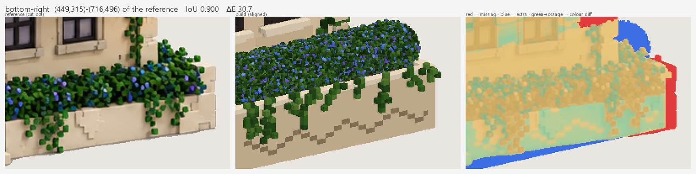

# Writing model scripts

**English** | [한국어](model-scripts.ko.md) · ← [Back to README](../README.md)

Every model is a Python file in `models/`. Claude writes and edits these scripts, and you can do the same: the `.vox` is always rebuilt from the script.

## What a script contains

| Name | Required | Meaning |
|---|---|---|
| `NAME` | yes | Output folder and file name |
| `build()` | yes | Returns a `Model` |
| `REFERENCE` | no | Path to the reference image; enables the comparison image and the score |
| `VIEW` | no | Preview camera, e.g. `{"azimuth": 36, "elevation": 18, "fov": 0}`. Azimuth 0 looks straight at the front, 90 at the left side; `fov` > 0 is a perspective camera |
| `SCORE_VIEW` | no | Camera used for scoring if it differs from `VIEW` (conversions score from the front) |
| `CUTOUT` | no | Background-removal settings, e.g. `{"keep": "all"}` for a sheet with several objects |
| `RES` | no | Voxels per design unit, used as `Model(..., res=RES)`; `voxtool build --res N` overrides it (see [High-resolution models](#high-resolution-models)) |

## Coordinates

`x` goes right, `y` goes into the scene (**`y = 0` is the front**, the side MagicaVoxel's default camera looks at), and `z` goes up. Boxes are given as position + size: `box(x, y, z, w, d, h, color)` fills `x … x+w-1` and so on. Anything outside the grid is clipped. A `region=` argument is always `(x, y, z, w, d, h)`. Up to 255 colours.

A `.vox` object holds at most 256 voxels per axis. Bigger grids, or parts bigger than that, are cut into tiles of 256 when saved and kept together in a MagicaVoxel group, so you can still move them as one. MagicaVoxel shows scenes up to about 2048 voxels per axis.

## Example

```python
from voxtool import Model

NAME = "tiny_hut"
VIEW = {"azimuth": 36, "elevation": 20}


def build() -> Model:
    m = Model(40, 34, 32, seed=1)                  # grid size: x (width), y (depth), z (height)
    m.pal.add("wall", "#dcc3a0"); m.pal.add("wall2", "#d2b893")
    m.pal.add("roof", "#0b8691"); m.pal.add("roof_hi", "#1ba3ad")
    m.pal.add("door", "#8c2b22"); m.pal.add("glass", "#8a8094")
    m.pal.add("lamp", "#ffd84a", emit=4)            # glows in MagicaVoxel's Render tab
    m.pal.add("leaf", "#2c5a19"); m.pal.add("leaf2", "#3d7524")

    m.shell(6, 8, 0, 28, 18, 16, "wall", t=2, top=False)          # walls, y=8 is the front face
    m.bricks(["wall", "wall2"], target="wall", bw=6, bh=3)       # stone-block texture
    roof = (4, 6, 16, 32, 22)                                     # footprint x, y, z, w, d
    m.gable_wall(*roof, "x", "wall", region=(6, 8, 28, 18))       # gable ends under the roof
    m.gable_roof(*roof, "x", ["roof_hi", "roof"], t=2)            # ridge along x, striped planks
    m.box(17, 8, 0, 6, 2, 10, "door")                             # door, 2 deep
    m.box(9, 8, 6, 5, 1, 5, "glass"); m.box(26, 8, 6, 5, 1, 5, "glass")
    m.box(15, 7, 9, 1, 1, 2, "lamp")                              # lamp in front of the wall
    m.blob(10, 5, 2, 3.5, 2.5, 2.5, ["leaf", "leaf2"])            # bushes
    m.blob(30, 5, 2, 3.5, 2.5, 2.5, ["leaf", "leaf2"])
    return m
```

Save it as `models/tiny_hut.py` and run `voxtool build models/tiny_hut.py --open`:


For a full, real example (quoins, crow-stepped parapet, awning, lanterns, planters, vines) see [models/player_house.py](../models/player_house.py).

## High-resolution models

Three tools work together when you want more detail than a ~100-voxel model holds:

1. **`res`: same script, finer voxels.** Write the script in design units as usual, add `RES = 1` at the top and create the model with `Model(w, d, h, res=RES)`. Every coordinate stays the same, but each design voxel becomes `RES × RES × RES` voxels: round shapes, roofs and bushes get smoother and textures finer. Iterate at `RES = 1` (fast), try the final resolution with `voxtool build models/<name>.py --res 3`, and when you like it set `RES = 3` in the script (`--res` only applies to that one build, so a later rebuild would go back to 1). Code that indexes `m.v` directly works in voxels, so multiply by `m.res` there.
2. **`paint_reference`: colours from the picture.** Once the shape is final, `m.paint_reference(REFERENCE, VIEW)` as the last line of `build()` reads the reference's own pixels through the fitted camera (with the score's alignment) and paints every voxel it shows: shading, stains, patterns and gradients you'd never place by hand. Voxels the reference doesn't show keep their colours, glowing colours are left alone, and a colour that differs too much from a voxel's own (`tol`) is skipped, so where the shape is a little off a wall doesn't take the colour of the bush in front of it. It works best when the silhouette already matches well (IoU ≥ 0.95); with a looser fit it smears.
3. **`score --zoom`: check details at full size.** The score compares at 320 px, which hides small things. `voxtool score models/<name>.py --zoom top-right` (any region from the score's `worst:` list, or `x0,y0,x1,y1` in reference pixels as read with `ref grid`) shows that area of the reference, the build and their difference at the reference's own resolution.

What `paint_reference` did on two real models:

| Model | Silhouette match (IoU) | Colour difference (ΔE) before → after |
|---|---|---|
| Paving slab generated in the UI | 0.969 | 5.2 → 2.3 |
| Hand-written player house | 0.899 | 20.0 → 18.3 (the shape is further off, so `tol` keeps most colours) |

The player house at `--res 1`, `2` and `3` (125 thousand, 1 million and 3.4 million voxels; the shapes stay put, bushes and textures get finer):


### Trees, bushes and other plants

Voxel-art foliage is a cluster of clusters: small clumps of a few cubes, grouped into lumps, grouped into the crown, with dark gaps between them. Primitives like `ellipsoid` or `blob` give smooth balls instead, so plants have their own tools:

- `tube(points, radius, c)`: a trunk, branch or root along a curve through the points, tapering from one radius to the next; a colour list gives bark streaks.
- `foliage(lobes, colors)`: a crown over lobes `(cx, cy, cz, r)` measured on the reference's outline. Each lobe gets sub-lobes and each sub-lobe small clumps (`clump`, in voxels), shaded light on top and outside, with a dark core showing in the gaps. Draw the trunk and limbs first; the leaves grow around them.
- `tree(x, y, z, height, leaves, bark, style=...)`: trunk, root flare, a limb into every lobe and a `foliage` crown. Pass your own `lobes=` or let a style lay them out:


- `crown_depth(lobes, x, y, VIEW)`: lobes read off a picture all lie in one plane, the vertical plane through the trunk at `(x, y)` that faces the camera, so the crown is right from the front and flat from the side. This adds copies behind and in front of each lobe, horizontally, as deep as a crown that is round seen from above, and no further than the measured outline allows (from above at an angle, a lobe further back shows higher up). `tree(..., lobes=..., view=VIEW)` does it for you. Don't fill an outline with a flat layer of voxels facing the camera, or copy lobes along the line of sight: the front score goes up a little, but the tree turns into a tilted board seen from anywhere else.
- `carve_to_reference(REFERENCE, VIEW, only=leaves)`: cuts the voxels that land on the reference's background, which tidies an organic outline that lobes only approximate. It scales the model's outline to the reference's height first, so get the proportions right before using it, and limit it with `only` so trunks and bases stay intact.

On a sheet of five tall trees, keeping the same lobe and trunk measurements and only replacing the hand-written clump code with these tools gave:

| Version | IoU | ΔE |
|---|---|---|
| Hand-written clumps (the script Claude wrote first) | 0.847 | 15.2 |
| `tube` + `foliage` | 0.844 | 14.6 |
| … + `carve_to_reference(only=leaves)` | 0.869 | 14.5 |
| … + `paint_reference` | 0.869 | 10.7 |

On a sheet of five spreading trees, the script Claude wrote first filled the outline with a voxel layer in the trunk's plane and copied lobes along the line of sight. It scored IoU 0.914 from the front, but every crown was a tilted slab from the side. Rebuilt from the same measurements with `crown_depth`, `foliage` and `tube`, the crowns are round from every side, at IoU 0.842 from the front. The score only looks from one direction, so check the side and back views in `_sheet.png` or with `voxtool angles`.

When the reference is itself voxel art, match its grain: one reference cube should be one voxel. On the same trees, `--res 2` made the leaves finer than the picture's and scored lower (IoU 0.855, ΔE 13.3).

`score --zoom bottom-right` on the player house shows what the full-image score can't: the reference's bushes spill over the planter and its face has cracks, while the build has a tidy hedge and a zigzag groove:



## DSL reference

All methods live on `Model` ([voxtool/model.py](../voxtool/model.py)). `c` is a palette name, a palette index, or `None` (carve).

| Group | Method | Purpose |
|---|---|---|
| Palette | `m.pal.add(name, hex, emit=0, glass=0, metal=0, rough=0.5)` | Register a named colour; `emit` glows, `glass` is transparent, `metal` metallic |
| | `m.pal.ramp(name, [hex, ...])` | Register `name0`, `name1`, … shade variants |
| Primitives | `box(x, y, z, w, d, h, c, only_empty=False, only_filled=False)` | Solid box (`c=None` carves) |
| | `carve(x, y, z, w, d, h)` | Empty a box |
| | `shell(x, y, z, w, d, h, c, t=1, top=True, bottom=True)` | Hollow box with wall thickness `t` |
| | `set(x, y, z, c)` / `get(x, y, z)` | Single voxel |
| | `line(p0, p1, c, r=0)` | 3D line; `r` gives it a cube brush |
| | `ellipsoid(cx, cy, cz, rx, ry, rz, c)` | Ellipsoid |
| | `cylinder(cx, cy, z, r, h, c, axis="z")` | Cylinder along z, x or y |
| | `where(x, y, z, w, d, h, fn, c)` | Fill where `fn(X, Y, Z)` (vectorized numpy) is true — any shape |
| | `paint_fn(x, y, z, w, d, h, fn)` | Recolour per voxel; `fn` returns palette indices |
| Architecture | `gable_roof(x, y, z, w, d, ridge, c, slope=1.0, t=2, fill=None)` | Gable roof; a colour list alternates per course (planks / shingles) |
| | `gable_wall(x, y, z, w, d, ridge, c, slope=1.0, region=None)` | Infill that meets that roof exactly (gable ends, attic) |
| | `shed_roof(x, y, z, w, d, down, c, slope=0.5, t=2)` | Lean-to roof / porch awning |
| | `stairs(x, y, z, w, steps, c, rise=1, run=2, direction="-y")` | Straight stairs |
| Texture & organic | `bricks(colors, target, bw=6, bh=3, mortar=None, p=None, region=None)` | Running-bond stone / brick pattern on existing voxels |
| | `vary(colors, target, p=None, region=None)` | Random recolour to break up flat surfaces |
| | `blob(cx, cy, cz, rx, ry, rz, colors, noise=0.35, density=1.0)` | Noisy ellipsoid: bushes, foliage, rocks |
| | `vine(x, y, z, length, colors, wall="-y", drift=0.35, leaf=0.6, spread=1)` | Vine hanging down a wall |
| | `sprinkle(colors, prob, target, region=None)` | Recolour random surface voxels (flowers in a bush) |
| | `scatter_on_top(region, colors, prob, target=None)` | Place voxels on top of exposed surfaces |
| Plants | `tube(points, radius, c, smooth=True)` | Curved, tapering limb (trunk, branch, root); a colour list gives bark streaks |
| | `foliage(lobes, colors, clump=1.8, density=1.0, core=None, tips=None)` | Lumpy leafy crown over lobes `(cx, cy, cz, r)`, colours dark → light |
| | `crown_depth(lobes, x, y, view, fill=1.0)` | Spread lobes measured on a picture through the crown's depth |
| | `tree(x, y, z, height, leaves, bark, style="round", width=None, lobes=None, view=None, ...)` | Whole tree; styles `round`, `column`, `cone`, `tiered`, `branched`, `spread`; `view` with measured `lobes` |
| Reference fit | `carve_to_reference(reference, view, only=None, margin=0.5, cutout=None)` | Cut voxels that land on the reference's background |
| Reference colours | `paint_reference(reference, view, colors=96, tol=30, only=None, blend=1.0, cutout=None)` | Paint the voxels the reference shows with its own pixels (call last); new colours are named `<colour>_r1`, … |
| Model | `Model(w, d, h, seed=0, res=1)` | Grid in design units; `res` voxels per unit (`m.res`, `m.dims`; `m.size` is the voxel grid) |
| Objects & files | `with m.part(name): ...` | Voxels drawn inside become a separate object in the `.vox` (kit sheets) |
| | `Model.from_vox(path, res=1)` / `m.paste_vox(path, x, y, z)` | Start from / paste in an existing `.vox` (a conversion, or a MagicaVoxel edit) |
| Transform & output | `mirror_x(x0, x1)` / `copy(x, y, z, w, d, h, dx, dy, dz)` | Mirror or duplicate a region |
| | `stats()` / `save(path)` | Summary (voxel count per colour) / write a `.vox` (backs up a MagicaVoxel-saved file first) |

## Conventions that pay off

- Put key dimensions in constants at the top (`FLOOR`, `EAVE`, …) and derive every other coordinate from them, so a proportion change is a one-line edit.
- Build order: walls → `bricks()` texture → roof → openings (carving) → decoration → plants (last, with `only_empty`).
- Check the per-colour counts in `stats()`: a colour with 0 voxels usually means a wrong `region` order.
